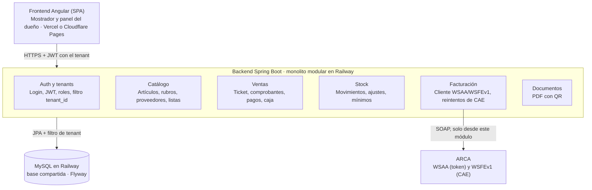

# Ferretería SaaS — Especificación del MVP

> Versión viva (editable): [Claude Doc](https://claude.ai/code/artifact/2f71e9a9-f655-41f6-85f2-29fdc96a94f7) · capturada el 2026-10-11

## Visión y alcance

Un sistema web multi-tenant para que una ferretería de Mar del Plata venda, facture electrónicamente con ARCA y mantenga sus precios al día, sin instalar nada. Cada ferretería es un tenant aislado: entra con su usuario y tiene todo ahí.

**Problema que resuelve:** actualizar miles de precios cuando llega la lista del proveedor, vender rápido en el mostrador y emitir la factura con CAE sin pelearse con ARCA.

**Principio rector: simple, práctico y que funcione.** Cada pantalla tiene que poder usarla un vendedor sin capacitación. Si una función no la pide una ferretería real, no entra.

**Criterios de éxito del MVP:**

- Una venta con factura B emitida en menos de 15 segundos desde que se escanea el primer artículo
- Una lista de precios de proveedor de 5.000 artículos importada y aplicada en menos de 2 minutos
- Una ferretería piloto usándolo a diario durante un mes sin volver a su sistema anterior

## Actores y roles

El MVP tiene tres roles fijos. Nada de permisos configurables por ahora.

| Rol | Quién es | Puede |
| --- | --- | --- |
| Super admin | Vos (el proveedor del servicio) | Dar de alta ferreterías, suspenderlas, ver estado general. No ve datos de ventas |
| Dueño | El dueño o encargado de la ferretería | Todo dentro de su ferretería: configuración, ARCA, usuarios, precios, reportes, anulaciones |
| Vendedor | Quien atiende el mostrador | Buscar artículos, vender, facturar, consultar stock, abrir y cerrar la caja |

**Actor externo:** ARCA (WSAA para autenticación, WSFEv1 para pedir el CAE).

## Casos de uso del MVP

Son 12 casos de uso (CU-01 a CU-12), agrupados en cinco módulos: Configuración, Artículos y precios, Venta, Stock y caja, y Clientes. Si algo no está en esta lista, no entra en el MVP.

### Configuración

**CU-01 Configurar la ferretería** (Dueño)

1. Carga razón social, CUIT, condición frente al IVA, domicilio e inicio de actividades.
2. Carga el punto de venta habilitado en ARCA para factura electrónica (web service).
3. Sube el certificado (.crt) y la clave privada, o genera el CSR desde el sistema.
4. El sistema prueba la conexión contra ARCA y muestra el último número de comprobante autorizado.
   - Alternativo: el certificado vence o es inválido → se avisa y se bloquea la facturación (la venta sin factura sigue habilitada).

**CU-02 Gestionar usuarios** (Dueño)

1. Crea, edita o desactiva usuarios con rol Dueño o Vendedor.

### Artículos y precios

**CU-03 Gestionar artículos** (Dueño)

1. Alta, edición y baja lógica de un artículo: código interno, código de barras, código del proveedor, descripción, rubro, proveedor, costo, margen, alícuota de IVA, unidad y stock mínimo.
2. El precio de venta se calcula solo: costo × (1 + margen) × (1 + alícuota de IVA) (ver Reglas de negocio).

**CU-04 Importar lista de precios del proveedor** (Dueño) — el caso más importante del sistema

1. Elige el proveedor y sube el archivo. Los proveedores mandan las listas en **Excel y/o PDF**: primero se soporta Excel/CSV; el PDF se extrae a tabla y pasa por la misma vista previa (ver nota abajo).
2. Mapea columnas una sola vez (código, descripción, costo); el mapeo queda guardado para ese proveedor.
3. El sistema cruza por código del proveedor y muestra una vista previa: cuántos suben, cuántos bajan, cuántos son nuevos, cuántos no están en la lista.
4. El dueño confirma y se actualizan los costos y precios en una sola transacción.
   - Alternativo: artículos nuevos → se pueden dar de alta en bloque con el margen por defecto del rubro.

> **Listas en PDF (2026-10-11):** varias listas llegan solo en PDF. La extracción de tablas de un PDF depende del formato de cada proveedor, así que se implementa después de Excel/CSV, con muestras reales, y siempre pasa por la vista previa antes de aplicar.

**CU-05 Actualizar precios masivamente** (Dueño)

1. Filtra por proveedor, rubro o búsqueda.
2. Aplica un porcentaje de aumento al costo o cambia el margen.
3. Ve la vista previa y confirma.

### Venta

**CU-06 Buscar artículo** (Vendedor)

1. Escanea el código de barras o escribe parte de la descripción o el código. La mayoría de las ferreterías ya tiene lector: funciona como teclado (escribe el código y manda Enter), así que el campo de búsqueda tiene que tener el foco siempre y reaccionar al Enter.
2. Ve precio, stock y ubicación al instante, sin hacer clic en nada.

**CU-07 Vender y facturar** (Vendedor)

1. Agrega artículos al ticket escaneando o buscando; ajusta cantidades.
   - Puede aplicar un **descuento en %** a un renglón (F7) o a todo el ticket (F6). Va de 0 a 99,99 %, con hasta 2 decimales; 0 lo saca. No hay tope por usuario por ahora. El descuento global se aplica a cada renglón (prorrateo), así el total es exactamente la suma de los renglones. El comprobante guarda el descuento de cada renglón, el global y el subtotal antes de descuentos; el que lo aplicó es el usuario de la venta.
2. Elige el cliente: Consumidor Final por defecto, o **F9** (botón «Cliente»): busca por razón social, CUIT o DNI entre los clientes activos, elige con ↑↓ y Enter, y puede dar de alta uno nuevo sin salir del mostrador (CU-11). El cliente se ve en el ticket con un «Quitar», se guarda con el ticket y viaja con la venta, el presupuesto y el remito; tras cobrar el ticket vuelve a quedar sin cliente. La venta guarda el id del cliente y una **copia de su razón social**: renombrarlo después no cambia lo ya emitido. En el presupuesto y el remito el diálogo muestra el cliente elegido en lugar del campo de texto libre, que sigue valiendo cuando no se eligió uno. «Pasar a venta» desde un presupuesto o un remito trae su cliente al ticket. Un cliente de otra ferretería es 404 y uno desactivado es 422; repetir la clave con otro cliente es `CLAVE_CON_OTRO_CONTENIDO`.
3. El sistema decide el comprobante (A, B o C) según la condición de IVA de la ferretería y del cliente.
4. Elige la **forma de pago** entre las que la ferretería tiene activas (por defecto Efectivo, Débito, Crédito y Transferencia; «Cuenta corriente» existe pero viene inactiva hasta que el Dueño la activa); o **pago mixto** (más de una forma): carga una parte y el resto se sugiere solo en la forma siguiente, y las partes tienen que sumar exactamente el total. Cada forma va una sola vez. El vuelto es solo del pago en efectivo único.
   - Cada forma tiene un **recargo en %** (0 a 200, 2 decimales; 0 por defecto) que el Dueño configura en Configuración → Formas de pago, donde también da de alta, edita, activa y desactiva (las formas no se borran). Cada una pertenece a un medio (efectivo, débito, crédito, transferencia o cuenta corriente), así la caja sigue sumando por medio. Siempre tiene que quedar al menos una forma activa de efectivo.
   - El recargo se calcula después de los descuentos, sobre la parte pagada con esa forma, y se reparte entre los renglones en proporción a su total (con su alícuota de IVA, porque integra la base del IVA): el total sigue siendo la suma de los renglones. El diálogo de cobro muestra el recargo y el total a cobrar. En el pago mixto la parte que se carga es la del ticket sin recargo.
   - El comprobante y cada renglón guardan el recargo; cada pago guarda la forma, su nombre y % del momento, el recargo y lo cobrado. Cambiar el % después no toca las ventas hechas.
   - **Cuenta corriente** (GDS-20, tramo 2): la forma «Cuenta corriente» (medio `CUENTA_CORRIENTE`) vende a crédito y suma deuda al cliente. Todas las ferreterías con formas la reciben **inactiva** y con recargo 0 (V20); las nuevas también (la quinta forma, inactiva). El Dueño la activa en Configuración → Formas de pago, y el recargo de esa forma queda fijo en 0 (el servidor lo fuerza, la pantalla lo deshabilita). Puede ser forma única o una parte del pago mixto: en el mixto solo la parte a cuenta suma deuda.
   - **El cliente es obligatorio:** pagar a cuenta corriente sin `clienteId` es 400 en `clienteId` («Elegí el cliente para vender a cuenta corriente.»); uno de otra ferretería es 404 y uno desactivado, 422. El cliente tiene que tener la cuenta habilitada (CU-11): con el límite en NULL la venta es 422 `CUENTA_CORRIENTE_NO_HABILITADA` («<razón social> no tiene cuenta corriente habilitada.»), también para el Dueño.
   - **Límite y exceso:** la venta excede si el saldo más lo que va a cuenta supera el límite (con límite 0 cualquier venta a cuenta excede). Un exceso es 422 `LIMITE_CUENTA_CORRIENTE`, con el objeto `cuentaCorriente { puedeAutorizar }` y, solo si lo ve el Dueño, `saldo`, `limite`, `disponible`, `importe` y `exceso`. Lo **autoriza solo el Dueño logueado**: reenvía la venta con `autorizaExceso: true`. Al Vendedor sin la marca se le rechaza con «Pedile al Dueño que la autorice.» y sin ninguna cifra; si un Vendedor manda `autorizaExceso: true` y la venta excede, es 403 («Autorizar el exceso es solo del Dueño») y no se guarda nada. Si la venta no excede, la marca se ignora. No hay PIN de supervisor. `autorizaExceso` no es parte del contenido de la venta: repetir la clave con otra marca no cambia nada.
   - **Qué queda guardado:** por cada pago a cuenta corriente, un movimiento `VENTA` en el libro del cliente con el debe igual al monto del pago, el comprobante, el pago, el usuario y la fecha; si hubo exceso, `excedio_limite` y quién lo autorizó. Se asienta en la misma transacción que la venta: si algo falla no queda movimiento ni cambia el saldo, y reenviar la misma clave devuelve la venta original (200) sin un segundo movimiento. Una **venta no facturable** a cuenta corriente suma deuda igual que una facturable. Los rechazos de cuenta corriente no consumen número, ni stock, ni caja.
   - **Diálogo de cobro:** con el cliente del ticket pide `GET /api/clientes/{id}/cuenta-corriente?importe=` (el importe es el total del ticket sin recargo) y la opción «Cuenta corriente» queda **deshabilitada con la razón a la vista** si falta el cliente (F9), la cuenta no está habilitada, no alcanza el límite (Vendedor) o no se pudo verificar. El Dueño ve el saldo, el límite y el disponible; ante un exceso la opción sigue elegible, avisa cuánto lo supera y el botón pasa a «Autorizar exceso y cobrar». El Vendedor ve solo «Alcanza» o «No alcanza el límite… Pedile al Dueño» (probando importes podría deducir el disponible: ver «Cuenta corriente» en Reglas de negocio). La cuenta corriente nunca es la forma inicial (Efectivo sigue siendo F4 + Enter). El pre-chequeo vale para la forma única; en el pago mixto decide el servidor, y si rechaza por límite el diálogo se queda abierto con el aviso y, para el Dueño, la autorización. El aviso tras cobrar dice «cobrada a cuenta corriente».
   - **Qué baja el saldo:** la venta lo sube y lo baja la **cobranza** del Dueño (CU-12, tramo 3a), que se hace desde la pantalla de la cuenta del cliente y no desde el mostrador. No hay nota de crédito (queda para la fase de facturación) ni ajuste manual, así que el Dueño puede bajar o quitar el límite para frenar ventas nuevas. El límite frena ventas, **nunca cobros**: se le cobra igual a un cliente con el límite vacío o en 0.
5. Confirma: se pide el CAE a ARCA, se descuenta el stock y se imprime o envía el comprobante en PDF.
   - Alternativo: ARCA no responde → la venta queda guardada como "pendiente de CAE" y se reintenta sola.
   - Alternativo: **venta no facturable** → en el diálogo de cobro, la casilla «No facturable» (arranca destildada en cada cobro, se llega con Tab o clic) deja la venta con estado `NO_FACTURABLE` en vez de `SIN_FACTURAR`. Cobra, entra en la caja, descuenta el stock y usa la misma numeración que las demás ventas; lo único que cambia es que **la fase 5 no la factura nunca** (no entra en la cola de pendientes de CAE ni en el libro IVA) y el estado no cambia después. El pedido (`POST /api/ventas`) manda `facturable: false`; sin el campo es `true`. La venta responde `facturable` y el aviso del mostrador dice «cobrada (no facturable)». La marca es parte del contenido de la venta: reenviar la misma clave con otra marca es `CLAVE_CON_OTRO_CONTENIDO`. La puede usar quien vende (Vendedor y Dueño); una venta que sale de un presupuesto o de un remito también puede marcarse. (El presupuesto y el remito de abajo son otros documentos.)
   - Alternativo: **presupuesto** (F8): el ticket se guarda como una cotización en vez de cobrarse. No pide caja abierta, forma de pago ni CAE, y no toca el stock (se puede presupuestar sin stock suficiente). El diálogo pide el cliente (texto libre, opcional), la validez en días (15 por defecto, de 1 a 90) y observaciones (opcionales). Lleva su numeración propia por ferretería, los descuentos del ticket y el total sin recargo (el recargo depende de la forma de pago, que se elige al cobrar). Se puede guardar con los mismos precios que vio el cajero: si un precio cambió, se avisa como en el cobro.
   - El presupuesto tiene **estados**: pendiente al emitirlo, aceptado y rechazado (se cambian a mano, en cualquier orden) y facturado, que solo lo pone la venta hecha desde él. «Vencido» no es un estado: es un pendiente o aceptado cuyo último día de validez ya pasó, y solo avisa.
   - Vendedor y Dueño ven los presupuestos de su ferretería en `Presupuestos` (lista con filtros por estado, número y fecha, y detalle con renglones). **Pasar a venta** deja en el mostrador un ticket con las cantidades y los descuentos del presupuesto pero con los **precios de hoy** (el presupuesto no fija precios; se puede cobrar aunque haya vencido). Un artículo que ya no se puede vender (borrado, dado de baja o sin precio) queda marcado en el ticket para que el cajero lo quite. Si el mostrador ya tenía un ticket con renglones, se pregunta antes de reemplazarlo.
   - Al cobrar, la venta lleva el presupuesto de origen y en la misma transacción lo deja facturado; un presupuesto rechazado o ya facturado no se puede cobrar (409) y uno de otra ferretería es un 404. Si la venta falla, el presupuesto no cambia. Si el cajero vacía el ticket, el presupuesto sigue como estaba. Como el presupuesto nunca descontó stock, no hay doble descuento.
   - Alternativo: **remito** (botón «Remito» de la botonera, sin tecla): el ticket sale como un documento de **entrega**, como el F5 de GDS pero con efecto fijo (sin interruptores globales, GDS-35). No cobra: no pide caja abierta, forma de pago ni CAE y no lleva recargo. **Descuenta el stock al emitirlo** y con stock insuficiente emite igual y avisa qué artículos quedaron en negativo. El diálogo pide el cliente (texto libre, opcional) y observaciones (opcionales, sirven para la dirección de entrega o la orden de compra). Lleva su numeración propia por ferretería, los descuentos del ticket y el total sin recargo, con la misma validación de precios que el cobro.
   - El remito tiene tres **estados**: emitido, facturado (lo pone solo la venta hecha desde él) y anulado. Facturado y anulado son finales.
   - Vendedor y Dueño ven los remitos de su ferretería en `Remitos` (lista con filtros por estado, número y fecha, y detalle con renglones). **Pasar a venta** deja en el mostrador un ticket con las cantidades y los descuentos del remito pero con los **precios de hoy**, igual que el presupuesto. Al cobrar, la venta lleva el remito de origen y en la misma transacción lo deja facturado; uno anulado o ya facturado no se puede cobrar (409) y uno de otra ferretería es un 404. Una venta sale de un presupuesto o de un remito, no de los dos.
   - **Sin doble descuento de stock:** como el remito ya descontó lo que entregó, la venta que sale de él mueve solo la **diferencia** por artículo (vendido menos entregado). Si el cajero cambió las cantidades, sale lo que se vendió de más y vuelve lo que sobra; un artículo que el remito no tenía sale entero y uno que no se vendió vuelve entero. Cada diferencia queda como movimiento de la venta, con el motivo «Diferencia con el remito N.º X». El aviso de sin stock mira solo lo que sale en la venta.
   - **Anular un remito** es solo del Dueño y pide confirmación: devuelve al stock lo que salió y deja un movimiento de anulación por artículo. Un remito ya facturado no se anula (la devolución va por nota de crédito, CU-08). Sin PDF ni impresión hasta la fase 5.

**CU-08 Anular una venta** (Dueño)

1. Busca la factura y emite la nota de crédito asociada (con su propio CAE).
2. El stock se repone automáticamente.

### Stock y caja

**CU-09 Consultar y ajustar stock** (Dueño)

1. Ve el stock actual y los artículos bajo el mínimo.
2. Hace un ajuste manual (ingreso de mercadería, rotura, conteo) con un motivo; queda registrado el movimiento.

**CU-10 Abrir y cerrar caja** (Vendedor y Dueño)

1. Hay **una sola caja abierta por ferretería**, no una por usuario: cualquier usuario (Dueño o Vendedor) vende sobre la caja abierta. Abrir con una ya abierta se rechaza («Ya hay una caja abierta.»).
2. Abre la caja con el efectivo inicial (cero o más). El sistema propone el efectivo contado del último cierre (o $ 0 si nunca hubo); si se abre con otro monto, queda registrada la diferencia de apertura (inicial − contado anterior) y quién abrió.
3. **Sin caja abierta no se vende** («Abrí la caja para vender.»). Cada venta queda asociada a la caja abierta. Si la caja abierta es de un día anterior, no se vende ni se cargan movimientos hasta cerrarla y abrir una nueva («La caja del dd/MM sigue abierta. Cerrala antes de vender.»); cerrarla sí se puede.
4. Durante el día se cargan movimientos de caja con importe, motivo, usuario y hora: ingresos varios y gastos varios (Dueño y Vendedor) y retiros (solo el Dueño).
5. **Cierre ciego:** el que cierra (Dueño o Vendedor) carga solo el efectivo contado. Recién entonces el sistema muestra el total por medio de pago (efectivo, débito, crédito, transferencia y, como renglón **informativo**, «Ventas en cuenta corriente»), las **cobranzas** de cuenta corriente por medio (efectivo y transferencia, CU-12), los ingresos, gastos y retiros, el efectivo esperado (inicial + ventas en efectivo + **cobranzas en efectivo** + ingresos − gastos − retiros) y la diferencia (contado − esperado). Lo vendido a cuenta corriente entra en el total de ventas pero **no** en el efectivo esperado: no entró plata a la caja. Las cobranzas **no son ventas**: no entran en el total de ventas ni en las ventas por medio. La cobranza en efectivo suma al efectivo esperado («suma al efectivo esperado»); la cobranza por transferencia es **informativa** y no entra («no entra en el efectivo esperado»). Mientras la caja está abierta el Vendedor no ve lo esperado ni los totales (tampoco las cobranzas); el Dueño sí ve la caja del día en vivo.
6. Una caja cerrada es inmutable: no se reabre, no se edita y no admite movimientos, ventas ni cobranzas. Cobrar la cuenta corriente (CU-12) exige la caja abierta del día, igual que vender: sin caja es 422 `CAJA_CERRADA` («Abrí la caja para cobrar.») y con la de un día anterior, 422 `CAJA_DE_OTRO_DIA` («La caja del dd/MM sigue abierta. Cerrala antes de cobrar.»). El recibo queda en la caja en que se cobró y no cambia al cerrarla.
7. El Dueño ve el historial de cajas cerradas (más nuevas primero) y el detalle de cada una: totales, **cobranzas** (`cobranzas` por medio y `totalCobranzas` en la respuesta; en las cajas de antes de la cobranza valen 0), movimientos y quién abrió y cerró. La lista del historial no trae las cobranzas, solo el detalle de cada caja. En pantalla, el resumen muestra las filas «Cobranzas en efectivo» y «Cobranzas por transferencia».

### Clientes

**CU-11 Clientes** (Vendedor y Dueño)

1. En `Clientes` (menú lateral) ve la lista, ordenada por razón social y con páginas de 20, y busca por razón social (contiene, sin distinguir mayúsculas ni tildes) o por documento (empieza con los dígitos, con o sin guiones y puntos). «Solo activos» oculta los desactivados.
2. Da de alta y edita un cliente con: **razón social** (obligatoria, hasta 120), **documento** (DNI, CUIT o CUIL, opcional), condición de IVA (Consumidor final por defecto, Responsable inscripto, Monotributista o Exento), domicilio, teléfono, WhatsApp y correo. No lleva fecha de nacimiento, rubro ni web.
   - El documento va **completo o no va**: tipo y número juntos. Se guarda solo con dígitos. El DNI tiene 7 u 8 dígitos; el CUIT y el CUIL, 11, con prefijo válido (20, 23, 24, 27, 30, 33 o 34) y dígito verificador módulo 11. Si la cuenta del verificador da 10, no existe verificador válido y ese número se rechaza.
   - El documento es **único por ferretería** entre los cargados, aunque el otro cliente esté desactivado (409). Dos clientes sin documento conviven; otra ferretería puede tener el mismo documento.
3. El **Dueño** desactiva y reactiva (el Vendedor no ve el botón). Los clientes no se borran: se desactivan, y uno desactivado deja de ofrecerse en F9 pero sus ventas y documentos se conservan.
   - **Un cliente con saldo distinto de cero no se desactiva**, ni con deuda ni con saldo a favor: es 422 («No se puede desactivar: el cliente tiene saldo en cuenta corriente.»), y la pantalla deja el botón apagado con la razón a la vista. Con saldo 0 se desactiva y reactivar siempre se puede. Una deuda se salda con una cobranza (CU-12); un saldo a favor (por ejemplo un adelanto) hoy solo baja con una venta a cuenta corriente, y no hay ajuste hasta el 3b. La verificación toma al cliente con lock, así que una venta a cuenta corriente en paralelo o entra antes (y la desactivación se rechaza) o ve al cliente desactivado (y la venta se rechaza); nunca pasan las dos.
4. Consumidor Final no es un cliente de la tabla: es una venta «sin cliente».
5. Un cliente de otra ferretería es 404, igual que uno que no existe. Todo se resuelve con la ferretería del JWT.
6. **Cuenta corriente** (GDS-20, tramo 2): cada cliente lleva un **límite** y un **saldo**. El límite vacío (NULL) es «sin cuenta corriente habilitada»; 0 es «habilitada, sin crédito»; no hay «sin tope». El saldo es lo que el cliente debe (positivo) o lo que tiene a favor (negativo); lo suben las ventas a cuenta corriente y lo bajan las cobranzas del Dueño (CU-12).
   - **El límite lo pone solo el Dueño**, por un endpoint propio: `PUT /api/clientes/{id}/cuenta-corriente/limite` con `{ "limite": número }` (0 a 9.999.999.999.999,99; con 2 decimales) o `{ "limite": null }` para deshabilitar. Sin la clave `limite` es 400 y no cambia nada. El Vendedor recibe 403. No va en el alta ni en la edición del cliente (`PUT`/`POST /api/clientes` lo ignoran), porque esa edición la usa también el Vendedor y reemplaza todo el cliente. Bajar el límite por debajo del saldo o deshabilitar con saldo está permitido: solo frena las ventas nuevas.
   - **Saldo y límite los ve solo el Dueño.** `ClienteResponse` (lista, detalle, alta, edición y cambio de estado) trae `cuentaCorrienteHabilitada` para todos y `limiteCuentaCorriente` y `saldo` solo para el Dueño (al Vendedor se le omiten, no se enmascaran). `GET /api/clientes/{id}/cuenta-corriente?importe=` responde `habilitada` y, si vino `importe`, `alcanza`; el Dueño recibe además `limite`, `saldo` y `disponible`. El Vendedor solo sabe si **alcanza** o no, sin cifras.
   - **Pantalla Clientes:** el Dueño ve las columnas Saldo (con «a favor» si es negativo) y Límite («Sin habilitar» si no hay) y edita la sección «Cuenta corriente» (casilla «Habilitar» y límite; 0 permitido), tanto en el alta como en la edición; guardar son dos llamadas, el cliente y después el límite (si falla la segunda, el cliente queda guardado y se avisa). El Vendedor no ve la sección. **F9** muestra «Cta. cte.» a todos los roles y «Saldo $ X · Límite $ Y» solo al Dueño.
   - Un saldo se puede mirar pero no corregir a mano: el libro (ver Modelo de datos) solo recibe movimientos de las ventas y de las cobranzas. **Pantalla de la cuenta:** el Dueño entra con el botón «Cuenta corriente» de la barra de Clientes (se habilita con un cliente elegido; el Vendedor no lo ve) y ahí cobra (CU-12). El extracto de movimientos por pantalla o API, la anulación de una cobranza, los ajustes manuales y la nota de crédito quedan para el tramo 3b y la fase de facturación.

**CU-12 Cobranza de cuenta corriente** (solo el Dueño; GDS-20, tramo 3a, y G59 con imputación)

> **Aviso importante, antes de usarlo en producción:** el tramo 3a **no trae anulación ni corrección** de una cobranza. Un cobro mal cargado (cliente, medio, importe o imputación equivocados) **no se puede deshacer** hasta el tramo 3b (anulación con contra-asiento, ajustes y extracto). **No hay que usar el tramo 3a en producción antes de que esté el 3b.** Mientras tanto, el único «arreglo» sería tocar la base a mano, que el sistema no admite (el libro es solo de alta).

1. **Pantalla de la cuenta.** En `Clientes`, el Dueño elige un cliente y toca «Cuenta corriente» (el Vendedor no ve el botón). Lleva a `/clientes/{id}/cuenta`, que muestra la razón social (con la etiqueta «Desactivado» si lo está), el **saldo**, lo que el cliente tiene **a cuenta** sin imputar (si hay) y la tabla de comprobantes con deuda, del **más viejo al más nuevo**: comprobante («Venta N.º n»), fecha, importe cargado a la cuenta, lo ya imputado y lo **pendiente**. Solo aparecen los de pendiente mayor que cero («No tiene comprobantes con deuda.» si no hay). Un Vendedor que entra por la URL ve «Solo el Dueño ve y cobra la cuenta corriente.» y la pantalla no hace ningún pedido al servidor.
   - Los datos salen de `GET /api/clientes/{id}/cuenta-corriente/pendientes` (solo Dueño: Vendedor 403, cliente de otra ferretería 404; un cliente desactivado se puede consultar): `{ saldo, aCuenta, comprobantes: [{ comprobanteId, referencia, fecha, importe, imputado, pendiente }] }`, con 2 decimales. `saldo`, `aCuenta` y `comprobantes` salen de la misma foto de la base, así que **Σ pendientes − aCuenta = saldo** (I2) en la propia respuesta. Es de solo lectura: no toma el turno de ninguna cobranza.
2. **Cobrar (F4).** El botón «Cobrar (F4)» (y la tecla F4, el mismo atajo del mostrador) abre el diálogo «Cobrar a <cliente>». Se puede cobrar a **cualquier cliente activo**, tenga o no deuda, pendientes o cuenta corriente habilitada: el límite frena ventas, no cobros (un cliente con el límite vacío o en 0 también paga). Un cliente desactivado se rechaza con 422 («El cliente está desactivado.»), aunque tenga saldo 0; la pantalla no apaga el botón, lo dice el servidor.
   - El Dueño carga el **total a cobrar** (arranca vacío y con el foco; no precarga la deuda) y elige el **medio**: efectivo (por defecto) o transferencia, con ← y → (un solo medio por recibo, sin recargo). Los demás medios (débito, crédito, cuenta corriente) se rechazan con 400 en `medio` («Elegí efectivo o transferencia»).
   - **Imputación FIFO sugerida y editable.** Mientras tipea el total, el diálogo propone repartirlo desde el comprobante más viejo (cada uno hasta su pendiente), en centavos enteros para no perder un centavo por redondeo. El Dueño puede editar los importes de cada fila o dejarlas en blanco; la sugerencia se recalcula con el total mientras no editó una fila a mano, y «Imputar en orden» la reaplica. **El servidor nunca imputa por su cuenta**: solo aplica lo que el pedido trae renglón por renglón.
   - **Excedente y adelanto «a cuenta».** Lo que no se imputa (total − Σ imputaciones) queda **a cuenta**: el diálogo lo muestra como «A cuenta $ X» y el saldo del cliente baja igual por el total, así que puede quedar **negativo (a favor)**. Un cobro mayor que la deuda, o sin imputar, es válido. Con un cliente sin deuda el diálogo dice «Sin deudas: el cobro queda a cuenta (adelanto)» y el recibo sale íntegro «A cuenta». Los adelantos se acumulan (saldo −500, luego −700). **Ese saldo a favor no se aplica solo a ventas futuras ni a pendientes nuevos**: «imputar saldo a favor» queda para después. Sí lo ve el cupo de una venta a cuenta corriente: el disponible es límite − saldo.
   - Atajos del diálogo: Tab recorre total → medio → filas → botones (←/→ cambian el medio solo con el foco en el grupo); Enter confirma si todo es válido (si no, enfoca el primer campo con error); Esc cierra. La pantalla valida en línea: total mayor que cero, cada importe hasta su pendiente, Σ imputado hasta el total, 2 decimales.
3. **Qué guarda el servidor.** `POST /api/cobranzas` (solo Dueño) con `{ clave, clienteId, medio, total, imputaciones }`: `clave` es un UUID obligatorio, `medio` es `EFECTIVO` o `TRANSFERENCIA`, `total` es mayor que cero (hasta 2 decimales y el tope de importe) e `imputaciones` es una lista de `{ comprobanteId, importe }` con hasta 200 renglones, que puede ir vacía (todo a cuenta). La ferretería y el usuario salen del JWT. Una cobranza válida se guarda en **una sola transacción**: el **recibo** (número propio, caja, cliente con copia de su razón social, medio, total), las **imputaciones** (un vínculo recibo → comprobante con importe mayor que cero, único por par), **un solo** movimiento `COBRO` en el libro (haber = total, con el recibo y la referencia copiada «Recibo N.º n») y la baja del saldo del cliente. Las imputaciones no escriben en el libro. Si algo falla, no queda recibo, imputación, movimiento ni saldo cambiado ni número consumido.
   - Responde 201 con el recibo: `{ id, numero, fecha, clienteId, clienteNombre, medio, total, aCuenta, cobradoPor, imputaciones: [{ comprobanteId, referencia, importe }] }`, todos los importes con 2 decimales. No lleva saldo ni «lo que resta»: no se guardan, y la repetida tiene que decir lo mismo que la original.
   - **Reglas de cada renglón.** El comprobante tiene que tener deuda a cuenta corriente **de ese cliente**: si no existe, es de otra ferretería o es de otro cliente, es 404 («Comprobante no encontrado en la cuenta del cliente»). El importe no puede superar lo que le queda por pagar (compara por valor: 100,1 es lo mismo que 100,10); si lo supera, incluso con pendiente 0, es **409 `IMPUTACION_EXCEDE_DEUDA`** («La deuda de algún comprobante cambió. Revisá la imputación y confirmá de nuevo.») con `comprobantes: [{ comprobanteId, referencia, pendiente }]`, la deuda **actual** de los comprobantes afectados. Un 409 es «la deuda cambió desde que la viste»: la pantalla deja el diálogo abierto, refresca los pendientes, vuelve a sugerir el reparto y avisa «Las deudas cambiaron: revisá la imputación y volvé a confirmar.». Un comprobante repetido en el pedido («Cada comprobante va una sola vez.») o una suma de imputaciones mayor que el total («Lo imputado supera el total del recibo.») son 400 en `imputaciones` (los renglones inválidos llevan su índice, p. ej. `imputaciones[0].importe`). Cliente de otra ferretería o inexistente, 404; Vendedor, 403 (también con un cuerpo inválido: el 403 va antes de la validación).
   - **Caja abierta del día, obligatoria.** Sin caja abierta, 422 `CAJA_CERRADA` («Abrí la caja para cobrar.»); con la de un día anterior, 422 `CAJA_DE_OTRO_DIA` («La caja del dd/MM sigue abierta. Cerrala antes de cobrar.»). El recibo queda en esa caja (CU-10).
   - **Idempotencia por clave.** La clave es única por ferretería. Repetir la misma clave con el **mismo contenido** (cliente, medio, total y conjunto de imputaciones, sin importar el orden) responde **200** con el recibo original, sin segundo recibo, movimiento, número ni cambio de saldo, y se resuelve antes de mirar la caja y los pendientes: reintentar un cobro ya hecho da 200 aunque la caja ya esté cerrada o el pendiente sea 0. La misma clave con **otro contenido** es 422 `CLAVE_CON_OTRO_CONTENIDO` («Este cobro ya se registró con otros datos»). La pantalla guarda la misma clave ante un error de red o un 5xx (reintentar es seguro: no se cobra dos veces) y genera una nueva en cada apertura del diálogo y tras un 409, un 400 o un `CLAVE_CON_OTRO_CONTENIDO`.
4. **Recibo interno, no fiscal.** Cada cobranza exitosa emite un recibo con **numerador propio por ferretería** (Recibo N.º 1, 2, 3…, correlativo desde 1, independiente de los comprobantes y de los remitos; un rechazo no consume número, así que no hay saltos). Es un documento **interno, no fiscal**. Tras cobrar (201 o 200) la pantalla abre el recibo con su vista imprimible (`window.print()`, solo el recibo en la hoja): ferretería, «Recibo N.º n», fecha, cliente, medio, quién cobró, los comprobantes cobrados con su importe, «A cuenta $ X» si quedó crédito sin imputar, el total y la leyenda «Recibo interno, no válido como comprobante fiscal». **El texto de la leyenda, y si el recibo alcanza como constancia para los clientes de la ferretería, hay que confirmarlo con el contador** (checklist de la fase 0). El aviso tras cobrar trae «Reimprimir recibo» (`GET /api/recibos/{id}`, solo Dueño, de otra ferretería 404 «Recibo no encontrado»), que dice lo mismo que la cobranza que lo creó. El PDF queda para la fase de facturación. Renombrar al cliente después no cambia el recibo.
5. **Simultaneidad.** Dos cobranzas del mismo cliente, o una cobranza y una venta a cuenta, un cierre de caja o una desactivación del mismo cliente, se serializan: la segunda ve lo que confirmó la primera. Nunca queda un comprobante imputado por encima de su pendiente, un recibo en una caja cerrada ni un cliente desactivado con saldo distinto de cero. Un conflicto de bloqueo transitorio se reintenta en el servidor y no sale como error 500. Cobranzas de clientes distintos no se esperan entre sí. El orden de locks está en «Reglas de negocio → Cuenta corriente».

## Reglas de negocio

Estas reglas se codifican en el dominio y se cubren con tests unitarios antes que cualquier pantalla.

### Precios

- El costo del proveedor se guarda **sin IVA**. Precio neto = costo × (1 + margen). Precio final = neto × (1 + alícuota de IVA).
- El margen se define por artículo; si no tiene, hereda el del rubro; si no, el margen por defecto de la ferretería.
- Sin redondeo por ahora: el precio final queda con centavos (escala 2, hacia arriba al centavo). Si las ferreterías lo piden, se evaluará redondear hacia arriba al peso entero. El código del múltiplo configurable sigue, con múltiplo 0 (sin redondeo) en todas las ferreterías (H11, migración V9).
- Todo cambio de costo o precio guarda historial: fecha, valor anterior, valor nuevo y origen (importación, masivo, manual).
- Montos en `BigDecimal` (Java) y `DECIMAL(15,2)` (base). Nunca `double`.

### Comprobantes

| Emisor (la ferretería) | Cliente | Comprobante |
| --- | --- | --- |
| Responsable Inscripto | Responsable Inscripto | Factura A |
| Responsable Inscripto | Consumidor Final, Monotributista o Exento | Factura B |
| Monotributista | Cualquiera | Factura C |

- La factura B a consumidor final informa el IVA contenido (Régimen de Transparencia Fiscal). Validar el formato vigente con un contador.
- Por encima del monto que fija ARCA, la venta a consumidor final exige identificar al cliente con DNI. El monto queda como parámetro configurable, no en el código.
- La numeración la da ARCA: antes de emitir se consulta el último comprobante autorizado por punto de venta y tipo.
- Un comprobante con CAE es inmutable. Solo se corrige con nota de crédito.

### Stock

- Toda variación de stock es un movimiento (venta, anulación, ajuste, ingreso). El stock actual es la suma de movimientos, cacheada en el artículo.
- Se permite stock negativo con advertencia: en el mostrador la venta no se frena por un error de carga.
- Las cantidades admiten decimales (cable por metro, clavos por kilo).

### Cuenta corriente

- El saldo del cliente es un caché del libro: **saldo = Σ debe − Σ haber** de sus movimientos, siempre. Positivo es deuda y negativo, saldo a favor. El libro es solo de alta (no se edita ni se borra) y un único servicio escribe el saldo y el libro.
- Una venta excede el límite si saldo + lo vendido a cuenta > límite. El límite NULL no habilita la cuenta y no se autoriza ni siquiera con el Dueño; el exceso sí lo autoriza el Dueño (CU-07).
- **Concurrencia:** el chequeo del límite y el asiento se hacen con el cliente tomado con lock (`SELECT … FOR UPDATE` nativo, que lee el saldo vigente y no la foto de la transacción) y el saldo se escribe con un UPDATE relativo. Toda venta con cliente, sea o no a cuenta corriente, toma al cliente en el mismo lugar del orden de locks: caja → presupuesto → remito → **cliente** → numerador → comprobante → artículos → hijos. Es lo que evita el deadlock con la FK al insertar el comprobante.
- La caja suma lo vendido a cuenta como renglón informativo: entra en el total de ventas y no en el efectivo esperado.
- **Pendiente e imputación (tramo 3a):** el **pendiente** de un comprobante es Σ debe de sus movimientos `VENTA` − Σ imputaciones registradas contra él, y nunca es negativo; una venta mixta solo debe su parte a cuenta corriente. Lo que un recibo no imputa es su **crédito sin imputar** (total − Σ imputaciones del recibo, «a cuenta»). Ambos son **derivados**, no se guardan. La imputación es un vínculo explícito recibo → comprobante que no toca el libro ni el saldo; el que baja el saldo es el `COBRO` (uno por recibo).
- **Invariantes (se verifican después de cualquier operación, también las repetidas, rechazadas y concurrentes):** **I1** saldo guardado = Σ debe − Σ haber del libro; **I2** Σ pendientes de los comprobantes del cliente − Σ crédito sin imputar de sus recibos = saldo (con un adelanto sin deuda: 0 − crédito = saldo negativo). I2 se desglosa en: ningún pendiente negativo; por recibo, Σ imputaciones ≤ total y exactamente un `COBRO` de haber igual al total; la igualdad global; y que imputación, recibo y débito del comprobante sean del mismo cliente.
- **Concurrencia de la cobranza:** toma la caja compartida (`FOR SHARE`), después el **cliente** con lock, antes de cualquier lectura plana, y recién entonces el numerador de recibos: caja → cliente → numerador de recibos → recibo → partidas (por id ascendente) → imputaciones → libro y saldo. La lectura de lo imputado es la actual (con lock), no la foto de la transacción: es lo que evita imputar dos veces la misma deuda. Compatible con el orden de la venta (cliente siempre antes que cualquier numerador): no hay ciclos. El cierre de caja toma la caja exclusiva y espera a las cobranzas en vuelo; las que llegan después ven la caja cerrada.
- El **límite de crédito aplica solo a ventas**: un `COBRO` nunca se rechaza por límite, ni con el límite vacío o en 0 ni cuando el saldo queda a favor.
- **Aviso operativo:** sin anulación ni ajuste (tramo 3b), un cobro mal cargado queda en el libro. No usar el tramo 3a en producción antes del 3b (CU-12).
- **Lo que el Vendedor puede deducir (aceptado):** como ve «alcanza» o «no alcanza» para un importe dado, probando importes con `GET /api/clientes/{id}/cuenta-corriente?importe=` (o con los rechazos `LIMITE_CUENTA_CORRIENTE` de las ventas) puede acotar por tanteo cuánto le queda disponible a un cliente. Es inherente a la decisión de que el Vendedor vea solo eso, y por ahora queda aceptado. Una posible mitigación futura es limitar el ritmo de consultas.

## Modelo de datos

Una sola base compartida y todas las tablas de negocio con `tenant_id`. Es el mismo esquema que en Sendo: la ferretería sale del JWT (`TenantFilter` → `TenantContext`), los repositorios extienden `TenantScopedRepository` y filtran siempre por `ferreteria_id`, y un test de ArchUnit prohíbe los finders sin scope.

| Entidad | Atributos clave | Relaciones |
| --- | --- | --- |
| Tenant | razón social, CUIT, condición IVA, domicilio, inicio de actividades, estado (activo/suspendido) | 1—N con todo lo demás |
| ConfigArca | punto de venta, certificado y clave (cifrados), vencimiento del certificado, ambiente (homologación/producción) | 1—1 con Tenant |
| Usuario | email, hash de contraseña, nombre, rol, activo | N—1 Tenant |
| Rubro | nombre, margen por defecto | 1—N Artículo |
| Proveedor | nombre, CUIT, mapeo de columnas de su lista (JSON) | 1—N Artículo, 1—N ImportacionLista |
| Articulo | código interno, código de barras, código proveedor, descripción, costo, margen, alícuota IVA, precio final, unidad, stock actual, stock mínimo, ubicación, activo | N—1 Rubro, N—1 Proveedor |
| HistorialPrecio | costo y precio anterior y nuevo, origen, fecha, usuario | N—1 Articulo |
| ImportacionLista | archivo, fecha, cantidades (suben, bajan, nuevos), estado | N—1 Proveedor |
| MovimientoStock | tipo (venta, ajuste, remito, anulación de remito), cantidad (decimal, con signo), motivo, fecha, usuario | N—1 Articulo, N—1 Comprobante (opcional), N—1 Remito (opcional) |
| Cliente | razón social, tipo y número de documento (opcionales y siempre juntos, único por ferretería), condición IVA, domicilio, teléfono, WhatsApp, correo, activo, límite de cuenta corriente (`limite_cuenta_corriente`, NULL = sin cuenta corriente, 0 = sin crédito, nunca negativo), saldo (`saldo`, 0 por defecto; positivo = debe, negativo = a favor; caché del libro) | N—1 Ferretería, 1—N Comprobante, 1—N Presupuesto, 1—N Remito, 1—N MovimientoCuentaCliente |
| Comprobante | tipo (FA, FB, FC, NC), punto de venta, número, fecha, neto, IVA, total, subtotal (antes de descuentos), descuento global %, recargo, cliente (opcional, con copia de su razón social), presupuesto o remito de origen (opcional, nunca los dos), CAE, vencimiento del CAE, estado (pendiente, autorizado, rechazado) | N—1 Cliente, N—1 Caja, 1—N Item, 1—N Pago |
| ItemComprobante | descripción, cantidad, precio unitario, alícuota IVA, bruto, descuento % del renglón, recargo, subtotal (copiados al momento de la venta) | N—1 Comprobante, N—1 Articulo |
| Presupuesto | número propio por ferretería, fecha, vencimiento, estado (pendiente, aceptado, rechazado, facturado), cliente (texto libre, opcional), observaciones, neto, IVA, total, subtotal (antes de descuentos), descuento global %, usuario que lo emitió | N—1 Ferretería, N—1 Usuario, 1—N ItemPresupuesto, 0—1 Comprobante (la venta que lo facturó) |
| ItemPresupuesto | descripción, unidad, cantidad, precio unitario, alícuota IVA, bruto, descuento % del renglón, subtotal (copiados al emitirlo) | N—1 Presupuesto, N—1 Articulo |
| Remito | número propio por ferretería, fecha, estado (emitido, facturado, anulado), cliente (texto libre, opcional), observaciones, neto, IVA, total, subtotal (antes de descuentos), descuento global %, usuario que lo emitió | N—1 Ferretería, N—1 Usuario, 1—N ItemRemito, 1—N MovimientoStock, 0—1 Comprobante (la venta que lo facturó) |
| ItemRemito | descripción, unidad, cantidad, precio unitario, alícuota IVA, bruto, descuento % del renglón, subtotal (copiados al emitirlo) | N—1 Remito, N—1 Articulo |
| FormaPago | nombre (único por ferretería), medio (efectivo, débito, crédito, transferencia, cuenta corriente), recargo % (siempre 0 si el medio es cuenta corriente), activa (la forma «Cuenta corriente» se siembra inactiva), orden | N—1 Ferretería, 1—N Pago |
| Pago | forma de pago (con nombre y recargo % copiados al momento), medio (puede ser cuenta corriente), recargo, monto cobrado (parte + recargo) | N—1 Comprobante, N—1 FormaPago, 0—1 MovimientoCuentaCliente (si el medio es cuenta corriente) |
| Caja | apertura (fecha y usuario que abre), cierre (fecha y usuario que cierra), efectivo inicial, efectivo contado, efectivo esperado, diferencia (contado − esperado), diferencia de apertura (inicial − contado del cierre anterior), abierta (una sola por ferretería) | N—1 Ferretería, N—1 Usuario (abre), N—1 Usuario (cierra), 1—N Comprobante, 1—N MovimientoCaja, 1—N Recibo |
| MovimientoCaja | tipo (ingreso, gasto, retiro), importe, motivo, fecha, usuario | N—1 Caja, N—1 Usuario |
| MovimientoCuentaCliente | tipo (venta, cobro, ajuste, nota de crédito, anulación; hoy se escriben venta y cobro, y la anulación está prevista para el 3b), debe y haber (≥ 0, uno solo de los dos mayor que 0), fecha (la fija el reloj del servidor), usuario, referencia (texto copiado: «Venta N.º n» o «Recibo N.º n»), excedió el límite y quién lo autorizó (juntos o ninguno) | N—1 Ferretería, N—1 Cliente, N—1 Usuario, N—1 Usuario (autoriza, opcional), N—1 Comprobante y N—1 Pago (obligatorios en la venta; un pago no se asienta dos veces), N—1 Recibo (obligatorio en el cobro; un solo cobro por recibo) |
| Recibo | número propio por ferretería (único, correlativo desde 1), clave de idempotencia (única por ferretería), cliente (con copia de su razón social), caja, usuario, fecha (la fija el reloj del servidor), medio (efectivo o transferencia), total (> 0). Inmutable: sin estado ni anulación en 3a | N—1 Ferretería, N—1 Cliente, N—1 Caja, N—1 Usuario, 1—N Imputacion, 1—1 MovimientoCuentaCliente (el cobro) |
| NumeradorRecibo | último número usado, uno por ferretería (propio: independiente de los de comprobantes, presupuestos y remitos) | 1—1 Ferretería |
| Imputacion | importe (> 0), cliente; único por (recibo, comprobante). Solo alta: no se edita ni se borra, y no escribe en el libro | N—1 Ferretería, N—1 Cliente, N—1 Recibo, N—1 Comprobante |

**Decisiones:**

- `ItemComprobante` copia descripción y precio: si mañana cambia el artículo, la factura vieja no cambia.
- Índices compuestos que empiezan por `tenant_id`: (`tenant_id`, `codigo_barras`), (`tenant_id`, `codigo_proveedor`, `proveedor_id`) y un índice full-text sobre la descripción para la búsqueda del mostrador.
- Migraciones con Flyway desde el día uno.
- La cuenta corriente es un **libro de debe y haber** (`movimiento_cuenta_cliente`, V20) con un saldo cacheado en el cliente: el saldo es siempre la suma del libro, y la base lo cuida con CHECKs (un solo lado, el sentido según el tipo, referencias de la venta, exceso con autorizador) y una restricción única por (pago, tipo). Hay un movimiento por pago a cuenta corriente, no por venta, para que las cobranzas puedan imputarse a cada comprobante sin tocar el libro. No se borra nada: sin `ON DELETE`.
- **Cobranza (V21, tramo 3a):** el libro admite el tipo `COBRO` (haber mayor que cero, con `recibo_id`, sin comprobante ni pago), gana `recibo_id` y `referencia` (texto copiado, obligatorio; las ventas existentes se rellenaron con «Venta N.º n») y una restricción única por (recibo, tipo): **un `COBRO` por recibo**, aunque se impute a varios comprobantes. Los CHECK ya admiten el contra-asiento `ANULACION` (debe mayor que cero, con recibo) para que el 3b no vuelva a tocarlos; el 3a no lo escribe. Se crean `recibo` (únicos por ferretería: número y clave; total > 0; medio solo efectivo o transferencia, para que un medio inesperado no corrompa el efectivo esperado de la caja), `numerador_recibo` e `imputacion` (importe > 0, único por recibo y comprobante). El recibo es inmutable (el 3b le agrega el estado con un ALTER aditivo).
- **El pendiente y el crédito sin imputar no se guardan:** se derivan del libro y de las imputaciones, así no hay un caché por comprobante que pueda divergir. El saldo del cliente sí es caché, y se escribe con un UPDATE relativo y una sola vez por cobranza.
- **Módulos:** `clientes` guarda el libro, el saldo y las imputaciones y expone un puerto de cobranza en `clientes.api` (solo ids y escalares, sin entidades); `ventas` guarda el recibo, el numerador, la caja y la idempotencia y orquesta. `clientes` no lee `ventas` y `ventas` no usa repositorios de `clientes` (ArchUnit). El puerto no declara nada de nota de crédito: la fase de facturación la agregará con un ALTER aditivo y un método propio.

## Integración ARCA

La facturación usa dos servicios SOAP de ARCA: WSAA para obtener el token y WSFEv1 para pedir el CAE. Todo se desarrolla primero contra homologación y se pasa a producción por tenant con un flag.

**Flujo de una factura:**

1. Se arma el TRA (LoginTicketRequest), se firma en CMS/PKCS#7 con el certificado (BouncyCastle) y se llama a `loginCms` del WSAA. Devuelve token y sign, válidos unas 12 horas.
2. El token se cachea por tenant y por servicio hasta que vence. No se pide uno por factura: ARCA rechaza pedidos repetidos con un token vigente.
3. `FECompUltimoAutorizado` devuelve el último número para ese punto de venta y tipo; el nuevo es ese + 1.
4. `FECAESolicitar` con cabecera, importes, alícuotas de IVA y datos del cliente. Devuelve CAE y vencimiento, o las observaciones y errores.
5. Se guarda el CAE, se genera el PDF con el código QR obligatorio y se marca el comprobante como autorizado.

**Cómo se autentica cada ferretería:** hay dos modelos, y hay que elegir uno antes de codear.

| Modelo | Cómo funciona | A favor | En contra |
| --- | --- | --- | --- |
| Certificado propio por tenant | Cada ferretería genera su certificado con clave fiscal y lo sube al sistema | Cada CUIT es independiente | Onboarding más difícil; hay que guardar N claves privadas y vigilar N vencimientos |
| Delegación al CUIT del servicio | Vos tenés un solo certificado; cada ferretería delega el servicio de factura electrónica a tu CUIT desde ARCA, y en cada llamada se informa el CUIT representado | Una sola clave que custodiar; el alta es un trámite de 5 minutos | Necesitás CUIT propio y todo depende de un solo certificado |

**Seguridad:** claves privadas cifradas en la base con AES-GCM, con la clave maestra en una variable de entorno y nunca en el repo. Aviso al dueño 30 días antes del vencimiento del certificado.

**Contingencias:**

- ARCA caída o con timeout → el comprobante queda "pendiente de CAE", el cliente se lleva un ticket provisorio y un job reintenta cada pocos minutos.
- ARCA rechaza el comprobante → se guarda el error tal cual lo devuelve ARCA y se le muestra al dueño en una bandeja de rechazados.
- Antes de reintentar, se consulta si el número ya fue autorizado (`FECompConsultar`) para no duplicar facturas.
- El régimen CAEA (CAE anticipado para emitir offline) queda para después del MVP.

## Arquitectura y stack

Es un monolito modular con el mismo stack que Sendo. Sin microservicios: una ferretería no necesita escalar módulos por separado, y un solo deploy es más fácil de mantener para una persona.

Cada módulo es un paquete con su dominio, servicios y controladores. ArchUnit impide que un módulo use las clases internas de otro, y solo Facturación conoce a ARCA.

| Capa | Tecnología |
| --- | --- |
| Backend | Java, Spring Boot, Spring Security (JWT), Hibernate/JPA, Maven |
| Base de datos | MySQL, Flyway |
| Frontend | Angular, TypeScript, RxJS |
| ARCA | Cliente SOAP generado del WSDL, BouncyCastle para firmar el TRA |
| PDF | Generación en el backend (por ejemplo OpenPDF) con el QR de ARCA |
| Tests | JUnit 5, Mockito, Testcontainers, ArchUnit, Karma/Jasmine |
| Infra | Docker, Railway (backend y base), Vercel o Cloudflare Pages (frontend) |

## Fuera del alcance del MVP

Nada de esto entra hasta que haya una ferretería piloto usando el sistema todos los días. Cada ítem vuelve a la lista solo si un cliente real lo pide.

- Lo que falta de la cuenta corriente de clientes. Ya están hechas la venta a cuenta corriente con su límite y su saldo (CU-07 y CU-11) y la **cobranza con imputación a cada comprobante y recibo interno** (CU-12, tramo 3a de GDS-20). Quedan afuera:
  - **Anulación de una cobranza** (tramo 3b: solo el Dueño, con motivo y contra-asiento), los **ajustes manuales** del saldo y el **extracto de movimientos** por pantalla o API (3b). Hasta entonces un cobro mal cargado no se corrige
  - **Nota de crédito** sobre una venta a cuenta corriente (fase de facturación; hasta que exista, solo las cobranzas bajan el saldo)
  - **PDF del recibo** (hoy es una vista imprimible del navegador), «imputar saldo a favor» a pendientes posteriores, cobro con tarjeta, recargo o mora, y cobrar con otros medios (hoy efectivo o transferencia)
  - **Comisiones de vendedores** (G62): solo queda disponible el dato derivado «cobrado y pendiente por comprobante»; liquidarlas es post-MVP
- PIN de supervisor para autorizar un exceso (hoy lo autoriza solo el Dueño logueado), recargo por financiación de la cuenta corriente y límite por usuario
- Compras, órdenes de compra y cuenta corriente con proveedores
- Múltiples sucursales o depósitos por ferretería
- Listas de precios múltiples (mayorista y minorista) y descuentos por cliente
- Libro IVA Ventas e integración con el contador
- Reportes avanzados y tableros (el MVP solo trae ventas del día y de un rango de fechas)
- CAEA y modo offline
- Impresora fiscal o de tickets térmica con drivers propios (el MVP imprime PDF desde el navegador)
- Tienda online, catálogo público o integración con Mercado Libre
- Cobro de la suscripción dentro del sistema (al principio se cobra por fuera)

## Plan de implementación

Son siete fases (de la 0 a la 6) en orden de riesgo y de dolor del cliente. La fase 0 y la prueba con ARCA corren en paralelo porque ARCA es lo único que puede trabar el proyecto entero.

0. **Validación con ferreterías** (1 semana, en paralelo con la fase 1)
   - Visitar 3 o 4 ferreterías con las preguntas de la sección siguiente.
   - Conseguir un Excel real de lista de proveedor y una exportación real de artículos.
   - Resultado: esta lista de casos de uso ajustada y una ferretería piloto comprometida.
1. **Prueba técnica de ARCA en homologación** (1 semana)
   - Proyecto aparte, sin UI: certificado de homologación, `loginCms`, `FECompUltimoAutorizado` y `FECAESolicitar` de una factura B.
   - Terminado cuando: un test de integración obtiene un CAE real de homologación.
2. **Esqueleto** (3 a 5 días)
   - Repo, Spring Boot + Angular, auth y multi-tenant traídos de Sendo, Flyway, Docker Compose y deploy en Railway.
   - Terminado cuando: un usuario de cada uno de dos tenants entra y no ve nada del otro (con test).
3. **Artículos y precios** (CU-03, CU-04, CU-05) (2 a 3 semanas)
   - Terminado cuando: el Excel real de la fase 0 se importa con vista previa y se aplica sin errores.
4. **Mostrador** (CU-06, CU-07 sin ARCA, CU-10) (2 semanas)
   - Búsqueda con lector de código de barras, ticket, medios de pago, presupuesto y caja.
   - Terminado cuando: una venta de 5 artículos se cierra en menos de 15 segundos solo con teclado y lector.
5. **Facturación electrónica** (CU-01, CU-07 completo, CU-08) (2 semanas)
   - Se enchufa el código de la fase 1: CAE, PDF con QR, nota de crédito, reintentos y bandeja de rechazados.
6. **Stock, pulido y piloto** (CU-02, CU-09) (2 semanas)
   - Ajustes de stock, gestión de usuarios, carga inicial de datos del piloto y paso a producción en ARCA.

**Forma de trabajo con Claude Code:** este documento se exporta como `docs/spec.md` en el repo y el `CLAUDE.md` apunta a él. Cada caso de uso se implementa en una rama propia: primero los tests del dominio, después el endpoint y después la pantalla.

## Preguntas abiertas para validar con ferreterías

Estas preguntas se llevan impresas a cada visita. Las respuestas pueden mover casos de uso adentro o afuera del MVP.

- [ ] ¿Qué sistema usan hoy, cuánto pagan por mes y qué es lo que más odian de él?
- [ ] ¿Cuántos artículos activos tienen y cuántos proveedores les mandan listas? ¿Cada cuánto llegan?
- [ ] ¿En qué formato llegan las listas (Excel, PDF, web del proveedor)? Pedir una de muestra.
- [ ] ¿Son Responsables Inscriptos o Monotributistas? ¿Qué proporción de facturas A hacen?
- [ ] ¿Cuántas ventas hacen en un día fuerte? ¿Cuántos puestos de venta usan a la vez?
- [ ] ¿Usan lector de código de barras? ¿Los artículos tienen código o los etiquetan ellos?
- [ ] ¿Imprimen la factura en A4, en ticket térmico o la mandan por WhatsApp?
- [ ] ¿Venden a cuenta corriente? La venta con límite (CU-07 y CU-11) y la cobranza con imputación (CU-12, tramo 3a) ya están hechas; la respuesta decide si se usan y qué falta (anulación, ajustes y extracto, tramo 3b). Preguntar también si les alcanza el límite por cliente que autoriza el Dueño y si les sirve que cobre solo el Dueño.
- [ ] ¿Les alcanza un **recibo interno no fiscal** al cobrar la cuenta corriente? Confirmar con el contador de la ferretería la leyenda («Recibo interno, no válido como comprobante fiscal») y si necesitan otro comprobante para sus clientes. Hasta confirmarlo, la leyenda es provisoria.
- [ ] ¿Cobran la cuenta corriente solo en efectivo y transferencia, y siempre contra caja abierta? ¿Reciben pagos a cuenta (adelantos) y los quieren aplicar solos a la próxima venta? ¿Con qué frecuencia se equivocarían al cargar un cobro (el 3a no deja corregirlo)?
- [ ] ¿Quién carga los precios hoy y cuánto tiempo le lleva?
- [ ] ¿Cuánto pagarían por mes por algo que les resuelva las listas de precios y la facturación?
