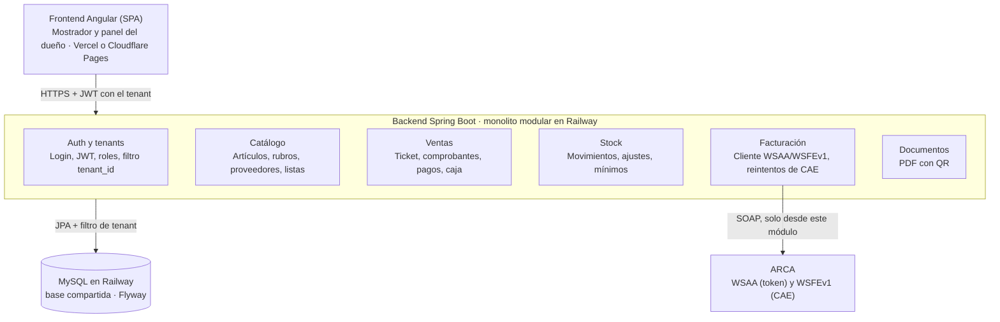

# Ferretería SaaS — Especificación del MVP

> Versión viva (editable): [Claude Doc](https://claude.ai/code/artifact/2f71e9a9-f655-41f6-85f2-29fdc96a94f7) · capturada el 2026-10-11

## Visión y alcance

Un sistema web multi-tenant para que una ferretería de Mar del Plata venda, facture electrónicamente con ARCA y mantenga sus precios al día, sin instalar nada. Cada ferretería es un tenant aislado: entra con su usuario y tiene todo ahí.

**Problema que resuelve:** actualizar miles de precios cuando llega la lista del proveedor, vender rápido en el mostrador y emitir la factura con CAE sin pelearse con ARCA.

**Principio rector: simple, práctico y que funcione.** Cada pantalla tiene que poder usarla un vendedor sin capacitación. Si una función no la pide una ferretería real, no entra.

**Criterios de éxito del MVP:**

- Una venta con factura B emitida en menos de 15 segundos desde que se escanea el primer artículo
- Una lista de precios de proveedor de 5.000 artículos importada y aplicada en menos de 2 minutos
- Una ferretería piloto usándolo a diario durante un mes sin volver a su sistema anterior

## Actores y roles

El MVP tiene tres roles fijos. Nada de permisos configurables por ahora.

| Rol | Quién es | Puede |
| --- | --- | --- |
| Super admin | Vos (el proveedor del servicio) | Dar de alta ferreterías, suspenderlas, ver estado general. No ve datos de ventas |
| Dueño | El dueño o encargado de la ferretería | Todo dentro de su ferretería: configuración, ARCA, usuarios, precios, reportes, anulaciones |
| Vendedor | Quien atiende el mostrador | Buscar artículos, vender, facturar, consultar stock, abrir y cerrar la caja |

**Actor externo:** ARCA (WSAA para autenticación, WSFEv1 para pedir el CAE).

## Casos de uso del MVP

Son 10 casos de uso, agrupados en cuatro módulos. Si algo no está en esta lista, no entra en el MVP.

### Configuración

**CU-01 Configurar la ferretería** (Dueño)

1. Carga razón social, CUIT, condición frente al IVA, domicilio e inicio de actividades.
2. Carga el punto de venta habilitado en ARCA para factura electrónica (web service).
3. Sube el certificado (.crt) y la clave privada, o genera el CSR desde el sistema.
4. El sistema prueba la conexión contra ARCA y muestra el último número de comprobante autorizado.
   - Alternativo: el certificado vence o es inválido → se avisa y se bloquea la facturación (la venta en negro, presupuesto, sigue habilitada).

**CU-02 Gestionar usuarios** (Dueño)

1. Crea, edita o desactiva usuarios con rol Dueño o Vendedor.

### Artículos y precios

**CU-03 Gestionar artículos** (Dueño)

1. Alta, edición y baja lógica de un artículo: código interno, código de barras, código del proveedor, descripción, rubro, proveedor, costo, margen, alícuota de IVA, unidad y stock mínimo.
2. El precio de venta se calcula solo: costo × (1 + margen) × (1 + alícuota de IVA) (ver Reglas de negocio).

**CU-04 Importar lista de precios del proveedor** (Dueño) — el caso más importante del sistema

1. Elige el proveedor y sube el archivo. Los proveedores mandan las listas en **Excel y/o PDF**: primero se soporta Excel/CSV; el PDF se extrae a tabla y pasa por la misma vista previa (ver nota abajo).
2. Mapea columnas una sola vez (código, descripción, costo); el mapeo queda guardado para ese proveedor.
3. El sistema cruza por código del proveedor y muestra una vista previa: cuántos suben, cuántos bajan, cuántos son nuevos, cuántos no están en la lista.
4. El dueño confirma y se actualizan los costos y precios en una sola transacción.
   - Alternativo: artículos nuevos → se pueden dar de alta en bloque con el margen por defecto del rubro.

> **Listas en PDF (2026-10-11):** varias listas llegan solo en PDF. La extracción de tablas de un PDF depende del formato de cada proveedor, así que se implementa después de Excel/CSV, con muestras reales, y siempre pasa por la vista previa antes de aplicar.

**CU-05 Actualizar precios masivamente** (Dueño)

1. Filtra por proveedor, rubro o búsqueda.
2. Aplica un porcentaje de aumento al costo o cambia el margen.
3. Ve la vista previa y confirma.

### Venta

**CU-06 Buscar artículo** (Vendedor)

1. Escanea el código de barras o escribe parte de la descripción o el código. La mayoría de las ferreterías ya tiene lector: funciona como teclado (escribe el código y manda Enter), así que el campo de búsqueda tiene que tener el foco siempre y reaccionar al Enter.
2. Ve precio, stock y ubicación al instante, sin hacer clic en nada.

**CU-07 Vender y facturar** (Vendedor)

1. Agrega artículos al ticket escaneando o buscando; ajusta cantidades.
   - Puede aplicar un **descuento en %** a un renglón (F7) o a todo el ticket (F6). Va de 0 a 99,99 %, con hasta 2 decimales; 0 lo saca. No hay tope por usuario por ahora. El descuento global se aplica a cada renglón (prorrateo), así el total es exactamente la suma de los renglones. El comprobante guarda el descuento de cada renglón, el global y el subtotal antes de descuentos; el que lo aplicó es el usuario de la venta.
2. Elige el cliente: Consumidor Final por defecto, o busca por CUIT o DNI.
3. El sistema decide el comprobante (A, B o C) según la condición de IVA de la ferretería y del cliente.
4. Elige el medio de pago: efectivo, débito, crédito o transferencia; o **pago mixto** (más de un medio): carga una parte y el resto se sugiere solo en el medio siguiente, y los pagos tienen que sumar exactamente el total. Cada medio va una sola vez. El vuelto es solo del pago en efectivo único.
5. Confirma: se pide el CAE a ARCA, se descuenta el stock y se imprime o envía el comprobante en PDF.
   - Alternativo: ARCA no responde → la venta queda guardada como "pendiente de CAE" y se reintenta sola.
   - Alternativo: venta sin factura → se registra como presupuesto o remito interno, sin pedir CAE.

**CU-08 Anular una venta** (Dueño)

1. Busca la factura y emite la nota de crédito asociada (con su propio CAE).
2. El stock se repone automáticamente.

### Stock y caja

**CU-09 Consultar y ajustar stock** (Dueño)

1. Ve el stock actual y los artículos bajo el mínimo.
2. Hace un ajuste manual (ingreso de mercadería, rotura, conteo) con un motivo; queda registrado el movimiento.

**CU-10 Abrir y cerrar caja** (Vendedor y Dueño)

1. Hay **una sola caja abierta por ferretería**, no una por usuario: cualquier usuario (Dueño o Vendedor) vende sobre la caja abierta. Abrir con una ya abierta se rechaza («Ya hay una caja abierta.»).
2. Abre la caja con el efectivo inicial (cero o más). El sistema propone el efectivo contado del último cierre (o $ 0 si nunca hubo); si se abre con otro monto, queda registrada la diferencia de apertura (inicial − contado anterior) y quién abrió.
3. **Sin caja abierta no se vende** («Abrí la caja para vender.»). Cada venta queda asociada a la caja abierta. Si la caja abierta es de un día anterior, no se vende ni se cargan movimientos hasta cerrarla y abrir una nueva («La caja del dd/MM sigue abierta. Cerrala antes de vender.»); cerrarla sí se puede.
4. Durante el día se cargan movimientos de caja con importe, motivo, usuario y hora: ingresos varios y gastos varios (Dueño y Vendedor) y retiros (solo el Dueño).
5. **Cierre ciego:** el que cierra (Dueño o Vendedor) carga solo el efectivo contado. Recién entonces el sistema muestra el total por medio de pago (efectivo, débito, crédito, transferencia), los ingresos, gastos y retiros, el efectivo esperado (inicial + ventas en efectivo + ingresos − gastos − retiros) y la diferencia (contado − esperado). Mientras la caja está abierta el Vendedor no ve lo esperado ni los totales; el Dueño sí ve la caja del día en vivo.
6. Una caja cerrada es inmutable: no se reabre, no se edita y no admite movimientos ni ventas.
7. El Dueño ve el historial de cajas cerradas (más nuevas primero) y el detalle de cada una: totales, movimientos y quién abrió y cerró.

## Reglas de negocio

Estas reglas se codifican en el dominio y se cubren con tests unitarios antes que cualquier pantalla.

### Precios

- El costo del proveedor se guarda **sin IVA**. Precio neto = costo × (1 + margen). Precio final = neto × (1 + alícuota de IVA).
- El margen se define por artículo; si no tiene, hereda el del rubro; si no, el margen por defecto de la ferretería.
- Sin redondeo por ahora: el precio final queda con centavos (escala 2, hacia arriba al centavo). Si las ferreterías lo piden, se evaluará redondear hacia arriba al peso entero. El código del múltiplo configurable sigue, con múltiplo 0 (sin redondeo) en todas las ferreterías (H11, migración V9).
- Todo cambio de costo o precio guarda historial: fecha, valor anterior, valor nuevo y origen (importación, masivo, manual).
- Montos en `BigDecimal` (Java) y `DECIMAL(15,2)` (base). Nunca `double`.

### Comprobantes

| Emisor (la ferretería) | Cliente | Comprobante |
| --- | --- | --- |
| Responsable Inscripto | Responsable Inscripto | Factura A |
| Responsable Inscripto | Consumidor Final, Monotributista o Exento | Factura B |
| Monotributista | Cualquiera | Factura C |

- La factura B a consumidor final informa el IVA contenido (Régimen de Transparencia Fiscal). Validar el formato vigente con un contador.
- Por encima del monto que fija ARCA, la venta a consumidor final exige identificar al cliente con DNI. El monto queda como parámetro configurable, no en el código.
- La numeración la da ARCA: antes de emitir se consulta el último comprobante autorizado por punto de venta y tipo.
- Un comprobante con CAE es inmutable. Solo se corrige con nota de crédito.

### Stock

- Toda variación de stock es un movimiento (venta, anulación, ajuste, ingreso). El stock actual es la suma de movimientos, cacheada en el artículo.
- Se permite stock negativo con advertencia: en el mostrador la venta no se frena por un error de carga.
- Las cantidades admiten decimales (cable por metro, clavos por kilo).

## Modelo de datos

Una sola base compartida y todas las tablas de negocio con `tenant_id`. Es el mismo esquema que en Sendo: la ferretería sale del JWT (`TenantFilter` → `TenantContext`), los repositorios extienden `TenantScopedRepository` y filtran siempre por `ferreteria_id`, y un test de ArchUnit prohíbe los finders sin scope.

| Entidad | Atributos clave | Relaciones |
| --- | --- | --- |
| Tenant | razón social, CUIT, condición IVA, domicilio, inicio de actividades, estado (activo/suspendido) | 1—N con todo lo demás |
| ConfigArca | punto de venta, certificado y clave (cifrados), vencimiento del certificado, ambiente (homologación/producción) | 1—1 con Tenant |
| Usuario | email, hash de contraseña, nombre, rol, activo | N—1 Tenant |
| Rubro | nombre, margen por defecto | 1—N Artículo |
| Proveedor | nombre, CUIT, mapeo de columnas de su lista (JSON) | 1—N Artículo, 1—N ImportacionLista |
| Articulo | código interno, código de barras, código proveedor, descripción, costo, margen, alícuota IVA, precio final, unidad, stock actual, stock mínimo, ubicación, activo | N—1 Rubro, N—1 Proveedor |
| HistorialPrecio | costo y precio anterior y nuevo, origen, fecha, usuario | N—1 Articulo |
| ImportacionLista | archivo, fecha, cantidades (suben, bajan, nuevos), estado | N—1 Proveedor |
| MovimientoStock | tipo, cantidad (decimal), motivo, fecha, usuario | N—1 Articulo, N—1 Comprobante (opcional) |
| Cliente | nombre o razón social, tipo y número de documento, condición IVA, domicilio | 1—N Comprobante |
| Comprobante | tipo (FA, FB, FC, NC, presupuesto), punto de venta, número, fecha, neto, IVA, total, subtotal (antes de descuentos), descuento global %, CAE, vencimiento del CAE, estado (pendiente, autorizado, rechazado) | N—1 Cliente, N—1 Caja, 1—N Item, 1—N Pago |
| ItemComprobante | descripción, cantidad, precio unitario, alícuota IVA, bruto, descuento % del renglón, subtotal (copiados al momento de la venta) | N—1 Comprobante, N—1 Articulo |
| Pago | medio (efectivo, débito, crédito, transferencia), monto | N—1 Comprobante |
| Caja | apertura (fecha y usuario que abre), cierre (fecha y usuario que cierra), efectivo inicial, efectivo contado, efectivo esperado, diferencia (contado − esperado), diferencia de apertura (inicial − contado del cierre anterior), abierta (una sola por ferretería) | N—1 Ferretería, N—1 Usuario (abre), N—1 Usuario (cierra), 1—N Comprobante, 1—N MovimientoCaja |
| MovimientoCaja | tipo (ingreso, gasto, retiro), importe, motivo, fecha, usuario | N—1 Caja, N—1 Usuario |

**Decisiones:**

- `ItemComprobante` copia descripción y precio: si mañana cambia el artículo, la factura vieja no cambia.
- Índices compuestos que empiezan por `tenant_id`: (`tenant_id`, `codigo_barras`), (`tenant_id`, `codigo_proveedor`, `proveedor_id`) y un índice full-text sobre la descripción para la búsqueda del mostrador.
- Migraciones con Flyway desde el día uno.

## Integración ARCA

La facturación usa dos servicios SOAP de ARCA: WSAA para obtener el token y WSFEv1 para pedir el CAE. Todo se desarrolla primero contra homologación y se pasa a producción por tenant con un flag.

**Flujo de una factura:**

1. Se arma el TRA (LoginTicketRequest), se firma en CMS/PKCS#7 con el certificado (BouncyCastle) y se llama a `loginCms` del WSAA. Devuelve token y sign, válidos unas 12 horas.
2. El token se cachea por tenant y por servicio hasta que vence. No se pide uno por factura: ARCA rechaza pedidos repetidos con un token vigente.
3. `FECompUltimoAutorizado` devuelve el último número para ese punto de venta y tipo; el nuevo es ese + 1.
4. `FECAESolicitar` con cabecera, importes, alícuotas de IVA y datos del cliente. Devuelve CAE y vencimiento, o las observaciones y errores.
5. Se guarda el CAE, se genera el PDF con el código QR obligatorio y se marca el comprobante como autorizado.

**Cómo se autentica cada ferretería:** hay dos modelos, y hay que elegir uno antes de codear.

| Modelo | Cómo funciona | A favor | En contra |
| --- | --- | --- | --- |
| Certificado propio por tenant | Cada ferretería genera su certificado con clave fiscal y lo sube al sistema | Cada CUIT es independiente | Onboarding más difícil; hay que guardar N claves privadas y vigilar N vencimientos |
| Delegación al CUIT del servicio | Vos tenés un solo certificado; cada ferretería delega el servicio de factura electrónica a tu CUIT desde ARCA, y en cada llamada se informa el CUIT representado | Una sola clave que custodiar; el alta es un trámite de 5 minutos | Necesitás CUIT propio y todo depende de un solo certificado |

**Seguridad:** claves privadas cifradas en la base con AES-GCM, con la clave maestra en una variable de entorno y nunca en el repo. Aviso al dueño 30 días antes del vencimiento del certificado.

**Contingencias:**

- ARCA caída o con timeout → el comprobante queda "pendiente de CAE", el cliente se lleva un ticket provisorio y un job reintenta cada pocos minutos.
- ARCA rechaza el comprobante → se guarda el error tal cual lo devuelve ARCA y se le muestra al dueño en una bandeja de rechazados.
- Antes de reintentar, se consulta si el número ya fue autorizado (`FECompConsultar`) para no duplicar facturas.
- El régimen CAEA (CAE anticipado para emitir offline) queda para después del MVP.

## Arquitectura y stack

Es un monolito modular con el mismo stack que Sendo. Sin microservicios: una ferretería no necesita escalar módulos por separado, y un solo deploy es más fácil de mantener para una persona.

Cada módulo es un paquete con su dominio, servicios y controladores. ArchUnit impide que un módulo use las clases internas de otro, y solo Facturación conoce a ARCA.

| Capa | Tecnología |
| --- | --- |
| Backend | Java, Spring Boot, Spring Security (JWT), Hibernate/JPA, Maven |
| Base de datos | MySQL, Flyway |
| Frontend | Angular, TypeScript, RxJS |
| ARCA | Cliente SOAP generado del WSDL, BouncyCastle para firmar el TRA |
| PDF | Generación en el backend (por ejemplo OpenPDF) con el QR de ARCA |
| Tests | JUnit 5, Mockito, Testcontainers, ArchUnit, Karma/Jasmine |
| Infra | Docker, Railway (backend y base), Vercel o Cloudflare Pages (frontend) |

## Fuera del alcance del MVP

Nada de esto entra hasta que haya una ferretería piloto usando el sistema todos los días. Cada ítem vuelve a la lista solo si un cliente real lo pide.

- Cuenta corriente de clientes y cobranzas
- Compras, órdenes de compra y cuenta corriente con proveedores
- Múltiples sucursales o depósitos por ferretería
- Listas de precios múltiples (mayorista y minorista) y descuentos por cliente
- Libro IVA Ventas e integración con el contador
- Reportes avanzados y tableros (el MVP solo trae ventas del día y de un rango de fechas)
- CAEA y modo offline
- Impresora fiscal o de tickets térmica con drivers propios (el MVP imprime PDF desde el navegador)
- Tienda online, catálogo público o integración con Mercado Libre
- Cobro de la suscripción dentro del sistema (al principio se cobra por fuera)

## Plan de implementación

Son siete fases (de la 0 a la 6) en orden de riesgo y de dolor del cliente. La fase 0 y la prueba con ARCA corren en paralelo porque ARCA es lo único que puede trabar el proyecto entero.

0. **Validación con ferreterías** (1 semana, en paralelo con la fase 1)
   - Visitar 3 o 4 ferreterías con las preguntas de la sección siguiente.
   - Conseguir un Excel real de lista de proveedor y una exportación real de artículos.
   - Resultado: esta lista de casos de uso ajustada y una ferretería piloto comprometida.
1. **Prueba técnica de ARCA en homologación** (1 semana)
   - Proyecto aparte, sin UI: certificado de homologación, `loginCms`, `FECompUltimoAutorizado` y `FECAESolicitar` de una factura B.
   - Terminado cuando: un test de integración obtiene un CAE real de homologación.
2. **Esqueleto** (3 a 5 días)
   - Repo, Spring Boot + Angular, auth y multi-tenant traídos de Sendo, Flyway, Docker Compose y deploy en Railway.
   - Terminado cuando: un usuario de cada uno de dos tenants entra y no ve nada del otro (con test).
3. **Artículos y precios** (CU-03, CU-04, CU-05) (2 a 3 semanas)
   - Terminado cuando: el Excel real de la fase 0 se importa con vista previa y se aplica sin errores.
4. **Mostrador** (CU-06, CU-07 sin ARCA, CU-10) (2 semanas)
   - Búsqueda con lector de código de barras, ticket, medios de pago, presupuesto y caja.
   - Terminado cuando: una venta de 5 artículos se cierra en menos de 15 segundos solo con teclado y lector.
5. **Facturación electrónica** (CU-01, CU-07 completo, CU-08) (2 semanas)
   - Se enchufa el código de la fase 1: CAE, PDF con QR, nota de crédito, reintentos y bandeja de rechazados.
6. **Stock, pulido y piloto** (CU-02, CU-09) (2 semanas)
   - Ajustes de stock, gestión de usuarios, carga inicial de datos del piloto y paso a producción en ARCA.

**Forma de trabajo con Claude Code:** este documento se exporta como `docs/spec.md` en el repo y el `CLAUDE.md` apunta a él. Cada caso de uso se implementa en una rama propia: primero los tests del dominio, después el endpoint y después la pantalla.

## Preguntas abiertas para validar con ferreterías

Estas preguntas se llevan impresas a cada visita. Las respuestas pueden mover casos de uso adentro o afuera del MVP.

- [ ] ¿Qué sistema usan hoy, cuánto pagan por mes y qué es lo que más odian de él?
- [ ] ¿Cuántos artículos activos tienen y cuántos proveedores les mandan listas? ¿Cada cuánto llegan?
- [ ] ¿En qué formato llegan las listas (Excel, PDF, web del proveedor)? Pedir una de muestra.
- [ ] ¿Son Responsables Inscriptos o Monotributistas? ¿Qué proporción de facturas A hacen?
- [ ] ¿Cuántas ventas hacen en un día fuerte? ¿Cuántos puestos de venta usan a la vez?
- [ ] ¿Usan lector de código de barras? ¿Los artículos tienen código o los etiquetan ellos?
- [ ] ¿Imprimen la factura en A4, en ticket térmico o la mandan por WhatsApp?
- [ ] ¿Venden a cuenta corriente? Si la respuesta es "sí, mucho", entra al MVP.
- [ ] ¿Quién carga los precios hoy y cuánto tiempo le lleva?
- [ ] ¿Cuánto pagarían por mes por algo que les resuelva las listas de precios y la facturación?
