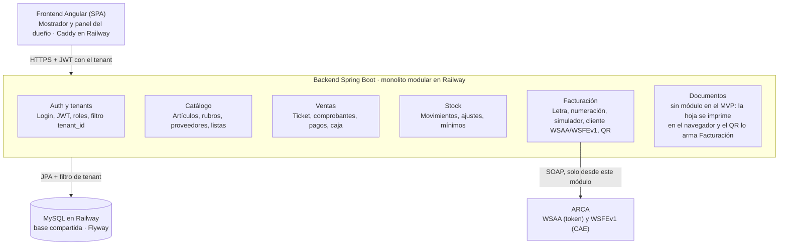

# Ferretería SaaS — Especificación del MVP

> Versión viva (editable): [Claude Doc](https://claude.ai/code/artifact/2f71e9a9-f655-41f6-85f2-29fdc96a94f7) · capturada el 2026-10-11

## Visión y alcance

Un sistema web multi-tenant para que una ferretería de Mar del Plata venda, facture electrónicamente con ARCA y mantenga sus precios al día, sin instalar nada. Cada ferretería es un tenant aislado: entra con su usuario y tiene todo ahí.

**Problema que resuelve:** actualizar miles de precios cuando llega la lista del proveedor, vender rápido en el mostrador y emitir la factura con CAE sin pelearse con ARCA.

**Principio rector: simple, práctico y que funcione.** Cada pantalla tiene que poder usarla un vendedor sin capacitación. Si una función no la pide una ferretería real, no entra.

**Criterios de éxito del MVP:**

- Una venta con factura B emitida en menos de 15 segundos desde que se escanea el primer artículo
- Una lista de precios de proveedor de 5.000 artículos importada y aplicada en menos de 2 minutos
- Una ferretería piloto usándolo a diario durante un mes sin volver a su sistema anterior

## Actores y roles

El MVP tiene tres roles fijos. Nada de permisos configurables por ahora.

| Rol | Quién es | Puede |
| --- | --- | --- |
| Super admin | Vos (el proveedor del servicio) | Dar de alta ferreterías (razón social, CUIT y condición de IVA), suspenderlas, ver estado general. Después del alta no edita los datos de la ferretería: los edita el Dueño (CU-01). Marca una ferretería «de prueba», le asigna el simulador de ARCA y prende su «facturación habilitada» (CU-01). No ve datos de ventas |
| Dueño | El dueño o encargado de la ferretería | Todo dentro de su ferretería: configuración, ARCA (salvo el ambiente, que nunca elige), usuarios, precios, reportes, anulaciones |
| Vendedor | Quien atiende el mostrador | Buscar artículos, vender, facturar, consultar stock, abrir y cerrar la caja |

**Actor externo:** ARCA (WSAA para autenticación, WSFEv1 para pedir el CAE). Hasta la conexión real, un simulador del WSFEv1 hace sus veces para la ferretería marcada «de prueba» (ver Integración ARCA).

## Casos de uso del MVP

Son 12 casos de uso (CU-01 a CU-12), agrupados en cinco módulos: Configuración, Artículos y precios, Venta, Stock y caja, y Clientes. Si algo no está en esta lista, no entra en el MVP.

### Configuración

**CU-01 Configurar la ferretería** (Dueño)

1. Carga razón social, CUIT, condición frente al IVA, domicilio e inicio de actividades.
   - **Datos de la ferretería** (Configuración → Facturación, solo el Dueño; decidido por Luca el 2026-10-28, D1 del plan de facturación). La razón social, el CUIT y la condición de IVA los carga el super admin en el alta; después el Dueño es el único que edita la razón social, la condición de IVA, el **domicilio comercial**, el **inicio de actividades** y los **Ingresos Brutos** (número, Convenio Multilateral, Exento o No contribuyente: la RG 1415 los pide en cada comprobante). El CUIT se ve y no se cambia nunca. El domicilio y el inicio de actividades son los del local donde se factura. Domicilio, inicio de actividades e Ingresos Brutos se pueden dejar vacíos al guardar; completos son requisito para habilitar la facturación. El inicio de actividades no puede ser una fecha futura. `GET`/`PUT /api/datos-fiscales`; el Vendedor y el super admin reciben 403.
2. Carga el punto de venta habilitado en ARCA para factura electrónica (web service).
   - **Ambiente de ARCA** (panel del super admin; decidido por Luca el 2026-10-28, D3 del plan de facturación). Hay tres: simulador, homologación y producción (ver Integración ARCA → Ambientes). **El Dueño nunca elige el ambiente.** El simulador lo asigna solo el super admin, y solo a una ferretería que él marcó «de prueba» (hoy, la Ferretería de Prueba): nunca a una ferretería sin la marca ni a una con registros fiscales de homologación o producción. Homologación o producción salen de la CA que firmó el certificado validado (paso 3; ramas 5 y 6 del plan), y de producción no se vuelve. El ambiente y el punto de venta no cambian mientras la ferretería tenga registros fiscales abiertos (pendientes, en curso o en verificación). Solo el super admin pone la marca y asigna el simulador: el Dueño y el Vendedor reciben 403, y otra ferretería no ve nada.
   - **Punto de venta con el simulador** (decidido por Luca el 2026-10-28 al abrir la rama 2 del plan de facturación). Al asignar el simulador, el punto de venta queda fijo en 1, sin pantalla para cambiarlo. En el simulador el número no tiene efecto fiscal; el real lo carga el Dueño en este paso, desde la rama 5.
   - **Facturación habilitada** (panel del super admin; decidido por Luca el 2026-10-28, ajuste a D3 del plan de facturación). La prende solo el super admin, y queda guardada su fecha de activación. Exige los datos del paso 1 completos (razón social, condición de IVA, domicilio comercial, inicio de actividades e Ingresos Brutos) y un ambiente asignado. Un certificado validado fija el ambiente, pero no habilita la facturación por sí solo. El Dueño y el Vendedor reciben 403.
   - **Punto de venta real** (rama 5 del plan de facturación). En la pantalla «Facturación» (Configuración → Facturación, solo el Dueño) el Dueño carga el punto de venta, de 1 a 99998, salvo con el simulador (fijo en 1) o con registros fiscales abiertos; el motivo se ve en la pantalla. `PUT /api/facturacion/punto-venta`.
3. Genera el pedido de certificado desde el sistema y sube el certificado (.crt) que le da ARCA (D8, decidida por Luca el 2026-10-28: «perfecto vamos con tus recomendaciones, lo que podamos usar del gds mejor»). La clave privada nace en el servidor, cifrada, y nunca sale: el MVP no tiene «subir la clave privada» (queda para cuando una piloto lo pida, como texto PEM dentro del JSON, PKCS#8 o PKCS#1).
   - **Pedido de certificado.** «Generar pedido de certificado» crea una clave RSA de 2048 bits y el CSR PKCS#10 (SHA256withRSA) con el sujeto `C=AR, O=<razón social>, CN=Ferreteria SaaS, serialNumber=CUIT <11 dígitos>`. La `O` lleva hasta 64 caracteres de la razón social (el tope de X.509); el CUIT va en el `serialNumber`. El CUIT es el de la ferretería; fuera de producción se puede poner el de la persona física para un certificado de homologación. La clave queda «pendiente» y nunca pisa la credencial activa; un pedido nuevo reemplaza al pendiente. El Dueño descarga el `.csr` y la pantalla le guía los pasos en ARCA: el alias, la renovación con «Agregar certificado» y el mismo alias, y la autorización a `wsfe`. `POST`/`GET /api/facturacion/pedido-certificado`.
   - **Certificado.** El `.crt` va como texto dentro del JSON (PEM, o DER en Base64), de hasta 16 KB. Se valida que su clave pública sea la del pedido pendiente, que el `serialNumber` del sujeto sea el CUIT de la ferretería (en producción es obligatorio; en homologación, otro CUIT solo avisa), que esté vigente, que la clave RSA tenga 2048 bits o más y que la firma verifique contra la CA oficial: «Computadores» fija producción y «Computadores Test», homologación. Desde producción no se vuelve a homologación, y el ambiente cambia solo sin registros fiscales abiertos. Activarlo reemplaza la credencial anterior y no habilita la facturación; si cambia el ambiente (de homologación a producción), la facturación queda deshabilitada hasta que el super admin la vuelva a prender. Con el simulador, una CA de simulación propia de la ferretería firma el pedido con un clic («Firmar con el simulador») y se rechazan los certificados de las CA de ARCA. `POST /api/facturacion/certificado` y `POST /api/facturacion/certificado/simulador`; el Vendedor y el super admin reciben 403.
   - **Habilitar por ambiente** (rama 6 del plan de facturación). El super admin puede habilitar la facturación con el simulador o en homologación. En producción sigue trabada hasta la rama 11 (la piloto): «La facturación en producción todavía no está disponible.».
4. El sistema prueba la conexión contra ARCA y muestra el último número de comprobante autorizado.
   - **Probar conexión** (rama 6 del plan de facturación). En «Facturación», el Dueño prueba la conexión: FEDummy (los servidores de ARCA), WSAA (el ticket de acceso con su certificado), FEParamGetPtosVenta (que el punto de venta exista, sea de tipo CAE y no esté bloqueado ni dado de baja) y FECompUltimoAutorizado de cada tipo de factura que emite la ferretería (A y B para Responsable inscripto; C para Monotributista y Exento). Cada paso muestra su resultado, y el primero que falla corta los siguientes. Con el simulador, la prueba corre contra él y avisa «Simulador: no se probó contra ARCA». Hace falta el ambiente, el punto de venta y un certificado vigente; si no, 409 con el motivo. `POST /api/facturacion/probar-conexion`; el Vendedor y el super admin reciben 403.
   - **Chequeo del super admin.** Desde su panel, el super admin corre FEDummy contra homologación y producción desde el servidor, para probar la red y el TLS desde Railway. `POST /api/admin/arca/fedummy`.
   - Alternativo: el certificado vence o es inválido → se avisa y se bloquea la facturación (la venta sin factura sigue habilitada: ver «Sin facturación», abajo). Desde 30 días antes del vencimiento, «Facturación» y el mostrador del Dueño avisan «El certificado de ARCA vence el dd/mm/aaaa: renovalo en Facturación.». El aviso y el bloqueo salen del vencimiento guardado y del reloj al leer; no hay un job ni un correo. En todos los ambientes, el simulador incluido (desde la rama 6), la facturación exige una credencial activa, vigente y legible.
   - Alternativo: **ARCA rechaza el certificado** (rama 6). Si WSAA contesta que el certificado no sirve (`cms.cert.*`) o que no está autorizado a `wsfe` (`coe.notAuthorized`), la facturación de esa ferretería queda bloqueada y «Facturación» muestra el motivo de ARCA. Se destraba al activar otro certificado o con «Probar conexión» OK (ver Integración ARCA → Errores de ARCA).
   - Alternativo: **sin facturación** (decidido por Luca el 2026-10-28, D5 del plan de facturación). Mientras la ferretería no puede facturar, la venta facturable se cobra igual y queda «sin factura»: no nace registro fiscal y la respuesta de la venta es la de siempre, sin el campo `fiscal` (CU-07 paso 5). Esa venta **nunca entra en la cola de reintentos**: no se factura sola cuando la facturación se destraba. La cola es solo para cuando ARCA está caída o no responde a tiempo (ver Integración ARCA → Contingencias). Hoy no puede facturar la ferretería con ARCA sin configurar o sin la facturación habilitada (paso 2); el certificado vencido o inválido y la credencial bloqueada se suman con el certificado y la conexión real (ramas 5 y 6 del plan de facturación), igual que el certificado que rechaza ARCA. El aviso de facturación bloqueada en el mostrador llega con la rama 7.

**CU-02 Gestionar usuarios** (Dueño)

1. Crea, edita o desactiva usuarios con rol Dueño o Vendedor.

### Artículos y precios

**CU-03 Gestionar artículos** (Dueño)

1. Alta, edición y baja lógica de un artículo: código interno, código de barras, código del proveedor, descripción, rubro, proveedor, costo, margen, alícuota de IVA, unidad y stock mínimo.
2. El precio de venta se calcula solo: costo × (1 + margen) × (1 + alícuota de IVA) (ver Reglas de negocio).
3. **Margen y redondeo** (Configuración, solo el Dueño), como la ganancia por defecto y el redondeo de GDS (G13, G26). El Dueño edita el margen por defecto de la ferretería y el múltiplo de redondeo del precio final (0 es sin redondeo, y así arranca). Antes de guardar, la pantalla avisa cuántos artículos cambian de precio y pide confirmación. Al guardar:
   - si cambió el múltiplo, se recalculan todos los artículos activos sin precio manual;
   - si cambió solo el margen por defecto, se recalculan los artículos activos sin precio manual, sin margen propio y sin rubro;
   - cada precio que cambia guarda historial con origen masivo. Un artículo cuyos ajustes dejarían el precio en 0 o menos conserva el suyo y se avisa;
   - con artículos en dólares a recalcular y sin cotización guardada, no se guarda nada (409).
4. **Exportar** (barra de Artículos, solo el Dueño), como la «Exportación Rápida» de GDS (G25, GDS-19). Baja en CSV los artículos que muestra la pantalla (la búsqueda y «Mostrar dados de baja»), todos juntos y en el mismo orden. El archivo `articulos-AAAA-MM-DD.csv` abre directo en Excel en castellano: UTF-8 con BOM, separador `;`, coma decimal, sin separador de miles. Columnas: código, código de barras, código del proveedor, descripción, rubro, proveedor, unidad, moneda, costo, IVA %, margen % («Heredado» si no tiene uno propio), precio final, precio manual (Sí/No), stock, stock mínimo, ubicación y activo (Sí/No). Los tres códigos salen como texto de Excel (`="0012"`), así Excel no les saca los ceros ni pasa un código de barras a `7,79E+12`; la importación de CU-04 lee `="…"` como su texto. Un texto que empieza con `=`, `+`, `-` o `@` sale con un apóstrofo adelante, para que Excel no lo tome como fórmula. La carga inicial de una ferretería usa la importación de CU-04 con «Crear los artículos nuevos».
5. **Costo al** (columna de Artículos, para el Dueño y el Vendedor), como la «F. Modif.» de GDS (G22, GDS-05): desde cuándo está al día el costo. Es la fecha más nueva entre el último cambio de costo o de moneda del historial (un cambio solo de precio no cuenta), la última importación de lista que tocó el artículo (aunque haya confirmado el mismo costo) y el alta. Sale del historial y de las importaciones, sin migración.
6. **Etiquetas** (menú, solo el Dueño), como las plantillas de etiquetas de GDS (G85, GDS-31). El Dueño busca o escanea artículos y los suma a una lista con la cantidad de copias (1 por defecto; sumar el mismo otra vez suma una copia). La lista no se guarda. Los dados de baja no se pueden sumar. Elige hoja A4 de 4 o 5 columnas e imprime desde el navegador. Cada etiqueta lleva el código de barras, el código en texto y la descripción, sin precio. El código de barras del artículo va en EAN-13 si tiene 13 dígitos con el verificador correcto, y si no en Code128; sin código de barras va el código interno en Code128, que el mostrador encuentra al escanearlo. Un código con caracteres que Code128 no tiene (una Ñ) sale sin barras y la lista lo avisa. Code39, los tamaños de etiqueta y la etiqueta de envío quedan afuera.
7. **Clientes que lo compraron** (barra de Artículos, solo el Dueño), como el Ctrl+A del listado de artículos de GDS (G29). Para el artículo elegido, aunque esté dado de baja, abre `/articulos/{id}/clientes`: una fila por cliente que lo compró, con la razón social actual («Desactivado» si lo está), cuántas ventas, la cantidad total con la unidad del artículo y la fecha de la última compra, la más nueva primero, de a 20 por página. Las ventas sin cliente (consumidor final) no se listan: una línea al pie dice cuántas son. No muestra plata. Un artículo de otra ferretería da 404.
8. **Controles de datos** (menú, solo el Dueño), como los «Controles de datos» de GDS (G81, GDS-18). El Dueño elige un control y ve todos los artículos activos que caen en él, ordenados por descripción, con código, descripción, rubro, proveedor, costo, IVA y precio (marca el precio manual); cada descripción lleva a la ficha para corregirlo y «Imprimir» saca el listado con la ferretería, el control y la fecha. Controles: **costo en cero**; **sin rubro** (un rubro de otra ferretería cuenta como ninguno); **margen negativo**, el costo en pesos mayor que el precio sin IVA, con la misma cuenta que el aviso de precio manual (un artículo en USD usa el dólar de los precios; sin dólar no sale); e **IVA en 0 %**. «Ventas con costo mayor a precio de venta» de GDS queda afuera: la ganancia de lo vendido está en Reportes.

**CU-04 Importar lista de precios del proveedor** (Dueño) — el caso más importante del sistema

1. Elige el proveedor y sube el archivo. Los proveedores mandan las listas en **Excel y/o PDF**: se aceptan Excel (.xlsx, .xls), CSV y PDF con texto; el PDF se extrae a tabla y pasa por la misma vista previa (ver nota abajo).
2. Mapea columnas una sola vez (código, descripción, costo); el mapeo queda guardado para ese proveedor.
3. El sistema cruza por código del proveedor y muestra una vista previa: cuántos suben, cuántos bajan, cuántos son nuevos, cuántos no están en la lista.
4. El dueño confirma y se actualizan los costos y precios en una sola transacción.
   - Alternativo: artículos nuevos → se pueden dar de alta en bloque con el margen por defecto del rubro.

> **Listas en PDF (2026-10-11, hecho el 2026-10-26):** varias listas llegan solo en PDF. Un PDF con texto se lee como **una sola hoja** («PDF») con todas las páginas seguidas: cada línea es una fila y las columnas salen de los huecos verticales que comparten las líneas de la tabla, así que el mapeo, la muestra y la vista previa son los mismos que con un Excel. Las líneas sueltas (títulos, rubros, encabezados y pies de página, notas) van enteras a la primera columna y la vista previa las saltea como títulos; el encabezado repetido en cada página también se saltea. Un importe con «US$» o «U$S» adelante se lee como el número (la moneda sale de la columna de moneda o de la moneda de todas las filas); si la lista no dice la moneda, esa fila no se importa y la vista previa avisa «El costo está en dólares, pero la lista no dice la moneda. Mapeá la columna de moneda o elegí la moneda de todas las filas.» (no se adivina la moneda, como GDS). Probado con las dos listas reales: LISTA 336 (152 páginas, 7 columnas, sus 4.139 artículos) y M-S (27 páginas, 1.167 artículos). Un PDF **escaneado** no tiene texto y da «El PDF no tiene texto para leer. Pedile al proveedor la lista en Excel o en un PDF que no sea escaneado.» (no hay OCR); uno con contraseña o dañado da el mismo aviso que un Excel. Como un PDF armado a propósito puede agotar la memoria o la CPU de quien lo lee, el PDF se lee **en un proceso aparte** con su propia memoria (256 MB), 30 segundos y un tope de palabras: pasarlos da «La lista es demasiado grande para leerla. Dividila en archivos más chicos.» y el servidor no se entera (ver Despliegue: lectura de PDF). Se lee un PDF por vez; un pedido que no consigue turno en 30 segundos da «Ya se está leyendo otra lista en PDF. Probá de nuevo en un momento.». Cada ferretería espera un solo PDF: si sube otro mientras se lee o espera el primero, recibe ese aviso al instante. Quedan afuera las páginas rotadas o a dos columnas.

**CU-05 Actualizar precios masivamente** (Dueño)

1. Filtra por proveedor, rubro o búsqueda.
2. Aplica un porcentaje de aumento al costo, cambia el margen o cambia el precio final en % o en $ (este último deja los artículos con precio manual, CU-14).
3. Ve la vista previa y confirma.

### Venta

**CU-06 Buscar artículo** (Vendedor)

1. Escanea el código de barras o escribe parte de la descripción o el código. La mayoría de las ferreterías ya tiene lector: funciona como teclado (escribe el código y manda Enter), así que el campo de búsqueda tiene que tener el foco siempre y reaccionar al Enter.
2. Ve precio, stock y ubicación al instante, sin hacer clic en nada. También ve «Costo al»: desde cuándo está al día el costo (GDS-05, como la «F. Modif.» de GDS). Es una fecha, no el costo.

**CU-07 Vender y facturar** (Vendedor)

1. Agrega artículos al ticket escaneando o buscando; ajusta cantidades.
   - Puede aplicar un **descuento en %** a un renglón (F7) o a todo el ticket (F6). Va de 0 a 99,99 %, con hasta 2 decimales; 0 lo saca. Cada usuario puede tener un **tope de descuento** (como el «Límite de Descuento» de GDS): lo carga el Dueño en Usuarios (0 a 99,99 %, vacío = sin tope) y el Dueño no tiene. Se mide el descuento efectivo de cada renglón, el del renglón y el global combinados; igual al tope entra. Si la venta, el presupuesto o el remito lo pasan, el sistema lo frena con un aviso. Al pasar a venta un presupuesto o un remito, sus descuentos ya están autorizados por quien lo emitió: el tope solo frena lo que se agregue o se suba. El descuento global se aplica a cada renglón (prorrateo), así el total es exactamente la suma de los renglones. El comprobante guarda el descuento de cada renglón, el global y el subtotal antes de descuentos; el que lo aplicó es el usuario de la venta.
2. Elige el cliente: Consumidor Final por defecto, o **F9** (botón «Cliente»): busca por razón social, CUIT o DNI entre los clientes activos, elige con ↑↓ y Enter, y puede dar de alta uno nuevo sin salir del mostrador (CU-11). El cliente se ve en el ticket con un «Quitar», se guarda con el ticket y viaja con la venta, el presupuesto y el remito; tras cobrar el ticket vuelve a quedar sin cliente. La venta guarda el id del cliente y una **copia de su razón social**: renombrarlo después no cambia lo ya emitido. En el presupuesto y el remito el diálogo muestra el cliente elegido en lugar del campo de texto libre, que sigue valiendo cuando no se eligió uno. «Pasar a venta» desde un presupuesto o un remito trae su cliente al ticket. Un cliente de otra ferretería es 404 y uno desactivado es 422; repetir la clave con otro cliente es `CLAVE_CON_OTRO_CONTENIDO`.
   - **Consumidor Final sin identificar** (GDS-32, como el «Límite de Venta a Cons.Final sin datos» de GDS, G88): desde el tope de la ferretería (igual o superior), la venta **facturable** necesita un cliente con documento (DNI, CUIT o CUIL). Sin cliente, con un cliente sin documento o con un nombre libre, la venta es 422 `CONSUMIDOR_FINAL_SIN_DATOS` («Desde $ <tope> la venta a Consumidor Final necesita identificar al comprador: elegí un cliente con DNI, CUIT o CUIL.») y no guarda nada; el mostrador deja el cobro abierto con el mensaje. Se compara el total que se cobra, con el recargo. La venta no facturable no se controla, y tampoco el presupuesto ni el remito (sí la venta que sale de ellos). El tope arranca en **$ 10.000.000**, el vigente de ARCA (RG 5700/2025, que mantiene la RG 5866/2026), y el Dueño lo cambia en Configuración → Consumidor Final (`GET`/`PUT /api/configuracion-ventas`, mayor que 0, hasta 2 decimales). **Con la facturación habilitada** (CU-01 paso 2; decidido por Luca el 2026-10-28, D4 del plan de facturación) el control rige desde el menor entre el tope del Dueño y el de identificación de ARCA (ver «Reglas de negocio → Comprobantes»): la venta sin identificar nunca llega al de ARCA, aunque el Dueño haya fijado uno mayor, y el mensaje dice el tope que rigió. Sin la facturación habilitada rige solo el tope del Dueño, como hasta ahora.
   - **Cliente sin datos fiscales** (decidido por Luca el 2026-10-28, D4 del plan de facturación): con la facturación habilitada, la venta **facturable** a un cliente Responsable Inscripto, Monotributista o Exento sin CUIT (tipo CUIT con su número) o sin domicilio es 422 `CLIENTE_SIN_DATOS_FISCALES` y no guarda nada, también si la ferretería emite C; el mostrador deja el cobro abierto con el mensaje. Son los clientes cargados sin esos datos antes de que CU-11 los exigiera. Sin la facturación habilitada, o con la venta no facturable, no se controla.
3. El sistema decide el comprobante (A, B o C) según la condición de IVA de la ferretería y del cliente (tabla en «Reglas de negocio → Comprobantes»).
   - **Qué decide la venta** (rama 3 del plan de facturación). Después de tomar al cliente con lock (si lo hay) y antes de numerar, la venta lee la configuración de ARCA de la ferretería con un lock compartido (mientras la venta no termina, el panel del super admin no la cambia) y decide si sale con factura: solo la venta **facturable** de una ferretería con la **facturación habilitada** (CU-01 paso 2). En ese caso suma los dos controles del paso 2 que dependen de la facturación (el tope de ARCA y el cliente sin datos fiscales), congela lo que va a ARCA (letra, receptor, emisor y desglose: ver Integración ARCA → Qué se manda) y crea el **registro fiscal** `PENDIENTE` dentro de la misma transacción de la venta: si la venta falla, no queda registro. Editar el cliente después de vender no cambia el registro. La venta no facturable y la de una ferretería que no puede facturar no crean registro (CU-01, «Sin facturación»).
4. Elige la **forma de pago** entre las que la ferretería tiene activas (por defecto Efectivo, Débito, Crédito y Transferencia; «Cuenta corriente» existe pero viene inactiva hasta que el Dueño la activa); o **pago mixto** (más de una forma): carga una parte y el resto se sugiere solo en la forma siguiente, y las partes tienen que sumar exactamente el total. Cada forma va una sola vez. El vuelto es solo del pago en efectivo único.
   - Cada forma tiene un **recargo en %** (0 a 200, 2 decimales; 0 por defecto) que el Dueño configura en Configuración → Formas de pago, donde también da de alta, edita, activa y desactiva (las formas no se borran). Cada una pertenece a un medio (efectivo, débito, crédito, transferencia o cuenta corriente), así la caja sigue sumando por medio. Siempre tiene que quedar al menos una forma activa de efectivo.
   - El recargo se calcula después de los descuentos, sobre la parte pagada con esa forma, y se reparte entre los renglones en proporción a su total (con su alícuota de IVA, porque integra la base del IVA): el total sigue siendo la suma de los renglones. El diálogo de cobro muestra el recargo y el total a cobrar. En el pago mixto la parte que se carga es la del ticket sin recargo.
   - **Descuento en efectivo** (relevamiento de ferreteros, bloque 3): cada forma puede llevar, en vez del recargo, un **descuento en %** (0 a 99,99, 2 decimales; 0 por defecto) que el Dueño configura en la misma pantalla; una forma lleva recargo o descuento, nunca los dos (422 «Una forma de pago lleva recargo o descuento, no los dos.»), y la forma «Cuenta corriente» queda siempre en 0. Se aplica **por venta, no por producto**, igual que el recargo y en espejo: después de los descuentos del Vendedor, sobre la parte pagada con esa forma, repartido entre los renglones (a ARCA va dentro del precio de cada renglón), también sobre los artículos en oferta. No cuenta para el tope de descuento del Vendedor. Se guarda como **recargo negativo** (comprobante, renglón y pago), así subtotal − descuento + recargo = total y la caja suma lo cobrado por medio sin cambios; en el pago mixto el recargo de la venta es la suma con signo del de cada pago. El diálogo de cobro marca la forma con «−N %» y muestra «Descuento por forma de pago»; el detalle, la impresión y la factura también. El reporte «Con descuento» sigue midiendo solo los descuentos del Vendedor.
   - El comprobante y cada renglón guardan el recargo; cada pago guarda la forma, su nombre y % del momento (negativo si es descuento), el recargo y lo cobrado. Cambiar el % después no toca las ventas hechas.
   - **Cuenta corriente** (GDS-20, tramo 2): la forma «Cuenta corriente» (medio `CUENTA_CORRIENTE`) vende a crédito y suma deuda al cliente. Todas las ferreterías con formas la reciben **inactiva** y con recargo 0 (V20); las nuevas también (la quinta forma, inactiva). El Dueño la activa en Configuración → Formas de pago, y el recargo de esa forma queda fijo en 0 (el servidor lo fuerza, la pantalla lo deshabilita). Puede ser forma única o una parte del pago mixto: en el mixto solo la parte a cuenta suma deuda.
   - **El cliente es obligatorio:** pagar a cuenta corriente sin `clienteId` es 400 en `clienteId` («Elegí el cliente para vender a cuenta corriente.»); uno de otra ferretería es 404 y uno desactivado, 422. El cliente tiene que tener la cuenta habilitada (CU-11): con el límite en NULL la venta es 422 `CUENTA_CORRIENTE_NO_HABILITADA` («<razón social> no tiene cuenta corriente habilitada.»), también para el Dueño.
   - **Límite y exceso:** la venta excede si el saldo más lo que va a cuenta supera el límite (con límite 0 cualquier venta a cuenta excede). Un exceso es 422 `LIMITE_CUENTA_CORRIENTE`, con el objeto `cuentaCorriente { puedeAutorizar }` y, solo si lo ve el Dueño, `saldo`, `limite`, `disponible`, `importe` y `exceso`. Lo **autoriza solo el Dueño logueado**: reenvía la venta con `autorizaExceso: true`. Al Vendedor sin la marca se le rechaza con «Pedile al Dueño que la autorice.» y sin ninguna cifra; si un Vendedor manda `autorizaExceso: true` y la venta excede, es 403 («Autorizar el exceso es solo del Dueño») y no se guarda nada. Si la venta no excede, la marca se ignora. No hay PIN de supervisor. `autorizaExceso` no es parte del contenido de la venta: repetir la clave con otra marca no cambia nada.
   - **Qué queda guardado:** por cada pago a cuenta corriente, un movimiento `VENTA` en el libro del cliente con el debe igual al monto del pago, el comprobante, el pago, el usuario y la fecha; si hubo exceso, `excedio_limite` y quién lo autorizó. Se asienta en la misma transacción que la venta: si algo falla no queda movimiento ni cambia el saldo, y reenviar la misma clave devuelve la venta original (200) sin un segundo movimiento. Una **venta no facturable** a cuenta corriente suma deuda igual que una facturable. Los rechazos de cuenta corriente no consumen número, ni stock, ni caja.
   - **Diálogo de cobro:** con el cliente del ticket pide `GET /api/clientes/{id}/cuenta-corriente?importe=` (el importe es el total del ticket sin recargo) y la opción «Cuenta corriente» queda **deshabilitada con la razón a la vista** si falta el cliente (F9), la cuenta no está habilitada, no alcanza el límite (Vendedor) o no se pudo verificar. El Dueño ve el saldo, el límite y el disponible; ante un exceso la opción sigue elegible, avisa cuánto lo supera y el botón pasa a «Autorizar exceso y cobrar». El Vendedor ve solo «Alcanza» o «No alcanza el límite… Pedile al Dueño» (probando importes podría deducir el disponible: ver «Cuenta corriente» en Reglas de negocio). La cuenta corriente nunca es la forma inicial (Efectivo sigue siendo F4 + Enter). El pre-chequeo vale para la forma única; en el pago mixto decide el servidor, y si rechaza por límite el diálogo se queda abierto con el aviso y, para el Dueño, la autorización. El aviso tras cobrar dice «cobrada a cuenta corriente».
   - **Qué baja el saldo:** la venta lo sube y lo baja la **cobranza** del Dueño (CU-12), que se hace desde la pantalla de la cuenta del cliente y no desde el mostrador; una cobranza mal cargada se deshace con su **anulación** (CU-12, tramo 3b-1), que vuelve a subir el saldo. También la mueven los **ajustes** del Dueño (CU-12 punto 8, tramo 3b-2): el Recargo la sube y el Descuento la baja. También la baja la **nota de crédito** (o la anulación interna) de una venta a cuenta corriente (CU-08 punto 4), que acredita lo que esa venta cargó a la cuenta. El Dueño puede bajar o quitar el límite para frenar ventas nuevas. El límite frena ventas, **nunca cobros**: se le cobra igual a un cliente con el límite vacío o en 0.
5. Confirma: se descuenta el stock, se pide el CAE a ARCA y se imprime el comprobante desde el navegador (D6; la hoja es de la rama 4 del plan de facturación).
   - **Cuándo se pide el CAE** (rama 3 del plan de facturación). Recién después del commit de la venta, sin transacción abierta y con una **espera acotada** (`app.facturacion.venta.espera`, configurable; de 5 a 8 s en producción). El envío sigue la numeración de Integración ARCA → Numeración. La venta **nunca responde 503 por ARCA**: ya quedó cobrada y guardada.
   - **Respuesta.** El 201 de una venta con registro fiscal trae `fiscal`, con el estado del registro al terminar la espera: estado, clase, letra, punto de venta, número, CAE y su vencimiento, y ambiente. La venta repetida (misma clave, 200) devuelve el estado fiscal actual sin volver a enviar. La venta sin registro fiscal (no facturable, o de una ferretería que no puede facturar) responde como siempre, sin `fiscal`.
   - **Antes de cobrar** (rama 4). Con la facturación habilitada, el diálogo de cobro anticipa el comprobante: «Factura B · Consumidor Final» o «Factura A · <razón social>», con «SIMULADO» u «HOMOLOGACIÓN» fuera de producción, y «Sin factura» si la venta es no facturable. La letra la arma el servidor (`GET /api/ventas/facturacion`, para el Dueño y el Vendedor) con la condición frente al IVA de la ferretería y la del cliente del ticket; el que decide al cobrar sigue siendo el servidor. Mientras espera el CAE, el cobro muestra «Autorizando con ARCA…».
   - **Impresión** (D6, decidida por Luca el 2026-10-28: «perfecto vamos con tus recomendaciones, lo que podamos usar del gds mejor»). La venta con registro fiscal abre, apenas se cobra, la factura en una hoja del navegador (`window.print`, con «Guardar como PDF»): A4 y una copia, sujeto a lo que diga el contador (RG 1415, art. 14). Enter imprime, con la misma guarda de escaneo que el cobro; Esc cierra y el foco vuelve al buscador; el vuelto se ve en ese diálogo y no se imprime. La venta sin registro fiscal sigue sin imprimir nada en el mostrador. El PDF generado en el backend y el envío por WhatsApp o correo quedan para cuando una ferretería los pida.
   - **La hoja** lee solo la copia del registro fiscal (nunca la configuración ni el cliente actuales) y lleva: el emisor (razón social, domicilio comercial, condición frente al IVA, CUIT, Ingresos Brutos e inicio de actividades); la letra y su código, el punto de venta y el número («00001-00000012») y la `CbteFch`; el receptor, o «A CONSUMIDOR FINAL»; los renglones y los totales; en la A, el neto y el IVA por alícuota del desglose guardado, y la leyenda de la Ley 27.618 si el cliente es Monotributista; en la B a consumidor final, «Régimen de Transparencia Fiscal al Consumidor (Ley 27.743)» con «IVA Contenido» y «Otros Impuestos Nacionales Indirectos» ($ 0,00 si no hay); en la C, sin IVA; el remito vinculado, y el pie con el QR, «Comprobante Autorizado», el CAE y su vencimiento. Fuera de producción o sin CAE sale el documento X (Integración ARCA → Ambientes): el ticket provisorio («TICKET PROVISORIO — factura en trámite con ARCA»), «SIN FACTURA — ARCA no la autorizó», o la marca del ambiente, con el número interno de la venta en lugar del fiscal. Los textos de las leyendas se confirman con el contador.
   - **Reimprimir** (D7, misma respuesta de Luca). Después de cobrar, el aviso del mostrador queda hasta el próximo renglón con «Reimprimir factura», que vuelve a abrir la hoja con la respuesta del cobro, solo para esa venta y sin pedir nada al servidor. El Vendedor no tiene listado ni consulta de ventas (CU-16, punto 5). La reimpresión de la factura cuyo CAE llega tarde queda acotada a las ventas que cobró ese Vendedor en la caja abierta y muestra solo la hoja fiscal, así el cierre sigue ciego (rama 7 del plan de facturación). El mostrador consulta cada minuto si llegó el CAE de alguna de esas ventas y avisa «Llegó el CAE de la venta N.º <n>» con «Reimprimir factura». El aviso dura mientras la caja esté abierta y se descarta al reimprimir o al cerrarlo (`GET /api/ventas/provisorias-autorizadas`; el Dueño ve lo mismo de sus ventas; decidido por Luca el 2026-10-29).
   - Alternativo: ARCA no responde o no se resuelve dentro de la espera → la venta queda guardada con su registro fiscal pendiente de CAE (`PENDIENTE`, `EN_CURSO` o `EN_VERIFICACION`) y se resuelve después, sola: lo retoma la venta siguiente de la misma serie (la serie se atiende en orden FIFO) y el job de reintento, que cada minuto atiende las series con pendientes (rama 7; ver «Integración ARCA → Contingencias»). La venta que salió con ticket provisorio queda marcada: cuando llega el CAE, se avisa para reimprimir la factura (ver «Reimprimir» y CU-16).
   - Alternativo: **venta no facturable** → en el diálogo de cobro, la casilla «No facturable» (arranca destildada en cada cobro, se llega con Tab o clic) deja la venta con estado `NO_FACTURABLE` en vez de `SIN_FACTURAR`. Cobra, entra en la caja, descuenta el stock y usa la misma numeración que las demás ventas; lo único que cambia es que **la fase 5 no la factura nunca** (no entra en la cola de pendientes de CAE ni en el libro IVA) y el estado no cambia después. El pedido (`POST /api/ventas`) manda `facturable: false`; sin el campo es `true`. La venta responde `facturable` y el aviso del mostrador dice «cobrada (no facturable)». La marca es parte del contenido de la venta: reenviar la misma clave con otra marca es `CLAVE_CON_OTRO_CONTENIDO`. La puede usar quien vende (Vendedor y Dueño); una venta que sale de un presupuesto o de un remito también puede marcarse. (El presupuesto y el remito de abajo son otros documentos.)
   - Alternativo: **presupuesto** (F8): el ticket se guarda como una cotización en vez de cobrarse. No pide caja abierta, forma de pago ni CAE, y no toca el stock (se puede presupuestar sin stock suficiente). El diálogo pide el cliente (texto libre, opcional), la validez en días (15 por defecto, de 1 a 90) y observaciones (opcionales). Lleva su numeración propia por ferretería, los descuentos del ticket y el total sin recargo (el recargo depende de la forma de pago, que se elige al cobrar). Se puede guardar con los mismos precios que vio el cajero: si un precio cambió, se avisa como en el cobro.
   - El presupuesto tiene **estados**: pendiente al emitirlo, aceptado y rechazado (se cambian a mano, en cualquier orden) y facturado, que solo lo pone la venta hecha desde él. «Vencido» no es un estado: es un pendiente o aceptado cuyo último día de validez ya pasó, y solo avisa.
   - Vendedor y Dueño ven los presupuestos de su ferretería en `Presupuestos` (lista con filtros por estado, número y fecha, y detalle con renglones). **Pasar a venta** deja en el mostrador un ticket con las cantidades y los descuentos del presupuesto pero con los **precios de hoy** (el presupuesto no fija precios; se puede cobrar aunque haya vencido). Un artículo que ya no se puede vender (borrado, dado de baja o sin precio) queda marcado en el ticket para que el cajero lo quite. Si el mostrador ya tenía un ticket con renglones, se pregunta antes de reemplazarlo.
   - Al cobrar, la venta lleva el presupuesto de origen y en la misma transacción lo deja facturado; un presupuesto rechazado o ya facturado no se puede cobrar (409) y uno de otra ferretería es un 404. Si la venta falla, el presupuesto no cambia. Si el cajero vacía el ticket, el presupuesto sigue como estaba. Como el presupuesto nunca descontó stock, no hay doble descuento. Por dentro el estado sigue siendo `FACTURADO`, pero en pantalla dice **«Vendido»**, porque la venta puede ser no facturable (arreglos-confusos, #64): `GET /api/presupuestos/{id}` de uno pasado a venta trae `facturadoPor` con la misma forma que el remito, y el detalle dice «Vendido en la venta N.º n» y, si esa venta tiene una factura válida, «· Factura B 00001-00000012». Sin `facturadoPor` dice «Ya se vendió.». La hoja imprimible del presupuesto no lo muestra. Los demás estados y el listado no lo traen.
   - **Imprimir el presupuesto** (cu-07-remito-presupuesto-imprimible). El detalle de `Presupuestos` tiene «Imprimir» para el Vendedor y el Dueño, en cualquier estado: abre una hoja del navegador (`window.print`, A4, con «Guardar como PDF»), igual que la factura. La hoja **no es fiscal**: lleva la letra **X** y «DOCUMENTO NO VALIDO COMO FACTURA», y nunca letra A, B ni C, código, número fiscal, CAE ni QR. Trae el emisor con los **datos actuales** de la ferretería (razón social, domicilio comercial, condición frente al IVA, CUIT, Ingresos Brutos e inicio de actividades; no se congelan al emitir), «Presupuesto N.º n», la fecha, «Válido hasta dd/MM/aaaa», el cliente (si hay), los renglones, los totales y las observaciones. Enter imprime y Esc cierra. Los datos del emisor los lee `GET /api/emisor` (solo lectura, para el Dueño y el Vendedor; el super admin recibe 403; la ferretería sale del token); `/api/datos-fiscales` sigue siendo solo del Dueño. Si no se pueden leer, el detalle avisa «No se pudieron leer los datos de la ferretería. Probá de nuevo.». La leyenda es **provisoria**: el texto lo confirma el contador (vive en una sola constante del frontend).
   - Alternativo: **remito** (botón «Remito» de la botonera, sin tecla): el ticket sale como un documento de **entrega**, como el F5 de GDS pero con efecto fijo (sin interruptores globales, GDS-35). No cobra: no pide caja abierta, forma de pago ni CAE y no lleva recargo. **Descuenta el stock al emitirlo** y con stock insuficiente emite igual y avisa qué artículos quedaron en negativo. El diálogo pide el cliente (texto libre, opcional) y observaciones (opcionales, sirven para la dirección de entrega o la orden de compra). Lleva su numeración propia por ferretería, los descuentos del ticket y el total sin recargo, con la misma validación de precios que el cobro.
   - El remito tiene tres **estados**: emitido, facturado (lo pone solo la venta hecha desde él) y anulado. Facturado y anulado son finales.
   - Vendedor y Dueño ven los remitos de su ferretería en `Remitos` (lista con filtros por estado, número y fecha, y detalle con renglones). **Pasar a venta** deja en el mostrador un ticket con las cantidades y los descuentos del remito pero con los **precios de hoy**, igual que el presupuesto. Al cobrar, la venta lleva el remito de origen y en la misma transacción lo deja facturado; uno anulado o ya facturado no se puede cobrar (409) y uno de otra ferretería es un 404. Una venta sale de un presupuesto o de un remito, no de los dos.
   - **Sin doble descuento de stock:** como el remito ya descontó lo que entregó, la venta que sale de él mueve solo la **diferencia** por artículo (vendido menos entregado). Si el cajero cambió las cantidades, sale lo que se vendió de más y vuelve lo que sobra; un artículo que el remito no tenía sale entero y uno que no se vendió vuelve entero. Cada diferencia queda como movimiento de la venta, con el motivo «Diferencia con el remito N.º X». El aviso de sin stock mira solo lo que sale en la venta.
   - **Devolver stock al facturar un remito es solo del Dueño** (hallazgo 3 de la revisión de seguridad, Luca, 2026-11-02): si algún artículo del remito se vende en menos cantidad de la que entregó, o se saca del ticket, esa diferencia vuelve al stock y la venta anula el remito en parte. Con un Vendedor la venta es 403 «Facturar menos de lo que entregó el remito devuelve stock: lo tiene que hacer el Dueño.» y no guarda nada (el remito sigue emitido); el mostrador muestra el mensaje en el cobro y conserva el ticket y el remito. Vender igual o más, o agregar artículos sin sacar los del remito, sigue libre para los dos.
   - **Anular un remito** es solo del Dueño y pide confirmación: devuelve al stock lo que salió y deja un movimiento de anulación por artículo. Un remito ya facturado no se anula (la devolución va por nota de crédito, CU-08).
   - **Imprimir el remito** (cu-07-remito-presupuesto-imprimible). El detalle de `Remitos` tiene «Imprimir» para el Vendedor y el Dueño, en cualquier estado, con la misma hoja no fiscal del presupuesto (letra **X**, «DOCUMENTO NO VALIDO COMO FACTURA», sin CAE ni QR, emisor con los datos actuales de la ferretería vía `GET /api/emisor`) pero con «Remito N.º n» y sin «Válido hasta». El remito **facturado** dice cuál venta lo facturó: `GET /api/remitos/{id}` trae `facturadoPor` (`ventaId`, `numero` y, solo si esa venta tiene una factura válida, `factura`: «Factura B 00001-00000012»), y el detalle y la hoja dicen «Facturado en la venta N.º n» y, con factura, «· Factura B 00001-00000012». Un remito emitido o anulado no trae `facturadoPor`, y el listado tampoco. La leyenda y si un remito sin CAI sirve para acompañar la mercadería son **provisorios**: los confirma el contador antes de cerrar la rama.

**CU-08 Anular una venta** (solo el Dueño; rama 8 del plan de facturación; D11, D12 y D13, decididos por Luca el 2026-10-28, y los detalles el 2026-10-29)

1. **Desde el detalle de Ventas** (CU-16), con «Anular», que va separado de «Imprimir», no tiene atajo de teclado y pide confirmación: «¿Anular la venta N.º n? Se emite una nota de crédito y vuelve el stock. La caja no cambia: si devolvés plata, cargá un egreso.» Sin CAE (punto 3), dice «La venta no tiene factura: queda anulada con el motivo y vuelve el stock.» en lugar de la primera oración.
2. **Con nota de crédito** (la venta tiene su factura `AUTORIZADO`). Se emite una nota de crédito **total** (D13: una devolución parcial es la NC total y una venta nueva con lo que el cliente se queda) con su propio CAE, sin motivo:
   - lleva la letra de la factura (`CbteTipo` 3, 8 o 13), el comprobante asociado (`CbtesAsoc`: tipo, punto de venta, número, CUIT del emisor y fecha) y el receptor copiado de la factura, no el cliente de hoy;
   - sale solo en el ambiente de la factura, con el mismo motor y su propia serie;
   - si ARCA no contesta, queda pendiente como una factura (job de reintento, rama 7); si la rechaza, sigue siendo la única NC de esa venta y se corrige con «Reintentar» desde la bandeja de Ventas, que vuelve a copiar de la factura.
3. **Con anulación interna** (D12: la venta no tiene CAE: no facturable, anterior a la facturación o con la facturación apagada, pendiente que nunca se envió, rechazada, fuera de fecha o sin factura). ARCA solo admite una NC asociada a una factura de su clase, así que se anula sin documento fiscal, con motivo obligatorio de hasta 200 caracteres (400: «Contá por qué se anula la venta.» o «El motivo tiene hasta 200 caracteres.»). Un pendiente que nunca se envió se toma con el mismo cambio condicional que usa el job: o lo envía el job o lo anula el Dueño, nunca las dos cosas.
4. **Efectos** (los mismos en los dos casos). La NC y la anulación interna son comprobantes `NOTA_CREDITO` con su número interno de siempre, asociados a la venta:
   - **stock:** vuelve todo lo vendido, también lo que salió por el remito de origen, con movimientos «Nota de crédito N.º n» o «Anulación N.º n». El remito sigue «facturado»;
   - **caja:** no cambia (D11, como GDS: «Actualiza Caja» destildado). La NC no lleva caja ni pagos; si se devuelve efectivo, el Dueño carga un egreso (CU-10);
   - **cuenta corriente** (rama 10 del plan de facturación; S6 a S9, confirmados por Luca el 2026-10-29): si la venta tenía pagos a cuenta corriente, la NC acredita **solo esa parte**, y la anulación interna hace lo mismo. Por cada pago a cuenta corriente de la venta asienta un movimiento `NC` al haber, con el monto de ese pago y la referencia «Nota de crédito N.º n» o «Anulación N.º n», y el saldo del cliente baja en esa suma. El crédito se **imputa primero a la venta anulada**, hasta lo que esa factura todavía debe; lo que sobra (la venta ya estaba cobrada en todo o en parte) queda **a favor** y lo usa sola la próxima venta a cuenta corriente del cliente, igual que el crédito de un recibo (CU-12 punto 8). La parte pagada con otros medios sigue D11: no se toca y, si se devuelve efectivo, el Dueño carga un egreso. Ejemplo: una venta de $ 1.500, con $ 1.000 en efectivo y $ 500 a cuenta: la NC acredita $ 500; si la venta debía esos $ 500, queda pagada; si ya estaba cobrada, quedan $ 500 a favor. Un pago a cuenta no se acredita dos veces;
   - **reportes:** CU-15 las resta en la fecha en que se hacen (punto 2);
   - **Ventas:** la venta queda «Anulada por la NC N.º n» o «Anulada: <motivo>», con quién y cuándo, y la NC o la anulación aparece como un renglón propio con el total en negativo y la venta que anula. Desde su detalle se reimprime la NC, con QR solo en producción.
5. **Errores:**
   - con la factura en envío, en verificación o en revisión, 409 «Esperá el CAE de la factura para anularla.»;
   - una venta ya anulada, 409 «La venta ya fue anulada por <usuario> el <fecha>.» (una sola NC por venta: dos a la vez dan una 201 y una 409);
   - una venta con un pago a cuenta corriente de un cliente desactivado, 422 «El cliente está desactivado.» (un cliente desactivado tiene saldo 0 y la NC lo dejaría a favor: primero se reactiva). Solo vale para la venta que cargó a cuenta corriente: las demás se anulan como siempre aunque su cliente esté desactivado;
   - una nota de crédito no se anula: 409 «Una nota de crédito no se anula.»
6. **API:** `POST /api/ventas/{id}/anular` con `{ "motivo": "…" }` (el motivo solo vale en la anulación interna). Responde 201 con la NC. El Vendedor recibe 403 y la venta de otra ferretería, 404.

### Stock y caja

**CU-09 Consultar y ajustar stock** (Dueño)

1. Ve el stock actual y los artículos bajo el mínimo. **Stock bajo mínimo** (menú lateral, solo el Dueño) es el «Listado de Artículos bajo Stock Mínimo» de GDS (G72): todos los artículos activos con stock menor al mínimo (los de mínimo 0 no tienen mínimo cargado y no salen), sin páginas, con código, descripción, rubro, proveedor, costo en su moneda, stock, mínimo y **a reponer** (mínimo − stock). Se ordena por descripción (por defecto), código, rubro o proveedor; sin rubro o proveedor van al final. «Imprimir» saca solo el listado, con la ferretería, el orden y la fecha de emisión.
2. Hace un ajuste manual (ingreso de mercadería, rotura, conteo) con un motivo; queda registrado el movimiento.
3. Consulta los **movimientos de stock de un artículo** («Movimientos» en la barra del listado o «Ver movimientos» en la ficha, también de uno dado de baja), como «Movimientos del Artículo» de GDS (G29): el más nuevo primero (orden por `id`, el orden en que cada movimiento se aplicó al stock, como el extracto de cuenta corriente: sin filtros, una fecha corrida no rompe el saldo), de a 20 por página y filtrable por Desde y Hasta (días inclusive). Cada movimiento muestra la fecha, el tipo (venta, remito, anulación de remito, compra o ajuste), la cantidad con signo (las salidas en negativo), el **saldo** que quedó después, el comprobante («Venta N.º 12», «Remito N.º 5», compra «FA 00003-00001234 · Proveedor»), el usuario y el motivo del ajuste. El saldo se calcula hacia atrás desde el stock actual, así el último movimiento siempre muestra el stock de hoy aunque falte el stock inicial. Desde y Hasta filtran por fecha, pero el saldo se encadena por orden de alta. Si un movimiento quedó con la fecha fuera de ese orden (por ejemplo, una venta y una nota de crédito del mismo artículo hechas al mismo tiempo, con la medianoche entre las dos) y el filtro lo deja afuera, los saldos de las filas de abajo quedan corridos: está aceptado. Solo el Dueño; el artículo de otra ferretería da 404.

**CU-10 Abrir y cerrar caja** (Vendedor y Dueño)

1. Hay **una sola caja abierta por ferretería**, no una por usuario: cualquier usuario (Dueño o Vendedor) vende sobre la caja abierta. Abrir con una ya abierta se rechaza («Ya hay una caja abierta.»).
2. Abre la caja con el efectivo inicial (cero o más). El sistema propone el efectivo contado del último cierre (o $ 0 si nunca hubo); si se abre con otro monto, queda registrada la diferencia de apertura (inicial − contado anterior) y quién abrió.
3. **Sin caja abierta no se vende** («Abrí la caja para vender.»). Cada venta queda asociada a la caja abierta. Si la caja abierta es de un día anterior, no se vende ni se cargan movimientos hasta cerrarla y abrir una nueva («La caja del dd/MM sigue abierta. Cerrala antes de vender.»); cerrarla sí se puede.
4. Durante el día se cargan movimientos de caja con importe, motivo, usuario y hora: ingresos varios y gastos varios (Dueño y Vendedor) y retiros (solo el Dueño).
5. **Cierre ciego:** el que cierra (Dueño o Vendedor) carga solo el efectivo contado. Recién entonces el sistema muestra el total por medio de pago (efectivo, débito, crédito, transferencia y, como renglón **informativo**, «Ventas en cuenta corriente»), las **cobranzas** de cuenta corriente por medio (efectivo y transferencia, CU-12), las **anulaciones de cobranzas** por medio (efectivo y transferencia, CU-12), los ingresos, gastos y retiros, el efectivo esperado (inicial + ventas en efectivo + **cobranzas en efectivo** − **anulaciones en efectivo** + ingresos − gastos − retiros) y la diferencia (contado − esperado). Lo vendido a cuenta corriente entra en el total de ventas pero **no** en el efectivo esperado: no entró plata a la caja. Las cobranzas **no son ventas**: no entran en el total de ventas ni en las ventas por medio. La cobranza en efectivo suma al efectivo esperado («suma al efectivo esperado»); la cobranza por transferencia es **informativa** y no entra («no entra en el efectivo esperado»). Lo mismo vale al revés para la **anulación** de una cobranza: la de un cobro en efectivo **resta** del efectivo esperado y la de un cobro por transferencia es **informativa** (CU-12). Las anulaciones tampoco son ventas: no entran en el total de ventas. Mientras la caja está abierta el Vendedor no ve lo esperado ni los totales (tampoco las cobranzas ni las anulaciones); el Dueño sí ve la caja del día en vivo.
6. Una caja cerrada es inmutable: no se reabre, no se edita y no admite movimientos, ventas, cobranzas ni anulaciones. Cobrar la cuenta corriente (CU-12) exige la caja abierta del día, igual que vender: sin caja es 422 `CAJA_CERRADA` («Abrí la caja para cobrar.») y con la de un día anterior, 422 `CAJA_DE_OTRO_DIA` («La caja del dd/MM sigue abierta. Cerrala antes de cobrar.»). El recibo queda en la caja en que se cobró y no cambia al cerrarla. **Anular** una cobranza exige también la caja abierta del día (de un cobro en efectivo **o** por transferencia): 422 `CAJA_CERRADA` («Abrí la caja para anular.») o 422 `CAJA_DE_OTRO_DIA` («La caja del dd/MM sigue abierta. Cerrala antes de anular.»). La anulación queda en la caja abierta **al anular**, no en la del cobro: anular un cobro en efectivo de una caja ya cerrada resta del efectivo esperado de la caja de **hoy** y no cambia nada de la caja cerrada (su efectivo esperado guardado, su detalle, sus cobranzas y su diferencia quedan como estaban).
7. El Dueño ve el historial de cajas cerradas (más nuevas primero) y el detalle de cada una: totales, **cobranzas** (`cobranzas` por medio y `totalCobranzas` en la respuesta; en las cajas de antes de la cobranza valen 0), **anulaciones** (`anulaciones` por medio, con 0 donde no hubo, y `totalAnulaciones`: la suma de los recibos cuya caja de anulación es esa caja, sean de esa u otra caja; las cobranzas son brutas y no cambian al anular), movimientos y quién abrió y cerró. La lista del historial no trae las cobranzas ni las anulaciones, solo el detalle de cada caja. En pantalla, el resumen muestra las filas «Cobranzas en efectivo» y «Cobranzas por transferencia», y «Anulaciones de cobranzas en efectivo» (resta del efectivo esperado) y «Anulaciones de cobranzas por transferencia» (informativa). El renglón de anulaciones se muestra aunque valga 0 si el servidor manda las claves, y se omite si no las manda. El Vendedor ve las anulaciones solo en el resumen del cierre (cierre ciego).
8. **Imprimir y reporte de movimientos** (G73; decidido por Luca el 2026-10-26, como GDS).
   - **Imprimir la caja.** Todo resumen de caja que se ve en pantalla tiene el botón «Imprimir»: la caja del día en vivo y el detalle del historial (Dueño) y el resumen del cierre (quien cierra, Dueño o Vendedor). Sale la misma hoja que se ve, con el nombre de la ferretería y «Emitido el dd/MM/aaaa HH:mm» arriba; el botón no sale en papel. No hay endpoint nuevo: el cierre ciego no cambia.
   - **Ingresos, gastos y retiros.** En Reportes (CU-15) hay un reporte más, «Ingresos, gastos y retiros», solo para el Dueño. Se elige «Desde / Hasta» (días de Buenos Aires, los dos incluidos, hoy al entrar, hasta 366 días) y el «Tipo» (Todos, Ingresos, Gastos o Retiros). La tabla trae fecha y hora, tipo, motivo, usuario e importe, del movimiento más viejo al más nuevo, de todas las cajas del rango, cerradas y abierta. Debajo van los totales por tipo (los tres con «Todos»; con un tipo, solo el suyo). «Imprimir» saca la hoja con la ferretería, el título, «Del dd/MM/aaaa al dd/MM/aaaa · Tipo: …» (el rango y el tipo del resultado, no los del formulario) y «Emitido el …». Sin movimientos dice «No hubo movimientos en esas fechas.».
   - **API.** `GET /api/reportes/caja/movimientos` con `desde`, `hasta` (ISO; sin fechas, hoy; falta una, se usa la otra) y `tipo` (`INGRESO`, `GASTO` o `RETIRO`; sin `tipo`, todos). Responde `{ desde, hasta, filas: [{ id, fecha, tipo, motivo, usuario, importe }], totales: { INGRESO, GASTO, RETIRO } }`; los totales suman las filas devueltas y valen 0 en los tipos sin filas. El Vendedor recibe 403. «Hasta» antes de «Desde» es 400 «La fecha «Hasta» no puede ser anterior a «Desde».», más de 366 días es 400 «El reporte admite hasta 366 días.» y un `tipo` que no existe es 400. Otra ferretería no ve ni suma estos movimientos.

### Clientes

**CU-11 Clientes** (Vendedor y Dueño)

1. En `Clientes` (menú lateral) ve la lista, ordenada por razón social y con páginas de 20, y busca por razón social (contiene, sin distinguir mayúsculas ni tildes) o por documento (empieza con los dígitos, con o sin guiones y puntos). «Solo activos» oculta los desactivados.
2. Da de alta y edita un cliente con: **razón social** (obligatoria, hasta 120), **documento** (DNI, CUIT o CUIL; opcional para Consumidor final), condición de IVA (Consumidor final por defecto, Responsable inscripto, Monotributista o Exento), domicilio, teléfono, WhatsApp y correo. No lleva fecha de nacimiento, rubro ni web.
   - El documento va **completo o no va**: tipo y número juntos. Se guarda solo con dígitos. El DNI tiene 7 u 8 dígitos; el CUIT y el CUIL, 11, con prefijo válido (20, 23, 24, 27, 30, 33 o 34) y dígito verificador módulo 11. Si la cuenta del verificador da 10, no existe verificador válido y ese número se rechaza.
   - El documento es **único por ferretería** entre los cargados, aunque el otro cliente esté desactivado (409). Dos clientes sin documento conviven; otra ferretería puede tener el mismo documento.
   - **CUIT y domicilio según la condición** (decidido por Luca el 2026-10-28, D4 del plan de facturación). Con la condición Responsable inscripto, Monotributista o Exento, el documento tiene que ser un **CUIT** (tipo CUIT con su número) y el **domicilio** es obligatorio, en toda ferretería, facture o no: si falta, el alta o la edición es 400 en el campo. Consumidor final sigue igual: el documento es opcional. Un cliente cargado antes sin esos datos los pide al editarlo; con la facturación habilitada, su venta facturable es 422 `CLIENTE_SIN_DATOS_FISCALES` (CU-07 paso 2).
3. El **Dueño** desactiva y reactiva (el Vendedor no ve el botón). Los clientes no se borran: se desactivan, y uno desactivado deja de ofrecerse en F9 pero sus ventas y documentos se conservan.
   - **Un cliente con saldo distinto de cero no se desactiva**, ni con deuda ni con saldo a favor: es 422 («No se puede desactivar: el cliente tiene saldo en cuenta corriente.»), y la pantalla deja el botón apagado con la razón a la vista. Con saldo 0 se desactiva y reactivar siempre se puede. Una deuda se salda con una cobranza (CU-12); un adelanto cargado por error se resuelve **anulando el recibo** (CU-12) y recién después desactivando; un saldo a favor legítimo (por ejemplo un adelanto real) lo consume sola la próxima venta a cuenta corriente, o el Dueño lo lleva a cero con un **Recargo** con motivo (CU-12 punto 8) y recién después desactiva. La verificación toma al cliente con lock, así que una venta a cuenta corriente en paralelo o entra antes (y la desactivación se rechaza) o ve al cliente desactivado (y la venta se rechaza); nunca pasan las dos.
4. Consumidor Final no es un cliente de la tabla: es una venta «sin cliente».
5. Un cliente de otra ferretería es 404, igual que uno que no existe. Todo se resuelve con la ferretería del JWT.
6. **Cuenta corriente** (GDS-20, tramo 2): cada cliente lleva un **límite** y un **saldo**. El límite vacío (NULL) es «sin cuenta corriente habilitada»; 0 es «habilitada, sin crédito»; no hay «sin tope». El saldo es lo que el cliente debe (positivo) o lo que tiene a favor (negativo); lo suben las ventas a cuenta corriente y las anulaciones de una cobranza, y lo bajan las cobranzas del Dueño (CU-12) y la nota de crédito de una venta a cuenta corriente (CU-08).
   - **El límite lo pone solo el Dueño**, por un endpoint propio: `PUT /api/clientes/{id}/cuenta-corriente/limite` con `{ "limite": número }` (0 a 9.999.999.999.999,99; con 2 decimales) o `{ "limite": null }` para deshabilitar. Sin la clave `limite` es 400 y no cambia nada. El Vendedor recibe 403. No va en el alta ni en la edición del cliente (`PUT`/`POST /api/clientes` lo ignoran), porque esa edición la usa también el Vendedor y reemplaza todo el cliente. Bajar el límite por debajo del saldo o deshabilitar con saldo está permitido: solo frena las ventas nuevas.
   - **Saldo y límite los ve solo el Dueño.** `ClienteResponse` (lista, detalle, alta, edición y cambio de estado) trae `cuentaCorrienteHabilitada` para todos y `limiteCuentaCorriente` y `saldo` solo para el Dueño (al Vendedor se le omiten, no se enmascaran). `GET /api/clientes/{id}/cuenta-corriente?importe=` responde `habilitada` y, si vino `importe`, `alcanza`; el Dueño recibe además `limite`, `saldo` y `disponible`. El Vendedor solo sabe si **alcanza** o no, sin cifras.
   - **Pantalla Clientes:** el Dueño ve las columnas Saldo (con «a favor» si es negativo) y Límite («Sin habilitar» si no hay) y edita la sección «Cuenta corriente» (casilla «Habilitar» y límite; 0 permitido), tanto en el alta como en la edición; guardar son dos llamadas, el cliente y después el límite (si falla la segunda, el cliente queda guardado y se avisa). El Vendedor no ve la sección. **F9** muestra «Cta. cte.» a todos los roles y «Saldo $ X · Límite $ Y» solo al Dueño.
   - El saldo se corrige a mano solo con un **ajuste** con motivo (Recargo o Descuento, CU-12 punto 8): el libro (ver Modelo de datos) recibe movimientos de las ventas, de las cobranzas, de las anulaciones de cobranzas, de los ajustes y de las notas de crédito. **Pantalla de la cuenta:** el Dueño entra con el botón «Cuenta corriente» de la barra de Clientes (se habilita con un cliente elegido; el Vendedor no lo ve) y ahí cobra, mira el extracto de movimientos y anula cobranzas (CU-12). Ahí también carga Recargos y Descuentos (CU-12 punto 8, tramo 3b-2); la nota de crédito no se carga ahí: entra sola al anular una venta a cuenta corriente (CU-08).

**CU-12 Cobranza de cuenta corriente** (solo el Dueño; GDS-20, tramo 3a, y G59 con imputación; anulación de la cobranza y extracto, tramo 3b-1)

> **Cómo se corrige un cobro mal cargado** (cliente, medio, importe o imputación equivocados): se **anula** el recibo entero (punto 7) y se cobra de nuevo con una clave nueva, que emite un recibo nuevo con el número siguiente. No hay edición ni anulación parcial, y la anulación no se deshace. El saldo se ajusta a mano con un Recargo o un Descuento (punto 8).

1. **Pantalla de la cuenta.** En `Clientes`, el Dueño elige un cliente y toca «Cuenta corriente» (el Vendedor no ve el botón). Lleva a `/clientes/{id}/cuenta`, que muestra la razón social (con la etiqueta «Desactivado» si lo está), el **saldo**, lo que el cliente tiene **a cuenta** sin imputar (si hay) y la tabla de comprobantes con deuda, del **más viejo al más nuevo**: comprobante («Venta N.º n»), fecha, importe cargado a la cuenta, lo ya imputado y lo **pendiente**. Solo aparecen los de pendiente mayor que cero («No tiene comprobantes con deuda.» si no hay). Debajo, el Dueño ve la sección «Movimientos» con el extracto de la cuenta (punto 6). Un Vendedor que entra por la URL ve «Solo el Dueño ve y cobra la cuenta corriente.» y la pantalla no hace ningún pedido al servidor.
   - Los datos salen de `GET /api/clientes/{id}/cuenta-corriente/pendientes` (solo Dueño: Vendedor 403, cliente de otra ferretería 404; un cliente desactivado se puede consultar): `{ saldo, aCuenta, comprobantes: [{ comprobanteId, referencia, fecha, importe, imputado, pendiente }] }`, con 2 decimales. `saldo`, `aCuenta` y `comprobantes` salen de la misma foto de la base, así que **Σ pendientes − aCuenta = saldo** (I2) en la propia respuesta. Cuentan solo las imputaciones **vigentes** (las de un recibo anulado no restan) y el `aCuenta` es el crédito sin imputar de los recibos, los Descuentos y las notas de crédito (CU-08), y descuenta las anulaciones (ver «Reglas de negocio → Cuenta corriente»). Es de solo lectura: no toma el turno de ninguna cobranza.
2. **Cobrar (F4).** El botón «Cobrar (F4)» (y la tecla F4, el mismo atajo del mostrador) abre el diálogo «Cobrar a <cliente>». Se puede cobrar a **cualquier cliente activo**, tenga o no deuda, pendientes o cuenta corriente habilitada: el límite frena ventas, no cobros (un cliente con el límite vacío o en 0 también paga). Un cliente desactivado se rechaza con 422 («El cliente está desactivado.»), aunque tenga saldo 0; la pantalla no apaga el botón, lo dice el servidor.
   - El Dueño carga el **total a cobrar** (arranca vacío y con el foco; no precarga la deuda) y elige el **medio**: efectivo (por defecto) o transferencia, con ← y → (un solo medio por recibo, sin recargo). Los demás medios (débito, crédito, cuenta corriente) se rechazan con 400 en `medio` («Elegí efectivo o transferencia»).
   - **Imputación FIFO sugerida y editable.** Mientras tipea el total, el diálogo propone repartirlo desde el comprobante más viejo (cada uno hasta su pendiente), en centavos enteros para no perder un centavo por redondeo. El Dueño puede editar los importes de cada fila o dejarlas en blanco; la sugerencia se recalcula con el total mientras no editó una fila a mano, y «Imputar en orden» la reaplica. **El servidor nunca imputa por su cuenta**: solo aplica lo que el pedido trae renglón por renglón.
   - **Excedente y adelanto «a cuenta».** Lo que no se imputa (total − Σ imputaciones) queda **a cuenta**: el diálogo lo muestra como «A cuenta $ X» y el saldo del cliente baja igual por el total, así que puede quedar **negativo (a favor)**. Un cobro mayor que la deuda, o sin imputar, es válido. Con un cliente sin deuda el diálogo dice «Sin deudas: el cobro queda a cuenta (adelanto)» y el recibo sale íntegro «A cuenta». Los adelantos se acumulan (saldo −500, luego −700). **Ese saldo a favor no se aplica solo a ventas futuras ni a pendientes nuevos**: «imputar saldo a favor» queda para después. Sí lo ve el cupo de una venta a cuenta corriente: el disponible es límite − saldo.
   - Atajos del diálogo: Tab recorre total → medio → filas → botones (←/→ cambian el medio solo con el foco en el grupo); Enter confirma si todo es válido (si no, enfoca el primer campo con error); Esc cierra. La pantalla valida en línea: total mayor que cero, cada importe hasta su pendiente, Σ imputado hasta el total, 2 decimales.
3. **Qué guarda el servidor.** `POST /api/cobranzas` (solo Dueño) con `{ clave, clienteId, medio, total, imputaciones }`: `clave` es un UUID obligatorio, `medio` es `EFECTIVO` o `TRANSFERENCIA`, `total` es mayor que cero (hasta 2 decimales y el tope de importe) e `imputaciones` es una lista de `{ comprobanteId, importe }` con hasta 200 renglones, que puede ir vacía (todo a cuenta). La ferretería y el usuario salen del JWT. Una cobranza válida se guarda en **una sola transacción**: el **recibo** (número propio, caja, cliente con copia de su razón social, medio, total), las **imputaciones** (un vínculo recibo → comprobante con importe mayor que cero, único por par), **un solo** movimiento `COBRO` en el libro (haber = total, con el recibo y la referencia copiada «Recibo N.º n») y la baja del saldo del cliente. Las imputaciones no escriben en el libro. Si algo falla, no queda recibo, imputación, movimiento ni saldo cambiado ni número consumido.
   - Responde 201 con el recibo: `{ id, numero, fecha, clienteId, clienteNombre, medio, total, aCuenta, cobradoPor, imputaciones: [{ comprobanteId, referencia, importe }], estado, fechaAnulacion, anuladoPor, motivoAnulacion }`, todos los importes con 2 decimales. `estado` es `EMITIDO` o `ANULADO`; los tres campos de anulación están siempre y valen `null` mientras el recibo está emitido. Las `imputaciones` son siempre las **originales** del recibo (también si se anuló), y `aCuenta` y los importes describen el recibo tal como se emitió. No lleva saldo ni «lo que resta»: no se guardan, y la repetida tiene que decir lo mismo que la original.
   - **Reglas de cada renglón.** El comprobante tiene que tener deuda a cuenta corriente **de ese cliente**: si no existe, es de otra ferretería o es de otro cliente, es 404 («Comprobante no encontrado en la cuenta del cliente»). El importe no puede superar lo que le queda por pagar (compara por valor: 100,1 es lo mismo que 100,10); si lo supera, incluso con pendiente 0, es **409 `IMPUTACION_EXCEDE_DEUDA`** («La deuda de algún comprobante cambió. Revisá la imputación y confirmá de nuevo.») con `comprobantes: [{ comprobanteId, referencia, pendiente }]`, la deuda **actual** de los comprobantes afectados. Un 409 es «la deuda cambió desde que la viste»: la pantalla deja el diálogo abierto, refresca los pendientes, vuelve a sugerir el reparto y avisa «Las deudas cambiaron: revisá la imputación y volvé a confirmar.». Un comprobante repetido en el pedido («Cada comprobante va una sola vez.») o una suma de imputaciones mayor que el total («Lo imputado supera el total del recibo.») son 400 en `imputaciones` (los renglones inválidos llevan su índice, p. ej. `imputaciones[0].importe`). Cliente de otra ferretería o inexistente, 404; Vendedor, 403 (también con un cuerpo inválido: el 403 va antes de la validación).
   - **Caja abierta del día, obligatoria.** Sin caja abierta, 422 `CAJA_CERRADA` («Abrí la caja para cobrar.»); con la de un día anterior, 422 `CAJA_DE_OTRO_DIA` («La caja del dd/MM sigue abierta. Cerrala antes de cobrar.»). El recibo queda en esa caja (CU-10).
   - **Idempotencia por clave.** La clave es única por ferretería. Repetir la misma clave con el **mismo contenido** (cliente, medio, total y conjunto de imputaciones, sin importar el orden) responde **200** con el recibo original, sin segundo recibo, movimiento, número ni cambio de saldo, y se resuelve antes de mirar la caja y los pendientes: reintentar un cobro ya hecho da 200 aunque la caja ya esté cerrada o el pendiente sea 0. Si ese recibo se **anuló** después, la repetida (mismo contenido) responde 200 con el recibo ya `ANULADO`: no crea un recibo nuevo, ni un `COBRO`, ni consume número, ni cambia el saldo; para cobrar de nuevo hace falta una clave nueva. La misma clave con **otro contenido** es 422 `CLAVE_CON_OTRO_CONTENIDO` («Este cobro ya se registró con otros datos»). La pantalla guarda la misma clave ante un error de red o un 5xx (reintentar es seguro: no se cobra dos veces) y genera una nueva en cada apertura del diálogo y tras un 409, un 400 o un `CLAVE_CON_OTRO_CONTENIDO`.
4. **Recibo interno, no fiscal.** Cada cobranza exitosa emite un recibo con **numerador propio por ferretería** (Recibo N.º 1, 2, 3…, correlativo desde 1, independiente de los comprobantes y de los remitos; un rechazo no consume número, así que no hay saltos). Es un documento **interno, no fiscal**. Tras cobrar (201 o 200) la pantalla abre el recibo con su vista imprimible (`window.print()`, solo el recibo en la hoja): ferretería, «Recibo N.º n», fecha, cliente, medio, quién cobró, los comprobantes cobrados con su importe, «A cuenta $ X» si quedó crédito sin imputar, el total y la leyenda «Recibo interno, no válido como comprobante fiscal». **El texto de la leyenda, y si el recibo alcanza como constancia para los clientes de la ferretería, hay que confirmarlo con el contador** (checklist de la fase 0). El aviso tras cobrar trae «Reimprimir recibo» (`GET /api/recibos/{id}`, solo Dueño, de otra ferretería 404 «Recibo no encontrado»), que dice lo mismo que la cobranza que lo creó. Cualquier recibo se puede reimprimir desde «Movimientos» (acción «Reimprimir» en la fila del cobro y en la de su anulación). Un recibo **anulado** se imprime con una marca grande «ANULADO» (rotada, con borde, dentro de la hoja), el motivo («Motivo: …») y «Anulado por X el dd/MM/aaaa hh:mm», conservando los datos originales, las imputaciones y la leyenda no fiscal; uno emitido se imprime sin marca. **La leyenda «ANULADO» también hay que confirmarla con el contador.** El PDF queda para la fase de facturación. Renombrar al cliente después no cambia el recibo.
5. **Simultaneidad.** Dos cobranzas del mismo cliente, o una cobranza y una venta a cuenta, un cierre de caja o una desactivación del mismo cliente, se serializan: la segunda ve lo que confirmó la primera. Nunca queda un comprobante imputado por encima de su pendiente, un recibo en una caja cerrada ni un cliente desactivado con saldo distinto de cero. Un conflicto de bloqueo transitorio se reintenta en el servidor y no sale como error 500. Cobranzas de clientes distintos no se esperan entre sí. El orden de locks está en «Reglas de negocio → Cuenta corriente». Lo mismo vale para la anulación de una cobranza (punto 7): se serializa con las cobranzas, las ventas a cuenta, los cierres de caja y las desactivaciones del mismo cliente.
6. **Extracto de movimientos** (solo el Dueño; tramo 3b-1). La pantalla de la cuenta tiene la sección «Movimientos», que el Vendedor no ve y que no hace ningún pedido al servidor para él. Se puede consultar también con el cliente desactivado.
   - **Pantalla.** Encabezado del período (saldo inicial, total debe, total haber y saldo final), filtros **Desde** y **Hasta** (inclusivos) y **Tipo** («Todos», Venta, Cobro, Anulación, Ajuste, NC) con «Filtrar» (Enter) y «Limpiar», y una tabla con el **más nuevo arriba**: fecha, tipo, comprobante (la referencia: «Venta N.º n», «Recibo N.º n», «Anulación Recibo N.º n», «Recargo N.º n», «Descuento N.º n», «Nota de crédito N.º n» o «Anulación N.º n»), debe, haber, saldo, usuario y acciones. Pagina de a 20 («Anterior / Página x de y / Siguiente»), con estados de carga, vacío («Sin movimientos para ese filtro») y error con «Reintentar». Cambiar un filtro vuelve a la página 0. Los importes salen con el formato de la app («$ 700,00»).
   - **Saldo real por línea.** Cada línea trae el saldo de la cuenta **después de ese movimiento**, calculado sobre todo el libro del cliente: no cambia al filtrar por tipo o fecha ni al paginar (con `tipo=COBRO`, el saldo de cada cobro sigue siendo el real). La línea más nueva del libro, sin filtros, tiene el saldo actual del cliente. Con un filtro por tipo, los totales del encabezado son los del tipo elegido y la pantalla lo avisa.
   - **Marcas.** Un cobro anulado se marca «ANULADO»; la línea de la anulación (`ANULACION`, debe = total del recibo) muestra «Motivo: …». Cada fila de `COBRO` y de `ANULACION` ofrece «Reimprimir» (punto 4).
   - **Nota de crédito** (CU-08, S9). La línea `NC` va al **haber**, con la referencia «Nota de crédito N.º n» (con CAE) o «Anulación N.º n» (anulación interna) y la venta que anula («Nota de crédito N.º 4 (Venta N.º 2)»), y el filtro por tipo «NC» la trae. No es anulable: no tiene «Anular» (punto 7).
   - **API.** `GET /api/clientes/{id}/cuenta-corriente/extracto?desde=yyyy-MM-dd&hasta=yyyy-MM-dd&tipo=COBRO&page=0&size=20&impresion=false` (todos opcionales; `tipo` en mayúsculas, uno solo). Responde `{ clienteId, clienteNombre, saldoActual, desde, hasta, tipo, saldoInicial, totalDebe, totalHaber, saldoFinal, movimientos: { items, page, size, totalElements, totalPages }, truncado }`; cada ítem trae `id, fecha, tipo, referencia, debe, haber, saldo, usuario, reciboId, comprobanteId, motivo, excedioLimite, autorizadoPor, anulado` (importes con 2 decimales; `anulado` es `true` solo en un `COBRO` cuyo recibo fue anulado). Orden por `id` descendente (el orden del libro; la fecha puede no ser estrictamente creciente entre transacciones concurrentes).
   - **Encabezado.** `saldoInicial` es Σ(debe − haber) de lo anterior a `desde` (0 sin `desde`); `totalDebe` y `totalHaber` salen de las líneas que pasan el filtro de fecha y tipo; `saldoFinal` es el saldo del libro hasta `hasta` inclusive (el saldo actual, sin `hasta`) y no depende del tipo; `saldoActual` es el del cliente. Las fechas son de Buenos Aires: `desde` va de las 00:00:00 y `hasta` hasta las 23:59:59.999999. Sin filtro de tipo vale saldo inicial + debe − haber = saldo final. Como el saldo inicial se calcula por fecha y el de cada línea por orden del libro, con fechas no crecientes al microsegundo pueden diferir: está aceptado.
   - **Parámetros y errores (nunca 500, y sin consultar el libro).** `size` por defecto 20 y se **acota** a [1, 100] (no se rechaza); `page` desde 0 (un valor negativo se toma como 0). `desde`, `hasta`, `tipo`, `page`, `size` o `impresion` mal formados o un `tipo` desconocido son 400 «Parámetro inválido: <nombre>». `desde` posterior a `hasta` es 400 en `desde` («La fecha desde no puede ser posterior a hasta.»). **El rango de fechas válido es del 01/01/1000 al 30/12/9999**: una fecha fuera de ese rango es 400 en `desde` o `hasta` («La fecha desde|hasta tiene que estar entre el 01/01/1000 y el 30/12/9999.»), y un `page` cuyo desplazamiento (página × tamaño) no entra en un entero es 400 en `page`. Los 400 de fechas se evalúan antes de buscar al cliente: un cliente ajeno con un rango inválido también recibe 400. Cliente de otra ferretería o inexistente, 404.
   - **Seguridad.** Solo el Dueño: el Vendedor recibe 403 **con cualquier método y cualquier parámetro**, también uno inválido (la regla por ruta se decide antes de interpretar los parámetros), `SUPER_ADMIN` 403 y sin token 401. El Dueño con un método no previsto (`POST`, `PUT`, `PATCH`, `DELETE`) recibe 405 y no cambia nada.
   - **Foto consistente, sin locks.** Una sola transacción de solo lectura: encabezado y líneas salen de la misma foto y no espera el turno de ninguna cobranza, venta, anulación o desactivación.
   - **Imprimir.** «Imprimir» (HTML con `window.print()`, sin PDF ni CSV) imprime el período y los filtros vigentes **completos**, no solo la página visible, con un único pedido (`impresion=true`: una sola transacción, así no hay líneas duplicadas ni corridas si entra un movimiento mientras tanto). Trae hasta **2000** movimientos; si hay más, `truncado` es `true` y se avisa «Se imprimen los primeros 2000 movimientos; acotá las fechas» en pantalla y en la hoja, y se imprimen los primeros 2000 (el botón no se deshabilita). El impreso lleva la ferretería, la razón social del cliente (no su documento), el período, el tipo, el saldo inicial, la tabla con las mismas columnas, orden y etiquetas que la pantalla (fecha, tipo, comprobante, debe, haber, saldo; «ANULADO»), los totales, el saldo final, «Emitido el …» y la leyenda «Resumen interno de cuenta, no válido como comprobante fiscal», que **también hay que confirmar con el contador**. Enter imprime y Esc cierra.
7. **Anular una cobranza** (solo el Dueño; GDS-20 «Anular Pago», G59; tramo 3b-1). Se anula el **recibo entero**, una sola vez; no existe deshacer la anulación, anular una parte ni editar un recibo, y solo se anula un `COBRO` (no una venta, un ajuste ni una nota de crédito).
   - **Pantalla.** En «Movimientos», cada fila `COBRO` vigente tiene «Anular» (las ya anuladas y las que no son cobro no lo tienen; con el cliente desactivado el botón está apagado y dice «Reactivá el cliente para anular»). Abre el diálogo «Anular recibo N.º n», con el resumen del recibo (número, cliente, fecha, medio, total), «Vuelven a quedar pendientes:» con los comprobantes imputados, «Deja de estar a cuenta $ X» si había crédito sin imputar, el aviso de caja y «Esta acción no se puede deshacer.». El campo **Motivo** (una línea, con el foco al abrir y un contador de hasta 200) pide al menos 5 caracteres después de recortar los espacios de los extremos (no hace falta que sean letras: «12345» vale) y como máximo 200; si no cumple, no se envía y se marca el error. **Enter** confirma (solo si el motivo es válido), **Esc** cierra sin anular y el foco vuelve al botón «Anular»; mientras se envía, los botones se apagan (sin doble envío).
   - **Aviso de caja.** Cobro en efectivo: «Esto resta $ T del efectivo esperado de la caja de hoy.» y, si el cobro es de otro día, «El cobro es del dd/MM: esa caja no cambia.». Cobro por transferencia: «No cambia el efectivo de la caja.».
   - **API.** `POST /api/recibos/{id}/anulacion` con `{ "motivo": string }` (solo Dueño). El servidor recorta el motivo y lo guarda recortado; la regla de 5 a 200 se mide sobre el texto recortado (un motivo de 200 caracteres más espacios en los extremos vale; el pedido admite hasta 1000 como red). Responde 200 con el recibo ya `ANULADO` (punto 3). **Orden de los errores** (el primero que falla decide): 403 (rol, antes de leer el cuerpo: un Vendedor con cuerpo inválido recibe 403) → 400 (motivo ausente, nulo, en blanco, de menos de 5 o más de 200 caracteres, en `motivo`: «Escribí el motivo de la anulación (al menos 5 letras).» / «El motivo admite hasta 200 caracteres.»; un cuerpo que no es JSON es 400 «El cuerpo del pedido no es válido» sin la clave `motivo`; `{"motivo": 12345}` se toma como «12345» y vale) → 404 «Recibo no encontrado» (inexistente o de otra ferretería) → 422 de caja (`CAJA_CERRADA` / `CAJA_DE_OTRO_DIA`, punto 5 de CU-10 y su punto 6) → 422 «El cliente está desactivado.» (hay que reactivarlo primero, así un cliente inactivo nunca queda con saldo distinto de cero) → 409 `RECIBO_YA_ANULADO` → 503. La caja gana al estado: con la caja cerrada, anular un recibo ya anulado da 422 y no 409. Un rechazo no guarda, no consume ni cambia nada. Con otro método el Dueño recibe 405 y el Vendedor 403.
   - **409 `RECIBO_YA_ANULADO`.** «Este recibo ya fue anulado por <nombre> el dd/MM/yyyy HH:mm.», con `anuladoPor` y `fechaAnulacion`. La idempotencia es **por estado** (no hay clave): si la respuesta 200 se perdió y se reintenta, llega el 409; la pantalla lo toma como hecho consumado, refresca y ofrece «Ver recibo». Dos anulaciones simultáneas del mismo recibo dan una 200 y una 409, con un solo contra-asiento y el saldo subido una vez. Si el servidor está saturado (contención agotada tras 3 reintentos): 503 «El sistema está ocupado, reintentá.» con `Retry-After`.
   - **Qué hace, en una sola transacción.** (1) Marca el recibo `ANULADO` con quién, cuándo (hora de Buenos Aires), la caja abierta en que se anuló y el motivo; (2) pasa a **no vigentes** todas las imputaciones del recibo (nunca vuelven a ser vigentes); (3) escribe **un** movimiento `ANULACION` en el libro con debe = total del recibo, el recibo, la referencia «Anulación Recibo N.º n», el motivo y el usuario; (4) sube el saldo del cliente en el total del recibo. No consume número (no hay numerador de anulaciones). Si algo falla, no queda nada.
   - **Efecto en la cuenta.** Cada comprobante imputado recupera lo que ese recibo le había imputado y reaparece en los pendientes (los más viejos primero); el crédito «a cuenta» baja en lo que ese recibo había dejado sin imputar; el saldo sube en el total del recibo. Los cobros posteriores no se tocan. Ejemplos: un cobro de 1.000 imputado a una venta de 1.000 (saldo 0) → anulado, saldo 1.000 y la venta pendiente 1.000; un adelanto de 500 sin deuda (saldo −500) → anulado, saldo 0; un adelanto ya «consumido» por una venta posterior a cuenta de 300 (saldo −200) → anulado, saldo 300 (queda la deuda de la venta: nunca se pagó).
   - **El límite no frena la anulación**, igual que no frena un cobro: puede dejar al cliente pasado de su límite, con límite vacío o en 0 también, y las ventas a cuenta siguientes se frenan solas por el cupo normal.
   - **Tras anular, la pantalla** cierra el diálogo, avisa «Recibo N.º n anulado. Los comprobantes volvieron a quedar pendientes.» con el botón «Ver recibo» (que abre el recibo con la marca «ANULADO»; el foco pasa ahí), y recarga los pendientes y el extracto en la **página y el filtro en los que estaba**. Como la nueva línea `ANULACION` entra arriba, las filas corren una posición hacia las páginas siguientes (un cobro que era el último de una página pasa a la siguiente): es lo esperado. Con un 422 de caja o de cliente desactivado, el diálogo se queda abierto y muestra el mensaje del servidor; con un 409 se cierra y avisa quién y cuándo la anuló; con un corte de red o un 5xx dice «No se pudo anular: no hay conexión… Reintentá: si ya se anuló, vas a ver el aviso» (reintentar es seguro).
   - **Aislamiento.** Un recibo de otra ferretería es 404 «Recibo no encontrado»; la caja de la anulación es siempre la de la ferretería del token.
8. **Ajustes del saldo: Recargo y Descuento** (solo el Dueño; GDS-20 tramo 3b-2, `Recargo` y `Descuento` de G59, como en GDS). Desde la pantalla de la cuenta, «Recargo» sube la deuda (deuda vieja, interés, un cargo olvidado) y «Descuento» la baja (bonificación, condonación). Importe mayor que 0 con 2 decimales y sin tope, **motivo obligatorio** de 5 a 200 caracteres y una **confirmación** que dice cómo queda el saldo («El saldo pasa de $ A a $ B.»).
    - **API.** `POST /api/clientes/{id}/cuenta-corriente/ajustes` con `clave` (UUID, idempotente como el cobro: la misma clave con el mismo contenido devuelve el mismo ajuste con 200, con otro contenido es 409), `tipo` (`RECARGO` o `DESCUENTO`), `importe`, `motivo` e `imputaciones` (solo el Descuento). Responde 201 con el número, la referencia («Recargo N.º n» o «Descuento N.º n»: los Recargos y los Descuentos se numeran cada uno por su lado, por ferretería, como GDS, G95; V40), las imputaciones y el saldo nuevo. Vendedor 403; cliente ajeno 404; cliente desactivado 422 (primero reactivar).
    - **Recargo.** Escribe un `AJUSTE` al debe y queda como una **partida pendiente** más, junto a las ventas: aparece en los pendientes y el cobro (o un Descuento) se le imputa. Puede dejar al cliente pasado de su límite, como la anulación; las ventas a cuenta se frenan solas.
    - **Descuento.** Escribe un `AJUSTE` al haber y se **imputa a los pendientes** como un cobro: el sistema sugiere del más viejo al más nuevo (FIFO) y el Dueño lo edita; lo que no imputa queda **a cuenta** (saldo a favor). Imputar más que el pendiente es 409 `IMPUTACION_EXCEDE_DEUDA` con la deuda actual.
    - **La deuda nueva consume sola el saldo a favor.** Una venta a cuenta corriente y un Recargo se imputan el crédito disponible del cliente (recibos con crédito a cuenta, y Descuentos y notas de crédito sin imputar), del más viejo al más nuevo y hasta su deuda. Esas imputaciones son **automáticas**: no cambian la reimpresión del recibo ni la comparación de un cobro o un Descuento repetido; si después se anula el recibo de ese crédito, la partida vuelve a quedar pendiente.
    - **Cliente que se va con saldo a favor:** el Dueño lo lleva a cero con un Recargo con motivo (por ejemplo «Devolución del adelanto en efectivo») y recién entonces lo desactiva; la regla de no desactivar con saldo distinto de cero no cambia. Devolver el dinero desde la caja queda para después.
    - **No mueve plata:** no pide la caja abierta ni aparece en la caja. **No se anula ni se edita:** un ajuste mal cargado se compensa con el ajuste contrario, con su motivo. El extracto muestra el ajuste con su referencia y su motivo, y el filtro por tipo «Ajuste» lo trae.
    - **Concurrencia.** El ajuste toma al cliente con lock antes de cualquier lectura, después el numerador de ajustes y recién entonces las partidas y créditos del cliente: el mismo prefijo que la venta, la cobranza y la anulación (sin la caja), así que no hay deadlock por orden de locks. La lectura actual del crédito (sobre `ix_imputacion_cliente`, como la de lo imputado en la cobranza desde el tramo 3a) deja en REPEATABLE READ un gap residual que llega al cliente siguiente: dos clientes vecinos de la misma ferretería pueden chocar y InnoDB elige una víctima, que la venta, la cobranza y el ajuste reintentan solos. Ningún pedido falla por eso y la cuenta siempre cierra.

**CU-13 Registrar una compra** (solo el Dueño; punto 4 del orden acordado, tramo 1: ingreso de mercadería; GDS G34, G38 y G86)

1. El Dueño carga la factura (o el remito) del proveedor: **proveedor** activo, **tipo** (Factura A, Factura B, Factura C o Remito), **punto de venta** (1 a 99999), **número** (1 a 99999999) y **fecha** (no futura). Proveedor, tipo, punto de venta y número no se pueden repetir en la ferretería: 409 «Esa compra ya está cargada: <tipo> <ppppp>-<nnnnnnnn> de <proveedor>.».
2. Agrega renglones: **artículo** activo, **cantidad** mayor a 0 (entera si el artículo se vende por unidad) y **costo unitario sin IVA** mayor a 0 (hasta 2 decimales), en la moneda del artículo. Un artículo no se repite en la misma compra, y una compra no mezcla artículos en pesos y en dólares. Entre 1 y 500 renglones.
3. **Vista previa** antes de confirmar: por renglón, el costo y el precio de venta anteriores y nuevos, cuántos suben, cuántos bajan y cuántos quedan igual. Marca la variación fuerte (más de ±50 %, la misma advertencia de CU-04 y CU-05). La vista previa no guarda nada.
4. El Dueño confirma y, **en una sola transacción**:
   - suma la cantidad al stock de cada artículo, con un movimiento de stock de tipo **compra** que referencia la compra;
   - **pisa el costo** del artículo con el del renglón (último costo, como GDS; decidido 2026-10-21) y **recalcula el precio de venta** con la regla de precios. GDS deja el precio viejo sin avisar (G86); acá no;
   - guarda el historial de precio con origen **compra** solo si el costo o el precio cambiaron;
   - no toca el precio de lista del proveedor, las bonificaciones, los ajustes, el margen ni el IVA del artículo.
   Si algo falla, no queda nada. La confirmación es idempotente por clave, como el remito.
5. **Consulta**: listado de compras (fecha, proveedor, comprobante, cantidad de renglones y neto = Σ cantidad × costo) con filtro por proveedor y por rango de fechas, y el detalle de cada compra con sus renglones.
6. **Aislamiento.** Una compra, un proveedor o un artículo de otra ferretería es 404, igual que uno inexistente. Un Vendedor recibe 403.
7. **Factura del proveedor en PDF** (cu-13-factura-pdf, pedido del relevamiento de ferreteros, 2026-11-04).
   - **Lectura.** En «Nueva compra», «Leer factura en PDF» (`POST /api/compras/factura-pdf`, solo el Dueño) lee una factura con texto. Usa el mismo proceso aparte y los mismos límites que las listas en PDF de CU-04.
   - **Qué completa.** El formulario sale con lo que se lee, sin guardar nada:
     - el proveedor, por el CUIT de la factura (el de la propia ferretería no cuenta; si ningún proveedor activo tiene ese CUIT, lo elige el Dueño);
     - el tipo, por «Código 01/06/11» o la letra;
     - el punto de venta, el número y la fecha;
     - los renglones, cada uno con su artículo (buscado por el código del proveedor), la cantidad y el costo unitario sin IVA.
   - **Cómo se leen los renglones.** No se arman columnas como en las listas. Cada línea es un renglón si trae cantidad × unitario = neto, con una bonificación opcional.
   - **Renglones sin artículo.** Los que no tienen artículo quedan aparte, con «Elegir artículo» o «Quitar». Mientras quede alguno no hay vista previa: «Resolvé los renglones sin artículo.».
   - **Control.** La suma de los netos más los recargos se compara con el subtotal impreso. Si coincide: «La lectura cuadra con el total de la factura…»; si no: «No pudimos comprobar el total de la factura: revisá los renglones antes de confirmar.».
   - **PDF escaneado.** Da «El PDF no tiene texto para leer (parece escaneado). Cargá la compra a mano.».
   - **Sin renglones.** Da «No se encontraron renglones en la factura. Cargá la compra a mano.».
   - **El PDF no se guarda.** Guardar el original queda como un «tal vez» para el final.
8. **Recargos del costo.**
   - **Qué son.** Un cargo de la factura sobre el total, como «EMBALAJE Y CARGA 4.44%», se lee como recargo si su importe es ese % de la suma de los netos. La compra lo lleva en `compra.recargos` y lo deja en cada artículo, pisando sus recargos como pisa el costo; una compra sin recargos los borra.
   - **En el precio.** Cada artículo puede tener hasta 5 recargos con nombre (de 1 a 40 caracteres) y un % entre −99,99 y 99,99, distinto de 0. El Dueño también los edita en la ficha. Se aplican sobre el costo antes del margen y el IVA: costo real = costo × (1 + Σ % / 100), a 2 decimales. Todo cálculo del precio parte del costo real: alta, edición, listas, actualización masiva, compras, cascada del rubro y cotización.
   - **Quién más usa el costo real.** El aviso de margen negativo y el costo que copia la venta para la ganancia (CU-15). El control «pisar costo» de CU-04 y la exportación siguen con el costo base.
   - **Vista previa.** Muestra el costo real anterior y el nuevo.
   - **Reintentos.** Reintentar con la misma clave y otros recargos da 409.
   - **Ejemplo.** Una soldadora con costo $ 235.971,56 y «Embalaje y carga 4,44 %» queda con costo real $ 246.448,70.
9. **Desglose y última compra en la ficha.**
   - **Desglose.** El desglose del precio muestra casilleros con el concepto arriba y el valor abajo: costo, cada recargo con su % y su importe, costo real, margen, IVA, ajustes y precio final.
   - **Última compra.** Debajo dice «Última compra: <comprobante> del dd/MM/aaaa», con un link que abre esa compra (`/compras/{id}`).
   - **Visibilidad.** Solo para el Dueño; el Vendedor no ve recargos ni compras.

> **Fuera del tramo 1:** el pago de la compra (efectivo, cheque, cuenta corriente, G36), la cuenta corriente y el pago a proveedores (G39, G40), la anulación de una compra, la devolución al proveedor (G37), el cálculo del costo desde la lista menos 3 bonificaciones en el renglón (G86), el IVA y el total de la factura, el alta rápida de un artículo desde la compra (G94), la fecha de última compra (G19) y el libro IVA Compras (G87). El precio manual y los ajustes sobre el precio final son una feature aparte, posterior (2026-10-21, Luca).

**CU-14 Precio manual y ajustes sobre el precio final** (quien edita artículos; decidido por Luca el 2026-10-22, como GDS G17 y G26)

1. **Precio manual.** En el artículo, la casilla «Precio manual» deja escribir el precio final (con IVA) a mano. Mientras está tildada, el precio no cambia por nada automático: la importación de listas (CU-04), la actualización masiva de costo o margen (CU-05), las compras (CU-13), la cascada del margen del rubro y el recálculo por cotización pueden cambiar el costo, pero no el precio. Al destildarla, el precio se vuelve a calcular con la regla de precios. Cambiar el precio a mano guarda historial con origen manual.
2. **Margen negativo.** Las vistas previas de CU-04, CU-05 y CU-13 avisan cuando un artículo con precio manual queda con un costo mayor que su precio sin IVA (margen negativo). Es un aviso, no impide confirmar.
3. **Ajustes sobre el precio final.** Cada artículo tiene una lista de ajustes, sin límite, con el botón «Agregar»: nombre opcional (por ejemplo «Flete»), tipo (% o $) y valor, positivo o negativo. Todos se calculan sobre el precio calculado (no se encadenan; el orden no cambia el resultado): precio = precio calculado + Σ (precio calculado × % / 100) + Σ $. El precio calculado ya viene redondeado al múltiplo de la configuración, y el resultado se redondea otra vez: la cuenta es la que el Dueño ve en pantalla (lo que muestra la columna más sus ajustes), aunque redondee dos veces (QA 05/11, decisión del 06/11). Se vuelven a aplicar en cada recálculo. Con precio manual no se aplican (se conservan para cuando se destilde).
4. **Actualización masiva del precio final.** CU-05 suma la opción «precio final», en % o en $, sobre el precio final actual. Los artículos afectados quedan con precio manual al precio nuevo (como GDS). La vista previa muestra el precio anterior y el nuevo, y marca la variación fuerte y el margen negativo.
5. **Aislamiento.** Los ajustes son datos de la ferretería: un artículo de otra ferretería es 404, igual que uno inexistente.

### Reportes

**CU-15 Reportes de ventas** (solo el Dueño; decidido por Luca el 2026-10-22, como el menú Ventas de GDS: G63, G66, G67 y GDS-08)

1. **Pantalla «Reportes».** El Dueño elige el reporte y el rango «Desde / Hasta» (días de Buenos Aires, los dos incluidos, hoy al entrar, hasta 366 días). Hay seis reportes, cada uno aparte como en GDS:
   - **Resumen:** ventas (total), neto, IVA, costo, ganancia y cantidad de comprobantes.
   - **Por usuario:** quién confirmó cada venta, con cantidad, total y ganancia.
   - **Por medio de pago:** cada forma de pago con la cantidad de pagos y el monto; los montos suman el total.
   - **Por día o mes:** un renglón por período con ventas.
   - **Por artículo y por rubro:** cantidad vendida, total y ganancia; el rubro es el de hoy del artículo («Sin rubro» si no tiene).
   - **Con descuento:** las ventas con descuento general o de algún renglón, con el importe descontado.
2. **Qué entra.** Las ventas, también las «No facturables», y desde CU-08 las notas de crédito y las anulaciones internas, que **restan** en la fecha en que se hacen, no en la de la venta (como GDS). El resumen muestra «Ventas» (las ventas solas), «Notas de crédito» (cuántas y lo que restan) y el «Total» que queda, y la ganancia sin NC y con NC (G66). «Por medio de pago» no las resta, porque no mueven plata (CU-08 punto 4). Los presupuestos y los remitos no son ventas, y las cobranzas tampoco. Marca, zona, rankings y gráficos quedan fuera.
3. **Totales.** Salen del total de cada comprobante, nunca de sumar renglones (GDS-37: GDS da $ 2.000,00 en un reporte y $ 1.999,98 en otro para la misma venta).
4. **Costo y ganancia.** Cada renglón vendido copia el costo del artículo al vender, sin IVA y en pesos (un artículo en USD se pasa con el dólar vigente); cambiar el costo después no cambia la ganancia de lo ya vendido. Ganancia = neto − costo. Las ventas anteriores a este cambio no tienen costo (no se completan con el de hoy) y la pantalla las avisa: «N ventas sin costo registrado: la ganancia no las incluye.»
5. **API.** `GET /api/reportes/ventas/{resumen, por-usuario, por-medio-pago, por-periodo, por-articulo, por-rubro, con-descuento}` con `desde` y `hasta` (ISO; sin fechas, hoy; falta una, se usa la otra) y `agrupar=DIA|MES` en `por-periodo`. El Vendedor recibe 403. «Hasta» antes de «Desde» es 400 «La fecha «Hasta» no puede ser anterior a «Desde».» y más de 366 días, 400 «El reporte admite hasta 366 días.». Otra ferretería no ve ni suma estas ventas.

**CU-16 Consultar y reimprimir ventas** (solo el Dueño; decidido por Luca el 2026-10-23, como la «Consulta de Facturas» de GDS: G60 y GDS-15)

1. **Pantalla «Ventas».** El Dueño busca por número, por cliente (contiene, sin distinguir mayúsculas ni tildes), por fecha «Desde / Hasta» (días de Buenos Aires, los dos incluidos) y por número de factura («12», «1-12» o «00001-00000012», de cualquier letra; otro formato da 400 «Escribí el número de la factura como 12 o 00001-00000012.»). La lista va de la más nueva a la más vieja, de a 20, con número, fecha y hora, cliente («Consumidor Final» si no tiene), usuario que la cobró, total, la marca «No facturable» y, desde la rama 4 del plan de facturación, la columna «Factura»: la letra de la hoja (X si no es válida como factura), el punto de venta y el número fiscal, el estado si no está autorizada y la marca del ambiente fuera de producción.
2. **Detalle.** Al elegir una venta se ve como al cobrarla: renglones, subtotal, descuento, recargo, total, pagos por forma, cliente, quién la cobró y si salió de un presupuesto o de un remito.
3. **Reimprimir.** «Imprimir» abre la venta en una hoja imprimible con la leyenda provisoria «Comprobante interno, no válido como factura» (se confirma con el contador). La venta con registro fiscal muestra e imprime la factura (A, B, C o X, CU-07 paso 5).
4. **Anular, sin borrar.** Anular es CU-08: nota de crédito si la venta tiene CAE, anulación interna si no. Una venta no se borra (GDS-15).
5. **Acceso.** GDS lo da por permisos de usuario («Consulta de Ventas», «Reimprimir Facturas»); acá no hay permisos por usuario y queda para el Dueño: con el listado el Vendedor podría sumar el efectivo del día y el cierre de caja dejaría de ser ciego (CU-10).
6. **API.** `GET /api/ventas` con `numero`, `cliente`, `desde`, `hasta`, `numeroFiscal`, `page` y `size` (hasta 100), con el resumen `fiscal` de cada venta, y `GET /api/ventas/{id}` (la misma respuesta que al cobrar, con `fiscal` y su `documento`, más `usuario`). El Vendedor recibe 403; una venta de otra ferretería o que no existe da 404 «Venta no encontrada», y otra ferretería no la encuentra por número de factura.
7. **Pendientes y rechazadas** (rama 7 del plan de facturación; D10, decidido por Luca el 2026-10-28; los detalles, el 2026-10-29). Es la bandeja de las ventas que todavía no tienen CAE o que ARCA no autorizó.
   - El filtro `fiscal` suma «Pendientes» (`PENDIENTES`: `PENDIENTE`, `EN_CURSO`, `EN_VERIFICACION` y las que están en revisión) y «Rechazadas» (`RECHAZADAS`: `RECHAZADO` y `FUERA_DE_FECHA`).
   - El detalle muestra cada error de ARCA con su código y su texto tal cual, más una explicación de los códigos conocidos, y las observaciones de una factura autorizada.
   - **«Reintentar»** (solo una rechazada o fuera de fecha). Vuelve a leer el cliente y los datos de la ferretería (CU-01) y arma una factura nueva: la letra puede cambiar. La rechazada queda como historia, con sus errores.
     - Si la fecha de la venta ya no entra en ARCA, pide confirmar que la factura salga con la fecha de hoy. Sin confirmar, 409 `FECHA_NUEVA_REQUERIDA` «La fecha de la venta ya no entra en ARCA. Confirmá que la factura salga con la fecha de hoy.». La fecha nunca cambia sola.
     - Con la facturación frenada (deshabilitada, sin certificado vigente o bloqueada por ARCA), 409 `FACTURACION_FRENADA` «La facturación está frenada: <motivo>.». Sin una factura rechazada para reintentar, 409 `SIN_FACTURA_RECHAZADA` «Esta venta no tiene una factura rechazada para reintentar.». Si el cliente de hoy no cumple la identificación del Consumidor Final, el mismo 422 que el cobro.
     - Responde como el cobro: espera el CAE el mismo rato corto y, si no llega, queda pendiente para el job.
   - **«Dejar sin factura»** (solo una rechazada o fuera de fecha), con motivo obligatorio de hasta 200 caracteres (400: «Contá por qué la venta queda sin factura.» o «El motivo tiene hasta 200 caracteres.»). La saca de la bandeja y la deja marcada «Sin factura» en Ventas, con el motivo, quién y cuándo. Es definitivo: después no se puede reintentar.
   - **En revisión.** Una diferencia con ARCA que el sistema no resuelve solo (CAE que no coincide o serie desincronizada) se ve con «Hay una diferencia con ARCA que tiene que revisar soporte.», sin acciones. La resuelve soporte y el job no la toca.
   - **«Reimprimir factura».** Una venta que salió con ticket provisorio y después se autorizó lo muestra en la lista y en el detalle.
   - API: `POST /api/ventas/{id}/factura/reintentar` (`{ "fechaDeHoy": false }`) y `POST /api/ventas/{id}/factura/sin-factura` (`{ "motivo": "…" }`), solo el Dueño. El Vendedor recibe 403 y una venta de otra ferretería, 404.
8. **Avisos en el mostrador del Dueño** (rama 7). Al abrir el mostrador y cada minuto: cuántas ventas hay rechazadas, pendientes de CAE desde hace más de 30 minutos y en revisión, y si la facturación está bloqueada por ARCA, con un enlace a «Ventas». Solo se muestra lo que no es cero (`GET /api/facturacion/avisos-mostrador`).

## Reglas de negocio

Estas reglas se codifican en el dominio y se cubren con tests unitarios antes que cualquier pantalla.

### Precios

- El costo del proveedor se guarda **sin IVA**. Precio neto = costo × (1 + margen). Precio final = neto × (1 + alícuota de IVA).
- El margen se define por artículo; si no tiene, hereda el del rubro; si no, el margen por defecto de la ferretería.
- Sobre el precio final calculado se suman los ajustes del artículo, todos sobre el mismo precio calculado (CU-14). Un artículo con precio manual conserva el precio que escribió el Dueño y no usa la fórmula (CU-14).
- Redondeo: el precio final se redondea hacia arriba a un múltiplo que elige el Dueño (CU-03, «Margen y redondeo»), como GDS. Con múltiplo 0 no se redondea y el precio queda con centavos (escala 2, hacia arriba al centavo). Toda ferretería arranca en 0 (H11, migración V9); desde 2026-10-23 el Dueño lo puede cambiar.
- Todo cambio de costo o precio guarda historial: fecha, valor anterior, valor nuevo y origen (importación, masivo, manual, compra).
- Montos en `BigDecimal` (Java) y `DECIMAL(15,2)` (base). Nunca `double`.

### Comprobantes

La letra es la que autoriza ARCA hoy (decidido por Luca el 2026-10-28, D2 del plan de facturación: RG 1415 con la RG 5003 y el anexo del manual WSFEv1 4.8). La venta sin cliente es a Consumidor Final.

| Emisor (la ferretería) | Cliente | Comprobante |
| --- | --- | --- |
| Responsable Inscripto | Responsable Inscripto | Factura A |
| Responsable Inscripto | Monotributista | Factura A, con la leyenda de la Ley 27.618 |
| Responsable Inscripto | Consumidor Final, Exento o venta sin cliente | Factura B |
| Monotributista | Cualquiera, también la venta sin cliente | Factura C, sin IVA |
| Exento | Cualquiera, también la venta sin cliente | Factura C, sin IVA (el contador confirma esta fila antes de habilitar una ferretería exenta) |

Cada pedido a ARCA lleva estos códigos (el mapeo vive en `facturacion`):

| Dato del pedido | Valores |
| --- | --- |
| `CbteTipo` | Factura A 1, B 6 y C 11; nota de crédito A 3, B 8 y C 13 |
| `DocTipo` | CUIT 80, CUIL 86, DNI 96 y sin identificar 99 (venta sin cliente o cliente sin documento) |
| `CondicionIVAReceptorId` | Responsable Inscripto 1, Exento 4, Consumidor Final (también la venta sin cliente) 5 y Monotributista 6 |

- **Todo pedido lleva `CondicionIVAReceptorId`.** ARCA rechaza el pedido sin ella (10246, obligatoria desde el 01/12/2026) y la B a un Monotributista (10243). La letra es una función pura con una tabla de verdad exhaustiva en JSON (las 3 condiciones del emisor por las 4 del cliente, más la venta sin cliente) que comparten el test de dominio y el simulador.
- La A a un Monotributista lleva la leyenda de la Ley 27.618 (RG 5003, desde el 01/07/2021). La hoja impresa es de la rama 4 del plan de facturación.
- La factura B a consumidor final informa el IVA contenido (Régimen de Transparencia Fiscal). Validar el formato vigente con un contador.
- **Tope de identificación de ARCA** (decidido por Luca el 2026-10-28, D4 del plan de facturación). Desde el monto que fija ARCA ($ 10.000.000,00 hoy: RG 5700/2025, que mantiene la RG 5866/2026), la venta a consumidor final exige identificar al comprador con DNI, CUIT o CUIL. Ese monto es un valor global de la configuración (`app.facturacion.tope-identificacion`), no del código ni de cada ferretería, y se actualiza cuando ARCA lo cambia. Con la facturación habilitada, la venta sin cliente identificado nunca llega a ese tope, aunque el Dueño haya fijado uno mayor: rige el menor de los dos (CU-07 paso 2, «Consumidor Final sin identificar»). Sin la facturación habilitada rige solo el tope del Dueño.
- La numeración la da ARCA, por serie (ferretería, ambiente, punto de venta y tipo): el número y la fecha fiscal se asignan al enviar, nunca se reenvía a ciegas y un rechazo libera el número (ver Integración ARCA → Numeración).
- El IVA que se informa se desglosa por alícuota a nivel comprobante, no renglón por renglón (ver Integración ARCA → Qué se manda).
- Un comprobante con CAE es inmutable. Solo se corrige con nota de crédito.

### Stock

- Toda variación de stock es un movimiento (venta, anulación, ajuste, ingreso). El stock actual es la suma de movimientos, cacheada en el artículo.
- Se permite stock negativo con advertencia: en el mostrador la venta no se frena por un error de carga.
- Las cantidades admiten decimales (cable por metro, clavos por kilo).

### Cuenta corriente

- El saldo del cliente es un caché del libro: **saldo = Σ debe − Σ haber** de sus movimientos, siempre. Positivo es deuda y negativo, saldo a favor. El libro es solo de alta (no se edita ni se borra) y un único servicio escribe el saldo y el libro.
- Una venta excede el límite si saldo + lo vendido a cuenta > límite. El límite NULL no habilita la cuenta y no se autoriza ni siquiera con el Dueño; el exceso sí lo autoriza el Dueño (CU-07).
- **Concurrencia:** el chequeo del límite y el asiento se hacen con el cliente tomado con lock (`SELECT … FOR UPDATE` nativo, que lee el saldo vigente y no la foto de la transacción) y el saldo se escribe con un UPDATE relativo. Toda venta con cliente, sea o no a cuenta corriente, toma al cliente en el mismo lugar del orden de locks: caja → presupuesto → remito → **cliente** → numerador → comprobante → artículos → hijos. Es lo que evita el deadlock con la FK al insertar el comprobante. La venta facturable suma la configuración de ARCA con lock compartido entre el cliente y el numerador, y el registro fiscal como último hijo (CU-07 paso 3).
- La caja suma lo vendido a cuenta como renglón informativo: entra en el total de ventas y no en el efectivo esperado.
- **Pendiente e imputación (tramos 3a y 3b-1):** el **pendiente** de un comprobante es Σ debe de sus movimientos `VENTA` − Σ imputaciones **vigentes** contra él, y nunca es negativo; una venta mixta solo debe su parte a cuenta corriente. Lo que un recibo no imputa es su **crédito sin imputar** («a cuenta»): Σ haber de los `COBRO` − Σ debe de las `ANULACION` − Σ imputaciones vigentes. El crédito sin imputar de una **nota de crédito** (CU-08) es Σ haber de sus movimientos `NC` − Σ imputaciones con esa NC como origen; esas imputaciones son siempre vigentes, porque la NC no se anula. Si se anula un recibo que pagaba una venta ya anulada, la nota de crédito de esa venta le vuelve a imputar, en automático, lo que el recibo cubría, hasta lo que le quede sin imputar: la venta anulada no vuelve a deber mientras su nota tenga crédito. Ambos son **derivados**, no se guardan. La imputación es un vínculo explícito recibo → comprobante que no toca el libro ni el saldo; el que baja el saldo es el `COBRO` (uno por recibo) y el que lo vuelve a subir es la `ANULACION` (una por recibo anulado). Una imputación es **vigente** si y solo si su recibo no está anulado; la anulación las pasa a no vigentes (de a todas, una sola vez) y es la única escritura permitida sobre una imputación. Todas las lecturas del libro de partidas (pendientes, crédito a cuenta, lo imputado con lock) consideran solo las vigentes; el recibo se reimprime con sus imputaciones originales.
- **Invariantes (se verifican después de cualquier operación, también las repetidas, rechazadas y concurrentes):** **I1** saldo guardado = Σ debe − Σ haber del libro (la `ANULACION` suma en el debe); **I2** Σ pendientes de los comprobantes del cliente − Σ crédito sin imputar de sus recibos, Descuentos y notas de crédito = saldo (con un adelanto sin deuda: 0 − crédito = saldo negativo), sobre imputaciones vigentes. I2 se desglosa en: ningún pendiente negativo; por recibo, exactamente un `COBRO` de haber igual al total y, si está emitido, ninguna `ANULACION` y Σ imputaciones vigentes ≤ total, o, si está anulado, exactamente una `ANULACION` de debe igual al total y ninguna imputación vigente; por nota de crédito, exactamente un `NC` por cada pago a cuenta corriente de la venta que anula, con haber igual a ese pago, y Σ imputaciones con ella como origen ≤ Σ de esos haberes; la igualdad global; y que imputación, recibo y débito del comprobante sean del mismo cliente. **I2e** (coherencia de la anulación): imputación no vigente ⇔ existe la `ANULACION` del recibo ⇔ el recibo está `ANULADO`, y la caja de la anulación es de la misma ferretería. **I-inactivo**: un cliente desactivado tiene saldo 0 (por eso la NC de una venta a cuenta corriente pide el cliente activo).
- **Concurrencia de la cobranza:** toma la caja compartida (`FOR SHARE`), después el **cliente** con lock, antes de cualquier lectura plana, y recién entonces el numerador de recibos: caja → cliente → numerador de recibos → recibo → partidas (por id ascendente) → imputaciones → libro y saldo. La lectura de lo imputado es la actual (con lock), no la foto de la transacción: es lo que evita imputar dos veces la misma deuda. Compatible con el orden de la venta (cliente siempre antes que cualquier numerador): no hay ciclos. El cierre de caja toma la caja exclusiva y espera a las cobranzas en vuelo; las que llegan después ven la caja cerrada.
- **Concurrencia de la nota de crédito (rama 10):** la anulación de una venta toma primero al **cliente** con lock y después la venta, así que una NC y una cobranza, una venta a cuenta o un ajuste del mismo cliente se serializan. El asiento en la cuenta va después de dar de alta el comprobante de la NC y, dentro de `clientes`, sigue el orden de la cobranza: partidas (por id ascendente) → lo imputado y el crédito (con lock, lectura actual) → libro y saldo.
- El **límite de crédito aplica solo a ventas**: un `COBRO` nunca se rechaza por límite, ni con el límite vacío o en 0 ni cuando el saldo queda a favor.
- **Concurrencia de la anulación (3b-1):** toma la caja abierta compartida (`FOR SHARE`), después el **cliente** con lock, y recién entonces el recibo: caja → cliente → recibo → imputaciones del recibo (por id ascendente) → libro y saldo. Es el mismo prefijo caja → cliente que la cobranza y la venta, y **no toma ningún numerador**, así que anular recibos de clientes distintos no se serializa. Antes del lock del cliente solo se resuelve, sin locks y en una transacción aparte de solo lectura, de qué cliente es el recibo (es inmutable) y se revalida bajo lock; ninguna lectura plana puede anteceder al lock del cliente, porque fijaría una foto vieja del estado del recibo. Una anulación contra un cierre de caja se serializa (o entra antes del cierre, y el resumen del cierre la incluye, o recibe 422 `CAJA_CERRADA`): nunca queda una anulación en una caja cerrada. Anulación y desactivación del mismo cliente también se serializan. El cierre de caja toma la caja abierta por el mismo camino que los lectores (vender, cobrar, anular), sin lo cual cerrar la caja y vender a la vez podía dar deadlock; el resultado de negocio no cambió.
- **Corregir un cobro:** un cobro mal cargado se corrige anulando su recibo y cobrando de nuevo con una clave nueva (CU-12). El saldo se ajusta a mano con un Recargo o un Descuento (CU-12 punto 8, tramo 3b-2), que no se anulan: se compensan con el contrario.
- **Lo que el Vendedor puede deducir (aceptado):** como ve «alcanza» o «no alcanza» para un importe dado, probando importes con `GET /api/clientes/{id}/cuenta-corriente?importe=` (o con los rechazos `LIMITE_CUENTA_CORRIENTE` de las ventas) puede acotar por tanteo cuánto le queda disponible a un cliente. Es inherente a la decisión de que el Vendedor vea solo eso, y por ahora queda aceptado. Una posible mitigación futura es limitar el ritmo de consultas.

### Despliegue: zona horaria

- La JVM del backend **tiene que correr con la zona `America/Argentina/Buenos_Aires`** (variable de entorno `TZ=America/Argentina/Buenos_Aires` o argumento `-Duser.timezone=America/Argentina/Buenos_Aires`, igual a `HoraArgentina.ZONA`) y **no puede cambiar entre un deploy y el siguiente**. Las fechas y horas de la aplicación son de Buenos Aires (el `Clock` del servidor); Hibernate las guarda convertidas según la zona de la JVM (`hibernate.jdbc.time_zone=UTC`) y las lee y filtra con la misma conversión. Con la zona fija y sin horario de verano, cada movimiento cae en exactamente un día y el extracto, la caja «del día» y los recibos son correctos.
- **Si la zona de la JVM cambia entre la escritura y la lectura** (por ejemplo, un deploy nuevo en un contenedor con la zona en UTC sobre una base con datos escritos con −03), las fechas ya guardadas se leen corridas por la diferencia de horas: los movimientos de las últimas o primeras horas del día pasan al día anterior o siguiente, la hora que se muestra sale corrida (3 horas) y los filtros por día del extracto y la caja «del día» dejan de coincidir con lo que vio el usuario. Nunca se duplican ni se pierden movimientos (cada uno sigue en exactamente un día), pero el día queda corrido. Con una zona con horario de verano que salta a medianoche, la hora mostrada puede salir corrida 1 hora. Esto es preexistente y de toda la aplicación, no de una pantalla.
- **Antes de cada deploy:** verificar que el entorno fija la zona (Railway: variable `TZ`). Al arrancar, el backend avisa con un WARN en el log (con las dos zonas) si `ZoneId.systemDefault()` difiere de `HoraArgentina.ZONA`; no frena el arranque.

### Despliegue: lectura de PDF

- Para leer una lista en PDF (CU-04), el backend lanza **otra JVM** (`LectorPdf` → `ExtractorPdf`) con el `java` de la suya (`java.home`) y `-Xmx256m`. El contenedor necesita entonces **hasta unos 400 MB más de memoria** mientras se lee un PDF (uno por vez; LISTA 336 llega a unos 300 MB y un PDF que agota los 256 MB, a unos 370 MB) y poder escribir en el directorio temporal (`java.io.tmpdir`), donde quedan el PDF y sus palabras mientras dura la lectura.
- El backend tiene que arrancar con **`java -jar` sobre el jar de Spring Boot** (la JVM hija arranca con su `PropertiesLauncher`) o con un classpath común. Las variables `JAVA_TOOL_OPTIONS`, `JDK_JAVA_OPTIONS` y `_JAVA_OPTIONS` no pasan a la JVM hija, así que no le cambian la memoria.
- La JVM hija corre con `nice -n 19` (`/usr/bin/nice` o `/bin/nice`) y `-XX:ActiveProcessorCount=1`: si un PDF la tiene ocupada hasta los 30 s, el servidor le gana la CPU. Si la imagen no tiene `nice`, la hija arranca igual, con la prioridad normal.
- Si la JVM hija no arranca, cada PDF da «No se pudo leer el archivo» y el log del backend dice `El proceso que lee el PDF terminó con el código N`.

## Modelo de datos

Una sola base compartida y todas las tablas de negocio con `tenant_id`. Es el mismo esquema que en Sendo: la ferretería sale del JWT (`TenantFilter` → `TenantContext`), los repositorios extienden `TenantScopedRepository` y filtran siempre por `ferreteria_id`, y un test de ArchUnit prohíbe los finders sin scope.

La base también lo garantiza (V29): toda FK entre tablas de negocio es compuesta, `(ferreteria_id, x_id) REFERENCES padre (ferreteria_id, id)`, y cada tabla padre tiene `UNIQUE (ferreteria_id, id)`. Una fila no puede apuntar a una fila de otra ferretería ni a un usuario SUPER_ADMIN, y una fila con hijos no se puede mudar de ferretería. Un `x_id` NULL no se chequea. Toda FK nueva entre tablas de negocio se escribe así; `MigracionV29Test` falla si una migración agrega una FK de negocio solo por `id`.

| Entidad | Atributos clave | Relaciones |
| --- | --- | --- |
| Tenant | razón social, CUIT, condición IVA, domicilio comercial, inicio de actividades, Ingresos Brutos, estado (activo/suspendido) | 1—N con todo lo demás |
| ConfigArca (módulo `facturacion`) | marca «de prueba», ambiente (`SIMULADOR`, `HOMOLOGACION` o `PRODUCCION`; sin asignar al principio, de producción no se vuelve), punto de venta (fijo en 1 con el simulador), facturación habilitada y su fecha de activación. La marca, el simulador y la habilitación los pone solo el super admin (CU-01). El certificado, la clave cifrada y su vencimiento llegan con CU-01 paso 3 (rama 5 del plan de facturación) | 1—1 con Tenant |
| Usuario | email, hash de contraseña, nombre, rol, activo | N—1 Tenant |
| Rubro | nombre, margen por defecto | 1—N Artículo |
| Proveedor | nombre, CUIT, mapeo de columnas de su lista (JSON) | 1—N Artículo, 1—N ImportacionLista |
| Articulo | código interno, código de barras, código proveedor, descripción, costo, margen, alícuota IVA, precio final, unidad, stock actual, stock mínimo, ubicación, activo | N—1 Rubro, N—1 Proveedor |
| HistorialPrecio | costo y precio anterior y nuevo, origen, fecha, usuario | N—1 Articulo |
| ImportacionLista | archivo, fecha, cantidades (suben, bajan, nuevos), estado | N—1 Proveedor |
| MovimientoStock | tipo (venta, ajuste, remito, anulación de remito, compra, nota de crédito), cantidad (decimal, con signo), motivo, fecha, usuario | N—1 Articulo, N—1 Comprobante (opcional), N—1 Remito (opcional), N—1 Compra (opcional) |
| Compra | proveedor, tipo (FA, FB, FC, REM), punto de venta, número (único por proveedor y tipo en la ferretería), fecha, neto, clave de idempotencia, usuario que la cargó | N—1 Proveedor, 1—N ItemCompra |
| ItemCompra | cantidad, costo unitario sin IVA, costo y precio anteriores del artículo (copiados al confirmar) | N—1 Compra, N—1 Articulo |
| Cliente | razón social, tipo y número de documento (siempre juntos, único por ferretería; opcionales para Consumidor final y CUIT obligatorio para Responsable inscripto, Monotributista o Exento: CU-11), condición IVA, domicilio (obligatorio salvo para Consumidor final), teléfono, WhatsApp, correo, activo, límite de cuenta corriente (`limite_cuenta_corriente`, NULL = sin cuenta corriente, 0 = sin crédito, nunca negativo), saldo (`saldo`, 0 por defecto; positivo = debe, negativo = a favor; caché del libro) | N—1 Ferretería, 1—N Comprobante, 1—N Presupuesto, 1—N Remito, 1—N MovimientoCuentaCliente |
| Comprobante | tipo (`VENTA` o `NOTA_CREDITO`, CU-08; la anulación interna es una `NOTA_CREDITO` sin registro fiscal, con motivo), comprobante asociado (solo la NC: la venta que anula; uno solo por venta, V37), número interno propio por ferretería (no es el fiscal), fecha, neto, IVA, total, subtotal (antes de descuentos), descuento global %, recargo, cliente (opcional, con copia de su razón social), presupuesto o remito de origen (opcional, nunca los dos), estado (`SIN_FACTURAR` o `NO_FACTURABLE`). No guarda CAE ni estado fiscal: viven en su ComprobanteFiscal | N—1 Cliente, N—1 Caja, 1—N Item, 1—N Pago, 0—1 ComprobanteFiscal |
| ItemComprobante | descripción, cantidad, precio unitario, alícuota IVA, bruto, descuento % del renglón, recargo, subtotal y costo sin IVA en pesos (copiados al momento de la venta; el costo es nulo en las ventas anteriores a CU-15) | N—1 Comprobante, N—1 Articulo |
| Presupuesto | número propio por ferretería, fecha, vencimiento, estado (pendiente, aceptado, rechazado, facturado), cliente (texto libre, opcional), observaciones, neto, IVA, total, subtotal (antes de descuentos), descuento global %, usuario que lo emitió | N—1 Ferretería, N—1 Usuario, 1—N ItemPresupuesto, 0—1 Comprobante (la venta que lo facturó) |
| ItemPresupuesto | descripción, unidad, cantidad, precio unitario, alícuota IVA, bruto, descuento % del renglón, subtotal (copiados al emitirlo) | N—1 Presupuesto, N—1 Articulo |
| Remito | número propio por ferretería, fecha, estado (emitido, facturado, anulado), cliente (texto libre, opcional), observaciones, neto, IVA, total, subtotal (antes de descuentos), descuento global %, usuario que lo emitió | N—1 Ferretería, N—1 Usuario, 1—N ItemRemito, 1—N MovimientoStock, 0—1 Comprobante (la venta que lo facturó) |
| ItemRemito | descripción, unidad, cantidad, precio unitario, alícuota IVA, bruto, descuento % del renglón, subtotal (copiados al emitirlo) | N—1 Remito, N—1 Articulo |
| FormaPago | nombre (único por ferretería), medio (efectivo, débito, crédito, transferencia, cuenta corriente), recargo % y descuento % (uno de los dos en 0; ambos siempre 0 si el medio es cuenta corriente; V45), activa (la forma «Cuenta corriente» se siembra inactiva), orden | N—1 Ferretería, 1—N Pago |
| Pago | forma de pago (con nombre y recargo % copiados al momento; negativo si la forma tiene descuento), medio (puede ser cuenta corriente), recargo (negativo si es descuento), monto cobrado (parte + recargo) | N—1 Comprobante, N—1 FormaPago, 0—1 MovimientoCuentaCliente (si el medio es cuenta corriente) |
| Caja | apertura (fecha y usuario que abre), cierre (fecha y usuario que cierra), efectivo inicial, efectivo contado, efectivo esperado, diferencia (contado − esperado), diferencia de apertura (inicial − contado del cierre anterior), abierta (una sola por ferretería) | N—1 Ferretería, N—1 Usuario (abre), N—1 Usuario (cierra), 1—N Comprobante, 1—N MovimientoCaja, 1—N Recibo (cobrados en ella), 1—N Recibo (anulados en ella) |
| MovimientoCaja | tipo (ingreso, gasto, retiro), importe, motivo, fecha, usuario | N—1 Caja, N—1 Usuario |
| MovimientoCuentaCliente | tipo (venta, cobro, ajuste, nota de crédito, anulación; la nota de crédito la escribe la anulación de una venta a cuenta corriente, CU-08), debe y haber (≥ 0, uno solo de los dos mayor que 0), fecha (la fija el reloj del servidor), usuario, referencia (texto copiado: «Venta N.º n», «Recibo N.º n», «Anulación Recibo N.º n», «Recargo N.º n», «Descuento N.º n», «Nota de crédito N.º n» o «Anulación N.º n»), motivo (hasta 200; obligatorio en anulación y ajuste, nulo en el resto), excedió el límite y quién lo autorizó (juntos o ninguno) | N—1 Ferretería, N—1 Cliente, N—1 Usuario, N—1 Usuario (autoriza, opcional), N—1 Comprobante y N—1 Pago (obligatorios en la venta; un pago no se asienta dos veces; en la NC, el comprobante es la nota de crédito y el pago, el pago a cuenta de la venta anulada, que no se acredita dos veces), N—1 Recibo (obligatorio en el cobro y en la anulación; un solo cobro y una sola anulación por recibo) |
| Recibo | número propio por ferretería (único, correlativo desde 1), clave de idempotencia (única por ferretería), cliente (con copia de su razón social), caja, usuario, fecha (la fija el reloj del servidor), medio (efectivo o transferencia), total (> 0), estado (`EMITIDO` o `ANULADO`) y, si está anulado, quién, cuándo, en qué caja y con qué motivo lo anuló (`fecha_anulacion`, `usuario_anulacion_id`, `caja_anulacion_id`, `motivo_anulacion`; las cuatro juntas o ninguna). Inmutable salvo el estado y su auditoría, que cambian una sola vez | N—1 Ferretería, N—1 Cliente, N—1 Caja (la del cobro), 0—1 Caja (la de la anulación), N—1 Usuario, 0—1 Usuario (el que anuló), 1—N Imputacion, 1—1 MovimientoCuentaCliente (el cobro), 0—1 MovimientoCuentaCliente (la anulación) |
| NumeradorRecibo | último número usado, uno por ferretería (propio: independiente de los de comprobantes, presupuestos y remitos) | 1—1 Ferretería |
| Imputacion | importe (> 0), cliente, vigente (verdadero mientras el recibo no está anulado), automática; **origen**: exactamente uno de recibo, Descuento o nota de crédito (V39); **destino**: exactamente uno de comprobante o Recargo; única por cada par (origen, destino), salvo nota de crédito → comprobante, que puede repetirse cuando se reimputa a la venta anulada (V39). Solo alta: no se borra y no se edita, salvo el paso de vigente a no vigente que hace la anulación del recibo (una sola vez), y no escribe en el libro | N—1 Ferretería, N—1 Cliente; origen: N—1 Recibo, N—1 AjusteCuenta (Descuento) o N—1 Comprobante (la NOTA_CREDITO); destino: N—1 Comprobante o N—1 AjusteCuenta (Recargo) |
| ComprobanteFiscal (registro fiscal, módulo `facturacion`) | ambiente (se fija al crearlo y no cambia), clase o letra (A, B o C), `CbteTipo`, punto de venta, número y `CbteFch` (nulos hasta enviar), estado (`PENDIENTE`, `EN_CURSO`, `EN_VERIFICACION`, `AUTORIZADO`, `RECHAZADO` o `FUERA_DE_FECHA`, más dos alertas que traban la serie sin renumerar: `CAE_NO_COINCIDE` y `SERIE_DESINCRONIZADA`, y desde la rama 7 `SIN_FACTURA`, con motivo, usuario y fecha), la marca de que la venta salió con ticket provisorio (rama 7), CAE y su vencimiento, resultado, observaciones y errores de ARCA tal cual, copia del receptor (condición de IVA, documento, razón social y domicilio) y del emisor (los datos de CU-01 paso 1), importes enviados (`ImpTotal`, `ImpNeto`, `ImpIVA`). Uno solo vigente por comprobante (desde la rama 7: el reintento del Dueño deja el anterior como historia) y único por (ferretería, ambiente, punto de venta, `CbteTipo`, número) | 1—1 Comprobante (FK compuesta), N—1 Ferretería, 1—N ComprobanteFiscalAlicuota, 1—N IntentoFiscal |
| ComprobanteFiscalAlicuota | Id de alícuota de WSFEv1 (3 = 0 %, 4 = 10,5 %, 5 = 21 %, 6 = 27 %, 8 = 5 %, 9 = 2,5 %), `BaseImp` e `Importe` del desglose por comprobante | N—1 ComprobanteFiscal |
| IntentoFiscal | número y `CbteFch` del envío, pedido, respuesta y resultado. Se guarda antes de llamar a ARCA y el resultado se completa después | N—1 ComprobanteFiscal |
| SerieFiscal | ferretería, ambiente, punto de venta y `CbteTipo` (una fila por serie), lease con dueño (quién la tiene tomada y hasta cuándo) y, desde la rama 7, el backoff del job (próximo reintento y cuántas pasadas seguidas terminaron en error transitorio) | N—1 Ferretería |

**Decisiones:**

- `ItemComprobante` copia descripción y precio: si mañana cambia el artículo, la factura vieja no cambia.
- Índices compuestos que empiezan por `tenant_id`: (`tenant_id`, `codigo_barras`), (`tenant_id`, `codigo_proveedor`, `proveedor_id`) y un índice full-text sobre la descripción para la búsqueda del mostrador.
- Migraciones con Flyway desde el día uno.
- La cuenta corriente es un **libro de debe y haber** (`movimiento_cuenta_cliente`, V20) con un saldo cacheado en el cliente: el saldo es siempre la suma del libro, y la base lo cuida con CHECKs (un solo lado, el sentido según el tipo, referencias de la venta, exceso con autorizador) y una restricción única por (pago, tipo). Hay un movimiento por pago a cuenta corriente, no por venta, para que las cobranzas puedan imputarse a cada comprobante sin tocar el libro. No se borra nada: sin `ON DELETE`.
- **Cobranza (V21, tramo 3a):** el libro admite el tipo `COBRO` (haber mayor que cero, con `recibo_id`, sin comprobante ni pago), gana `recibo_id` y `referencia` (texto copiado, obligatorio; las ventas existentes se rellenaron con «Venta N.º n») y una restricción única por (recibo, tipo): **un `COBRO` por recibo**, aunque se impute a varios comprobantes. Los CHECK ya admiten el contra-asiento `ANULACION` (debe mayor que cero, con recibo) para que el 3b no vuelva a tocarlos; el 3a no lo escribe y el 3b-1 sí (ver V22). Se crean `recibo` (únicos por ferretería: número y clave; total > 0; medio solo efectivo o transferencia, para que un medio inesperado no corrompa el efectivo esperado de la caja), `numerador_recibo` e `imputacion` (importe > 0, único por recibo y comprobante). El recibo es inmutable en 3a (el 3b-1 le agrega el estado con un ALTER aditivo, V22).
- **El pendiente y el crédito sin imputar no se guardan:** se derivan del libro y de las imputaciones, así no hay un caché por comprobante que pueda divergir. El saldo del cliente sí es caché, y se escribe con un UPDATE relativo y una sola vez por cobranza (y una vez por anulación).
- **Anulación (V22, tramo 3b-1):** migración aditiva que conserva todo lo de V21. Agrega a `recibo` el `estado` (`EMITIDO` por defecto, o `ANULADO`) y la auditoría de la anulación (`fecha_anulacion`, `usuario_anulacion_id`, `caja_anulacion_id` y `motivo_anulacion`, hasta 200), con un CHECK de coherencia (`ANULADO` ⇔ las cuatro presentes, con motivo de al menos 5 caracteres; `EMITIDO` ⇔ las cuatro vacías) y un índice por (ferretería, caja de la anulación) para las sumas de la caja. Agrega al libro `motivo` (hasta 200) con el CHECK `(tipo es ANULACION o AJUSTE) ⇔ hay motivo`, y a `imputacion` la columna `vigente` (verdadero por defecto, no nula). Los CHECK de tipo, sentido y recibo del libro no se tocan. La base rechaza, además, una segunda `ANULACION` del mismo recibo (la restricción única por (recibo, tipo) de V21), una `ANULACION` con haber, sin recibo, con comprobante o con pago, y un estado fuera de dominio. **Invariantes nuevas** (ver «Reglas de negocio → Cuenta corriente»): I2e e I-inactivo. El recibo no se borra ni se edita salvo su estado y su auditoría, que solo cambian en la anulación.
- **Ajustes (V28, tramo 3b-2):** migración aditiva. Crea `numerador_ajuste_cuenta` (como el de recibos) y `ajuste_cuenta` (ferretería, cliente, número y clave únicos por ferretería, tipo `RECARGO` o `DESCUENTO`, importe mayor que 0, motivo de al menos 5 caracteres, fecha y usuario; inmutable). El libro gana `ajuste_id` (único; `AJUSTE` ⇔ hay ajuste). `imputacion` deja opcionales `recibo_id` y `comprobante_id` y gana `ajuste_origen_id` (un Descuento), `ajuste_destino_id` (un Recargo) y `automatica` (falso por defecto; verdadero cuando la imputación la creó la deuda nueva al consumir crédito), con un CHECK de exactamente un origen y exactamente un destino y una única por cada par. Las filas existentes no cambian. Rollback probado en `backend/src/test/resources/clientes/rollback-v28-ajustes-cuenta-corriente.sql`. **Invariante nueva** I2f: cada ajuste tiene exactamente un `AJUSTE` en el libro con su importe del lado que le toca, y un Descuento no imputa más que su importe.
- **Nota de crédito en la cuenta corriente (V39, rama 10 de facturación):** `imputacion` gana `nc_origen_id`, la NC como tercer origen de crédito, con FK compuesta (ferretería, NC) a `comprobante` y su índice. El CHECK de origen pasa a «exactamente uno de recibo, Descuento o NC» (`ck_imputacion_origen_v39`, en un solo ALTER con el DROP del de V28) y hay una única por par (NC, comprobante) y (NC, Recargo). El libro no cambia: el movimiento `NC` (haber, pago a cuenta de la venta, comprobante de la NC, sin recibo ni motivo) ya entra con sus CHECK, y el único (pago, tipo) impide acreditar dos veces un pago. Las filas existentes no cambian. Rollback probado en `backend/src/test/resources/clientes/rollback-v39-nc-cuenta-corriente.sql`, solo sin NC en la cuenta corriente (se niega con un movimiento `NC` o una imputación de una NC), que deja el CHECK de V28 con su nombre para que el rollback de V28 siga andando.
- **Numeración de ajustes por tipo (V40, cu-12-numeracion-ajustes):** `numerador_ajuste_cuenta` gana `tipo` (`RECARGO` o `DESCUENTO`, con su CHECK) y pasa a una fila por ferretería y tipo; `ajuste_cuenta` pasa a ser único por (ferretería, tipo, número). La migración vuelve a llenar el numerador desde `ajuste_cuenta` con el número más alto de cada tipo: los ajustes existentes conservan su número y cada tipo sigue desde su máximo (con Recargo N.º 1 y Descuento N.º 2, los próximos son Recargo N.º 2 y Descuento N.º 3). Durante el deploy, un ajuste que reciba la instancia vieja falla y se reintenta. Rollback probado en `backend/src/test/resources/clientes/rollback-v40-numeracion-ajustes.sql`, solo sin dos ajustes de la misma ferretería con el mismo número (se niega por `uk_ajuste_cuenta_numero` sin tocar nada).
- **Extracto:** una consulta nativa con una función de ventana (`SUM(debe − haber) OVER (ORDER BY id)`) sobre **todo** el libro del cliente, con los filtros de fecha y tipo y el límite aplicados afuera: el saldo de cada línea es el real aunque se filtre o se pagine, y una transacción de solo lectura sin locks da una única foto. Usa el índice `ix_mcc_cliente` (ferretería, cliente, id) y el filtro por `ferreteria_id` explícito. La impresión es un único pedido con tope de 2000 movimientos y el indicador `truncado`.
- **Módulos:** `clientes` guarda el libro, el saldo y las imputaciones y expone un puerto de cobranza en `clientes.api` (solo ids y escalares, sin entidades) que incluye el asiento de la anulación; `ventas` guarda el recibo, el numerador, la caja y la idempotencia y orquesta (rol, caja, estado, motivo y auditoría de la anulación). `clientes` no lee `ventas` y `ventas` no usa repositorios de `clientes` (ArchUnit); `clientes` es el único escritor de libro, imputaciones y saldo. El puerto de la venta suma un método propio para la nota de crédito (CU-08, rama 10): `ventas` pasa ids y montos de la NC, la venta y sus pagos a cuenta corriente, y `clientes` asienta los `NC`, imputa y baja el saldo.
- **Registro fiscal (V32 y V33, rama 2 del plan de facturación):** el CAE vive en un registro fiscal 1—1 del módulo `facturacion`, no en Comprobante. Reportes, consultas y pantallas siguen leyendo `comprobante.tipo` (`VENTA`) y `comprobante.estado` (`SIN_FACTURAR` o `NO_FACTURABLE`), que no cambian. V32 es aditiva: crea ConfigArca, el registro fiscal con sus alícuotas, los intentos y la serie, todos con `ferreteria_id` y FK compuestas. El número es nulo hasta enviar, así que los pendientes no chocan en el único por serie. Un CHECK de coherencia, como el de V22: `AUTORIZADO` ⇔ CAE, vencimiento, número y `CbteFch` presentes, y número nulo en `PENDIENTE` y `RECHAZADO` (un rechazo libera el número). V33, también aditiva, crea las tablas del simulador, con `ferreteria_id`. Las dos traen su rollback probado con guarda; en producción, después del primer CAE (simulado o real), la vuelta atrás es solo de código, porque un rollback de esquema borraría comprobantes inmutables.
- **Reintento del Dueño (V36, rama 7):** «Reintentar» no reescribe el registro rechazado, que es inmutable: crea otro con la copia de ese momento y deja el anterior como historia. Por eso el registro fiscal deja de ser único por comprobante: hay **uno solo vigente** por comprobante, y todo lo que lee el registro de una venta lee el vigente. La V36 también suma `SIN_FACTURA` al CHECK de estado con su motivo, la marca de «salió con ticket provisorio» y el backoff de la serie (próximo reintento y cuántos seguidos fallaron). Trae su rollback probado con guarda.
- **Módulo `facturacion`** (rama 2 del plan de facturación): guarda ConfigArca, el registro fiscal, sus alícuotas, los intentos, la serie y el estado del simulador, y es el **único escritor** del registro fiscal y del CAE (sin setters del CAE). Es el único que habla con ARCA o con el simulador y, desde la rama 4, el que arma el QR. Fronteras en `ModulosArchTest`, que reemplazan la regla que prohibía el paquete: solo `facturacion` conoce a ARCA (escaneo de los hosts de ARCA en el código fuente); `facturacion.api` usa solo tipos del JDK; `ventas` usa `facturacion` solo por `facturacion.api` (desde la rama 3: decide y registra dentro de la transacción de la venta y pide el CAE después del commit, CU-07 pasos 3 y 5); `facturacion` no depende de `ventas`, `clientes`, `stock` ni `catalogo` (sí de `ferreteria`, por los datos del emisor), y no usa `HoraArgentina.ahora()`, `now()` ni `Instant.now()`: el tiempo sale del `Clock` inyectado. `plataforma` lee y cambia la marca «de prueba», el ambiente y la facturación habilitada solo por `facturacion.api`. Sus repositorios extienden `TenantScopedRepository`. La alícuota se modela con el Id de WSFEv1, no con la de `catalogo`: la venta la traduce (rama 3).

## Integración ARCA

La facturación usa dos servicios SOAP de ARCA: WSAA para obtener el token y WSFEv1 para pedir el CAE. Todo se construye primero contra un **simulador del WSFEv1 4.8** dentro de `facturacion`; la homologación y el paso a producción se hacen con la piloto (rama 11 del plan de facturación). El ambiente de cada ferretería no es un flag: lo fija el super admin o la CA del certificado (CU-01, «Ambiente de ARCA»).

**Ambientes** (quién los fija: decidido por Luca el 2026-10-28, D3 del plan de facturación; el resto, reglas del plan de facturación del 2026-10-28):

- Hay tres: `SIMULADOR`, `HOMOLOGACION` y `PRODUCCION`. El ambiente va en cada registro fiscal y en sus únicos, se fija al crearlo y no cambia: un cambio de configuración no reetiqueta lo ya emitido ni manda a ARCA real un pendiente simulado.
- **Lo simulado nunca parece fiscal.** La marca, la letra y el QR salen del ambiente del registro, nunca de la configuración actual. Fuera de producción, y en todo lo que no tiene CAE, la pantalla, la API y el impreso muestran la letra X con «DOCUMENTO NO VALIDO COMO FACTURA» y «SIMULADO — sin validez fiscal» (u «HOMOLOGACIÓN — sin validez fiscal»), sin QR ni «Comprobante Autorizado». La hoja es de la rama 4. En la API, la apariencia la da `fiscal.documento` (`validoComoFactura` en false: letra X y, en null, el código, el número fiscal, el CAE y el QR); los campos de estado de `fiscal` (CU-07 paso 5, «Respuesta») informan el registro tal como está, con su ambiente, y ninguna pantalla ni hoja los usa para mostrar la factura.
- **Nada simulado llega a ARCA real.** El adaptador se elige por el ambiente del registro: el simulador rechaza lo que no es `SIMULADOR` y el cliente real rechaza `SIMULADOR`. Las URL de ARCA salen del ambiente, nunca de un campo editable. El ambiente y el punto de venta no cambian mientras haya registros `PENDIENTE`, `EN_CURSO` o `EN_VERIFICACION`.

**Flujo de una factura:**

1. Se arma el TRA (LoginTicketRequest), se firma en CMS/PKCS#7 con el certificado (BouncyCastle) y se llama a `loginCms` del WSAA. Devuelve token y sign, válidos unas 12 horas.
2. El ticket de acceso (TA: token, sign y vencimiento) se guarda cifrado en la base por ferretería, servicio y ambiente, y se reusa hasta que vence, también después de un reinicio. No se pide uno por factura: dentro del lapso preventivo (10 minutos en homologación y 2 en producción, según el manual WSAA 20.2.19, que ARCA puede cambiar sin aviso) ARCA rechaza un pedido nuevo con un TA vigente.
3. Con la serie tomada, se asignan el número siguiente y la `CbteFch`, y el intento se guarda antes de llamar (ver «Numeración»).
4. `FECAESolicitar` con cabecera, importes, el desglose por alícuota y el receptor con su `CondicionIVAReceptorId`. Devuelve CAE y vencimiento, o las observaciones y errores.
5. El resultado se guarda en el registro fiscal (el comprobante no cambia): el CAE, su vencimiento y las observaciones y errores tal cual. La factura impresa lleva el código QR obligatorio, que se arma en `facturacion` (rama 4).

Desde la rama 6, el simulador hace los cinco pasos igual que ARCA: recibe el mismo XML y la misma firma CMS (ver «Simulador»).

**Cliente de ARCA** (rama 6 del plan de facturación):

- El XML de WSAA y de WSFEv1 se arma con plantillas de texto y se lee con javax.xml, sin cliente generado del WSDL. El parser no acepta DOCTYPE ni entidades externas. Se lee lo que trae ARCA: errores, observaciones y eventos.
- WSFEv1: FEDummy, FEParamGetPtosVenta, FECompUltimoAutorizado, FECAESolicitar y FECompConsultar.
- **El TA se pide de a uno.** Un lease con dueño en la base, como el de la serie, hace que entre las dos JVM de un deploy haya un solo `loginCms` por ferretería, servicio y ambiente. El que llega mientras otro lo pide espera un rato acotado. El TA se renueva con margen, antes de vencer, y el TRA sale con el `generationTime` unos minutos antes del `Clock`.
- **Transporte.** Timeouts de conexión y de lectura dentro del presupuesto de la llamada: el backend no arranca si no alcanza para WSAA y WSFEv1 juntos. TLS con el truststore del JDK: 1.3 y 1.2, y en 1.2 solo suites ECDHE (servicios1 ofrece DHE de 1024 bits). Las URL de homologación y producción están en la configuración, nunca en un campo editable.
- **Logs.** No se vuelca el SOAP; el token y el sign van enmascarados.
- **Pruebas.** Una suite de contrato corre siempre contra el simulador y contra un servidor HTTP del JDK con respuestas reales guardadas. Un perfil opt-in (`-Parca-real`) corre FEDummy contra ARCA real.

**Errores de ARCA** (cortacircuito por ferretería, rama 6; códigos de la especificación técnica WSAA 1.2.2):

- Certificado (`cms.cert.*`) o no autorizado (`coe.notAuthorized`): bloquea la facturación de la ferretería hasta que el Dueño active otro certificado o «Probar conexión» dé OK. Mientras tanto la venta sale sin factura (CU-01, «Sin facturación») y no se llama a WSAA.
- Error del sistema (`xml.*`, `wsn.notFound`, `cms.bad`, `cms.bad.base64`, `cms.sign.invalid` o un código desconocido): alerta en el log para soporte y no se llama a WSAA por un rato. El registro queda pendiente; la ferretería sigue facturando.
- Transitorio (`wsaa.*` y `wsn.unavailable`): no se llama a WSAA por 60 segundos o más, como pide ARCA, y el registro queda pendiente. «TA vigente» (`coe.alreadyAuthenticated`) también es transitorio, con su propia espera.
- Token o firma inválidos en WSFEv1 (600): se pide un TA nuevo una sola vez y se repite la llamada una vez.

**Qué se manda** (la letra: decidido por Luca el 2026-10-28, D2 del plan de facturación; el desglose, plan de facturación del 2026-10-28):

- La letra, `CbteTipo`, `DocTipo` y `CondicionIVAReceptorId` salen de las tablas de «Reglas de negocio → Comprobantes». El mapeo del dominio al pedido es el mismo en todos los ambientes.
- **Desglose del IVA por alícuota a nivel comprobante.** Para cada alícuota a, con T el total con IVA de sus renglones: `BaseImp` = T / (1 + a) redondeado al centavo e `Importe` = T − `BaseImp`. En la C, `ImpNeto` es el total, `ImpIVA` vale 0 y no va el array de IVA. `ImpTotal` es siempre lo cobrado. Sumar el IVA renglón por renglón, como la venta de hoy, no pasa la tolerancia de 10051 en tickets chicos: dos renglones de $ 100 al 21 % ya fallan, y por comprobante pasan. El neto y el IVA del Comprobante (los de los reportes de CU-15) pueden diferir en centavos del desglose fiscal; se acepta mientras el libro IVA esté fuera del MVP.
- Lo que va a ARCA (letra, receptor, emisor y desglose) se congela en el registro fiscal al vender (rama 3): el reintento automático nunca lo recalcula. Solo «Reintentar» del Dueño (CU-16) arma un registro nuevo con la copia de ese momento (D10).

**Numeración** (plan de facturación del 2026-10-28, regla «Nunca se reenvía a ciegas»):

- La serie es (ferretería, ambiente, punto de venta, `CbteTipo`). Se toma con un **lease con dueño en la base**, que vale entre JVM (en cada deploy conviven dos): hay a lo sumo un intento abierto por serie, y la serie se atiende en orden FIFO.
- El número y la `CbteFch` se asignan **al enviar**, no al vender. El intento se guarda con ellos en una transacción corta antes de llamar; la llamada va sin transacción ni lock abiertos, y el resultado se guarda en otra transacción corta con un UPDATE condicional.
- Antes de enviar se chequea la `CbteFch`: no puede ser anterior a la del último autorizado ni a más de 5 días antes del envío (N−5) y, si es posterior al envío, tiene que caer en el mismo mes. Lo que no entra pasa a `FUERA_DE_FECHA`, sin reintento: la fecha nunca cambia sola (solo «Reintentar» del Dueño, con su confirmación, la pasa a la de hoy: CU-16).
- Un timeout de conexión cuenta como no enviado. Un timeout de lectura o un 5xx pasa el registro a `EN_VERIFICACION`, que traba la serie hasta resolverse con `FECompUltimoAutorizado` y `FECompConsultar`, sobre el número N del intento:
  - si ARCA ya autorizó N o más, se consulta N y se adopta el CAE solo si coinciden todos los campos; si no coinciden, alerta sin renumerar;
  - si el último autorizado es N−1, se reenvía el mismo intento;
  - si es menor que N−1, alerta de serie desincronizada.
- Un rechazo libera el número: el registro rechazado queda sin número.
- **10016** (el número o la fecha no son los próximos; rama 7). El código es el mismo para los dos casos, así que se consulta `FECompUltimoAutorizado`: si el número enviado no era el próximo, la serie se resincroniza con ARCA (también hacia atrás) y el registro vuelve a pendiente sin número, para renumerarse; si era el próximo, el problema es la fecha y pasa a `FUERA_DE_FECHA`. Un 10016 no deja el registro rechazado. Si ARCA va atrás de números que la serie ya tiene (por ejemplo, un homologación vaciado con facturas nuestras), no se renumera: es una serie desincronizada, que traba la serie hasta que la revise soporte.
- **602** de `FECompConsultar` («no existe») no es un error transitorio. Al sincronizar la serie, el 602 del último es que no está: la serie sigue sin su fecha. En la verificación, con ARCA en N o más, es una contradicción (la numeración de ARCA es correlativa, así que N tendría que existir): alerta sin renumerar, como un CAE que no coincide, porque renumerar a ciegas podría duplicar la factura de la venta.

**Simulador** (plan de facturación del 2026-10-28; rama 2, y desde la rama 6 en el borde del transporte):

- Va detrás de un puerto en términos de WSFEv1 (`FECompUltimoAutorizado`, `FECAESolicitar` y `FECompConsultar`) y solo atiende el ambiente `SIMULADOR`, que solo se asigna a una ferretería marcada «de prueba» (CU-01).
- Copia el manual WSFEv1 4.8, con la versión escrita en el código y sus mismos códigos y mensajes: valida 10013, 10015 (formato), 10016, 10023, 10040, 10048, 10051 (HALF_EVEN y tolerancias), 10061, 10071, 10152, 10197, 10243 y 10246, y devuelve como observaciones 10041, 10063, 10188, 10217 y 10237. Cada diferencia que aparezca con ARCA real se agrega como test del simulador.
- Tiene **estado propio** en tablas con `ferreteria_id` (V33), que sobrevive a un reinicio. La latencia es configurable, y las fallas (timeout antes y después de autorizar, 502 y rechazo con observaciones) se inyectan solo en tests.
- **En el borde del transporte** (rama 6). El ambiente `SIMULADOR` usa el mismo cliente SOAP que ARCA, con un transporte que no sale a la red. Allí el simulador valida el XML contra el XSD del WSDL de WSFEv1 (guardado con su fecha) y verifica el CMS contra la CA de simulación de la ferretería. También emite el TA con un lapso configurable, rechaza el `Auth` que no emitió (600) y usa el mismo núcleo de reglas. Exige una credencial vigente, como los otros ambientes. En dev, el perfil dev genera al arrancar la credencial simulada de las ferreterías demo; nunca hay datos cifrados en `db/dev-data`.

**Tiempo:** todo el tiempo de `facturacion` (la `CbteFch`, los leases y los vencimientos) sale del `Clock` inyectado; ArchUnit le prohíbe `HoraArgentina.ahora()`, `now()` e `Instant.now()`.

**Cómo se autentica cada ferretería:** se eligió el **certificado propio por tenant** (decisión de Luca, 2026-10-22). Cada ferretería genera su certificado con su clave fiscal, carga sus datos (CUIT, punto de venta) y hace sus trámites con ARCA; el sistema solo conecta esa ferretería con ARCA. No hay CUIT del servicio ni delegación. Los dos modelos que se evaluaron:

| Modelo | Cómo funciona | A favor | En contra |
| --- | --- | --- | --- |
| Certificado propio por tenant | Cada ferretería genera su certificado con clave fiscal y lo sube al sistema | Cada CUIT es independiente | Onboarding más difícil; hay que guardar N claves privadas y vigilar N vencimientos |
| Delegación al CUIT del servicio | Vos tenés un solo certificado; cada ferretería delega el servicio de factura electrónica a tu CUIT desde ARCA, y en cada llamada se informa el CUIT representado | Una sola clave que custodiar; el alta es un trámite de 5 minutos | Necesitás CUIT propio y todo depende de un solo certificado |

**Seguridad:** claves privadas cifradas en la base con AES-GCM, con la clave maestra en una variable de entorno y nunca en el repo. Aviso al dueño 30 días antes del vencimiento del certificado.

- **Formato del dato cifrado** (rama 5 del plan de facturación): versión, id de la clave maestra, nonce aleatorio de 12 bytes y texto cifrado con tag de 128 bits (AES/GCM). El AAD lleva el propósito (clave de la credencial o de la CA del simulador), el `ferreteria_id` y la huella de la clave pública: un dato copiado a otra ferretería o a otro uso no se descifra.
- **Clave maestra:** `ARCA_CLAVE_MAESTRA`, 32 bytes en Base64. En producción no tiene valor por defecto: sin ella, o con otro largo, el backend no arranca (como `JWT_SECRET`). En dev tiene un valor por defecto y en los tests es fija. Se guarda una copia fuera de Railway: si se pierde, las claves cifradas no se recuperan y cada ferretería tiene que pedir un certificado nuevo (ningún test detecta esa pérdida).
- **Rotación sin migrar:** la clave nueva va en `ARCA_CLAVE_MAESTRA` y la vieja en `ARCA_CLAVE_MAESTRA_ANTERIOR`; el id de clave del dato dice con cuál se descifra. Nada se recifra: lo cifrado con la vieja se lee mientras siga en `ARCA_CLAVE_MAESTRA_ANTERIOR`. Cada pedido nuevo sale con la clave actual, así que la vieja se saca recién cuando todas las ferreterías renovaron el certificado (dura dos años). Las CA del simulador no se renuevan: sin la vieja, «Firmar con el simulador» de esa ferretería da 409. Hay un solo lugar para la anterior: rotar otra vez antes de sacarla deja ilegible lo cifrado con la primera. Un id desconocido o un dato que no se descifra deja la credencial «ilegible» y bloquea solo la facturación de esa ferretería.
- **Sin secretos afuera:** ninguna respuesta ni log lleva la clave privada ni el dato cifrado; las respuestas dan CUIT, emisor, vigencia, huella, ambiente y estado.
- **Ticket de acceso** (rama 6): el token y el sign se guardan cifrados con el mismo formato, con su propio propósito en el AAD y la huella de la credencial que los pidió. Un TA de otra credencial no se usa. Ninguna respuesta ni log lleva el token, el sign ni el CMS.

**Contingencias:**

- ARCA caída o con timeout → la venta queda "pendiente de CAE" (en su registro fiscal) y el cliente se lleva un ticket provisorio X («DOCUMENTO NO VALIDO COMO FACTURA»). Lo retoma la venta siguiente de la misma serie (CU-07 paso 5) y el job de reintento (rama 7).
- **Contingencia mientras no conteste el contador** (D9, decidido por Luca el 2026-10-28): espera corta en línea, ticket provisorio X y reintento automático acotado, que vence a los 5 días corridos. Hasta que el contador diga si en la B a consumidor final se corta en el día, «5 días» es la misma ventana de la `CbteFch` (N−5 por día de Buenos Aires, ver «Numeración»): lo que ya no entra pasa a `FUERA_DE_FECHA` y queda en la bandeja del Dueño (CU-16). Si el contador confirma que la ferretería está en el Anexo de la RG 4290, el CAEA entra como rama propia antes del paso a producción.
- **Job de reintento** (rama 7). Corre en un hilo propio, no en el del scheduler que comparten el recálculo diario y las cotizaciones. Cada minuto recorre las ferreterías activas y, de cada una, las series con trabajo:
  - una serie tomada por otro (la venta u otra JVM) se saltea;
  - primero resuelve el envío en duda, después atiende los pendientes en orden FIFO y corta la serie en el primer error transitorio;
  - el backoff es por serie y vive en la base: arranca en 1 minuto, se duplica en cada pasada con error y tiene un tope de 30 minutos; vuelve a cero cuando la serie autoriza;
  - la pasada tiene un tope de tiempo, y una serie trabada por una alerta no se toca hasta que la resuelva soporte.
- La cola de reintentos es solo para ARCA caída o con timeout. La venta facturable de una ferretería que no puede facturar no entra nunca: queda sin factura (CU-01, «Sin facturación»).
- ARCA rechaza el comprobante → se guarda el error tal cual lo devuelve ARCA y se le muestra al Dueño en la bandeja de «Ventas», con «Reintentar» y «Dejar sin factura» (CU-16, punto 7; D10).
- Antes de reintentar un envío en duda se resuelve `EN_VERIFICACION` con `FECompUltimoAutorizado` y `FECompConsultar` (ver «Numeración»), para no duplicar facturas.
- El régimen CAEA (CAE anticipado para emitir offline) queda para después del MVP, salvo que el contador confirme que la ferretería está en el Anexo de la RG 4290 (D9).

## Arquitectura y stack

Es un monolito modular con el mismo stack que Sendo. Sin microservicios: una ferretería no necesita escalar módulos por separado, y un solo deploy es más fácil de mantener para una persona.

Cada módulo es un paquete con su dominio, servicios y controladores. ArchUnit impide que un módulo use las clases internas de otro, y solo Facturación conoce a ARCA. Las reglas de `facturacion` (ver «Modelo de datos → Módulo `facturacion`») están en `ModulosArchTest`: un escaneo del código fuente encuentra los hosts de ARCA solo en `facturacion`. El QR de ARCA se arma ahí y se expone por `facturacion.api` (rama 4), así que la regla no necesita excepciones.

| Capa | Tecnología |
| --- | --- |
| Backend | Java, Spring Boot, Spring Security (JWT), Hibernate/JPA, Maven |
| Base de datos | MySQL, Flyway |
| Frontend | Angular, TypeScript, RxJS |
| ARCA | XML de WSAA y WSFEv1 armado con el JDK, sin cliente generado del WSDL (rama 6); BouncyCastle para firmar el TRA (rama 5) |
| Impresión | Hoja del navegador (`window.print`, D6). El QR de ARCA lo arma `facturacion` con ZXing (`com.google.zxing:core`) y el front lo dibuja en SVG. Sin librería de PDF |
| Tests | JUnit 5, Mockito, Testcontainers, ArchUnit, Karma/Jasmine |
| Infra | Docker, Railway (backend, base y frontend servido por Caddy) |

## Fuera del alcance del MVP

Nada de esto entra hasta que haya una ferretería piloto usando el sistema todos los días. Cada ítem vuelve a la lista solo si un cliente real lo pide.

- Lo que falta de la cuenta corriente de clientes. Ya están hechas la venta a cuenta corriente con su límite y su saldo (CU-07 y CU-11), la **cobranza con imputación a cada comprobante y recibo interno** (CU-12, tramo 3a de GDS-20), la **anulación de una cobranza** con el **extracto de movimientos** por pantalla, API e impresión (CU-12, tramo 3b-1, G59 «Anular Pago»), y la **nota de crédito sobre una venta a cuenta corriente** (CU-08, rama 10 de facturación). Quedan afuera:
  - Un botón **«aplicar saldo a favor» a pendientes viejos** (desde el tramo 3b-2 la deuda nueva consume sola el crédito; igual pueden convivir si el Dueño deja un cobro o un Descuento a cuenta habiendo deuda, o si la nota de crédito de una venta ya cobrada deja saldo a favor) y **devolver un saldo a favor en efectivo** desde la caja; anular o editar un ajuste (se compensa con el contrario)
  - **Deshacer una anulación**, anular parcialmente o editar un recibo (un cobro mal cargado se anula y se cobra de nuevo), anular ajustes, una lista fija de motivos, la devolución en efectivo de un saldo a favor, **PDF, CSV o correo del extracto** (hoy es una vista imprimible del navegador) y una clave de idempotencia propia de la anulación (la anulación es idempotente por estado: 409)
  - Nota de crédito por renglones o cantidades (D13: la NC es total) y devolver efectivo desde la caja al anular (D11: se carga un egreso)
  - **PDF del recibo** (hoy es una vista imprimible del navegador), cobro con tarjeta, recargo o mora, y cobrar con otros medios (hoy efectivo o transferencia)
  - **Comisiones de vendedores** (G62): solo queda disponible el dato derivado «cobrado y pendiente por comprobante»; liquidarlas es post-MVP
- PIN de supervisor para autorizar un exceso (hoy lo autoriza solo el Dueño logueado), recargo por financiación de la cuenta corriente y límite por usuario
- De compras, todo lo que no es el tramo 1 de CU-13: órdenes de compra, pago de la compra, cuenta corriente y pago a proveedores, anulación y devolución al proveedor
- Múltiples sucursales o depósitos por ferretería
- Listas de precios múltiples (mayorista y minorista) y descuentos por cliente
- Libro IVA Ventas e integración con el contador
- Reportes avanzados y tableros: rankings, gráficos, ventas por marca o zona, stock valorizado y libro IVA (el MVP trae los reportes de ventas de CU-15)
- CAEA y modo offline
- Impresora fiscal o de tickets térmica con drivers propios (el MVP imprime PDF desde el navegador)
- Tienda online, catálogo público o integración con Mercado Libre
- Cobro de la suscripción dentro del sistema (al principio se cobra por fuera)

## Plan de implementación

Son siete fases (de la 0 a la 6) en orden de riesgo y de dolor del cliente. La fase 0 y la prueba con ARCA corren en paralelo porque ARCA es lo único que puede trabar el proyecto entero. Desde el 2026-10-28 (plan de facturación), esa prueba es el simulador de la fase 5 más la homologación con la piloto.

0. **Validación con ferreterías** (1 semana, en paralelo con la fase 1)
   - Visitar 3 o 4 ferreterías con las preguntas de la sección siguiente.
   - Conseguir un Excel real de lista de proveedor y una exportación real de artículos.
   - Resultado: esta lista de casos de uso ajustada y una ferretería piloto comprometida.
1. **ARCA: simulador y homologación con la piloto** (reemplaza a la prueba técnica en homologación; plan de facturación del 2026-10-28)
   - Sin proyecto aparte: el riesgo de ARCA se ataca con un simulador que copia el manual WSFEv1 4.8 (rama 2 de la fase 5) y con el cliente real probado sin CUIT (rama 6). La homologación necesita el certificado de una piloto y va en la rama 11.
   - Terminado cuando: con el certificado de la piloto, la suite de contrato pasa contra homologación y obtiene un CAE real de homologación de una factura B (rama 11).
2. **Esqueleto** (3 a 5 días)
   - Repo, Spring Boot + Angular, auth y multi-tenant traídos de Sendo, Flyway, Docker Compose y deploy en Railway.
   - Terminado cuando: un usuario de cada uno de dos tenants entra y no ve nada del otro (con test).
3. **Artículos y precios** (CU-03, CU-04, CU-05) (2 a 3 semanas)
   - Terminado cuando: el Excel real de la fase 0 se importa con vista previa y se aplica sin errores.
4. **Mostrador** (CU-06, CU-07 sin ARCA, CU-10) (2 semanas)
   - Búsqueda con lector de código de barras, ticket, medios de pago, presupuesto y caja.
   - Terminado cuando: una venta de 5 artículos se cierra en menos de 15 segundos solo con teclado y lector.
5. **Facturación electrónica** (CU-01, CU-07 completo, CU-08) (unas 18.000 a 28.000 líneas: las 2 semanas originales quedan cortas)
   - Once ramas, en este orden (detalle en `wiki/plan-facturacion.md` del vault):
     - Rama 1, `feat/cu-01-datos-fiscales`: CU-01 paso 1, datos fiscales de la ferretería.
     - Rama 2, `feat/cu-07-motor-fiscal`: CU-07 pasos 3 y 5 sin pantalla: módulo `facturacion`, registro fiscal, numeración y simulador. Queda apagada en producción.
     - Rama 3, `feat/cu-07-venta-facturada`: la venta crea el registro fiscal y pide el CAE.
     - Rama 4, `feat/cu-07-factura-mostrador`: CU-07 paso 5 y CU-16, la factura impresa con QR en el mostrador.
     - Rama 5, `feat/cu-01-certificado-arca`: CU-01 pasos 2 y 3, punto de venta, certificado y clave cifrada. Puede empezar apenas la 2 fije el puerto, en paralelo con la 3 y la 4.
     - Rama 6, `feat/cu-01-conexion-arca`: CU-01 paso 4, WSAA y WSFEv1 reales, y el simulador en el borde del transporte.
     - Rama 7, `feat/cu-07-contingencias`: reintento automático, bandeja de rechazados y contingencia.
     - Rama 8, `feat/cu-08-nota-de-credito`: nota de crédito con CAE sobre una factura autorizada.
     - Rama 9, `feat/cu-07-remito-presupuesto-imprimible`: remito y presupuesto imprimibles. Puede ir en cualquier momento después de la 4.
     - Rama 10, `feat/cu-08-nc-cuenta-corriente`: CU-08 sobre cuenta corriente.
     - Rama 11, `feat/cu-07-arca-real-piloto`: homologación con la piloto, que se adelanta apenas haya una piloto con certificado y la 6 esté en producción, y paso a producción, que espera la 7, la 8 y al contador.
   - Siguen abiertos con el contador el CAEA y los duplicados electrónicos: si alguno entra, es una rama más antes del paso a producción.
6. **Stock, pulido y piloto** (CU-02, CU-09) (2 semanas)
   - Ajustes de stock, gestión de usuarios, carga inicial de datos del piloto y paso a producción en ARCA (rama 11 de la fase 5).

**Forma de trabajo con Claude Code:** este documento se exporta como `docs/spec.md` en el repo y el `CLAUDE.md` apunta a él. Cada caso de uso se implementa en una rama propia: primero los tests del dominio, después el endpoint y después la pantalla.

## Preguntas abiertas para validar con ferreterías

Estas preguntas se llevan impresas a cada visita. Las respuestas pueden mover casos de uso adentro o afuera del MVP.

- [ ] ¿Qué sistema usan hoy, cuánto pagan por mes y qué es lo que más odian de él?
- [ ] ¿Cuántos artículos activos tienen y cuántos proveedores les mandan listas? ¿Cada cuánto llegan?
- [ ] ¿En qué formato llegan las listas (Excel, PDF, web del proveedor)? Pedir una de muestra.
- [ ] ¿Son Responsables Inscriptos o Monotributistas? ¿Qué proporción de facturas A hacen?
- [ ] ¿Cuántas ventas hacen en un día fuerte? ¿Cuántos puestos de venta usan a la vez?
- [ ] ¿Usan lector de código de barras? ¿Los artículos tienen código o los etiquetan ellos?
- [ ] ¿Imprimen la factura en A4, en ticket térmico o la mandan por WhatsApp?
- [ ] ¿Venden a cuenta corriente? La venta con límite (CU-07 y CU-11) y la cobranza con imputación, su anulación y el extracto (CU-12, tramos 3a y 3b-1) ya están hechas; la respuesta decide si se usan y qué falta (los ajustes manuales del tramo 3b-2 ya están hechos como en GDS: confirmar con la ferretería que les sirve el Recargo para una deuda vieja). Preguntar también si les alcanza el límite por cliente que autoriza el Dueño y si les sirve que cobre solo el Dueño.
- [ ] ¿Les alcanza un **recibo interno no fiscal** al cobrar la cuenta corriente? Confirmar con el contador de la ferretería la leyenda («Recibo interno, no válido como comprobante fiscal»), la marca «ANULADO» del recibo anulado, la leyenda del extracto impreso («Resumen interno de cuenta, no válido como comprobante fiscal») y si necesitan otro comprobante para sus clientes. Hasta confirmarlo, las leyendas son provisorias.
- [ ] ¿Cobran la cuenta corriente solo en efectivo y transferencia, y siempre contra caja abierta? ¿Reciben pagos a cuenta (adelantos) y los quieren aplicar solos a la próxima venta? ¿Con qué frecuencia se equivocarían al cargar un cobro (se corrige anulándolo y cobrando de nuevo, con caja abierta)?
- [ ] ¿Quién carga los precios hoy y cuánto tiempo le lleva?
- [ ] ¿Cuánto pagarían por mes por algo que les resuelva las listas de precios y la facturación?
