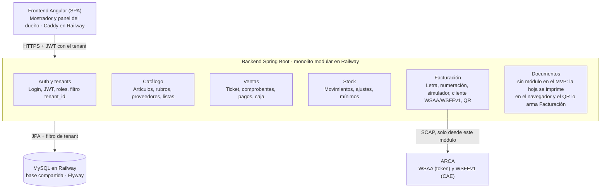

# Arquitectura y stack

> Parte de la especificación del MVP de Ferretería SaaS. Índice: [../spec.md](../spec.md) · sección extracto de `spec.md:568-602` en la partición del 2026-11-10.

<!-- spec payload: spec.md:568-602 -->
## Arquitectura y stack

Es un monolito modular con el mismo stack que Sendo. Sin microservicios: una ferretería no necesita escalar módulos por separado, y un solo deploy es más fácil de mantener para una persona.

Cada módulo es un paquete con su dominio, servicios y controladores. ArchUnit impide que un módulo use las clases internas de otro, y solo Facturación conoce a ARCA. Las reglas de `facturacion` (ver «Modelo de datos → Módulo `facturacion`») están en `ModulosArchTest`: un escaneo del código fuente encuentra los hosts de ARCA solo en `facturacion`. El QR de ARCA se arma ahí y se expone por `facturacion.api` (rama 4), así que la regla no necesita excepciones.

| Capa | Tecnología |
| --- | --- |
| Backend | Java, Spring Boot, Spring Security (JWT), Hibernate/JPA, Maven |
| Base de datos | MySQL, Flyway |
| Frontend | Angular, TypeScript, RxJS |
| ARCA | XML de WSAA y WSFEv1 armado con el JDK, sin cliente generado del WSDL (rama 6); BouncyCastle para firmar el TRA (rama 5) |
| Impresión | Hoja del navegador (`window.print`, D6). El QR de ARCA lo arma `facturacion` con ZXing (`com.google.zxing:core`) y el front lo dibuja en SVG. Sin librería de PDF |
| Tests | JUnit 5, Mockito, Testcontainers, ArchUnit, Vitest |
| Infra | Docker, Railway (backend, base y frontend servido por Caddy) |
<!-- fin payload: spec.md:568-602 -->

